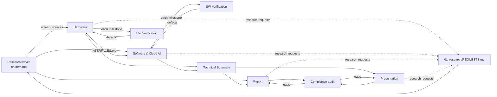

# Project Plan — Smart Palm Oil Plantation Cognitive System

Lead: Project Lead (Claude, orchestrator — verifies, directs, owns `SPEC.md`; produces no deliverables).
Deadline: **15 Dec 2026 00:00**. Start: 23 Nov 2026.

## Team (each member = a subagent working in its own folder)
| Team | Member | Folder | Main deliverables |
|---|---|---|---|
| Technical | Research | `01_research/` | Problem evidence, sources (Harvard), datasets, cloud platform/credits study, platform comparison, MSPO/Ganoderma/FFB facts, hardware facts |
| Technical | Hardware | `02_hardware/` | Specs, block/wiring/schematic diagrams, pin map, power budget, BOM (+ optional purchases in MYR), firmware, demo plan, beginner assembly guide |
| Technical | Software & Cloud AI | `03_software/` | Architecture (adapted Fig. 4), cloud AI design, data pipeline, dataset prep, model training notebooks, API + dashboard, HW integration, beginner implementation guide |
| Technical | (Software+Research, Lead-verified) | `04_technical/` | Final technical summary report of the whole system |
| Outputs | Report | `05_report/` | Final report in Markdown, structured exactly to Parts 1–3 + progress report |
| Outputs | Presentation | `06_presentation/` | Interactive/animated web presentation (runs in laptop browser, embeds live demo) + 15-min script split for 5 speakers |
| Verification | HW tester | `07_verification/hardware/` | HW test plan, firmware compile check, pin/power/interface validation |
| Verification | SW tester | `07_verification/software/` | SW test plan, dataset validity, training run check, end-to-end integration dry run |
| Verification | Compliance | `07_verification/compliance/` | Rubric scorecard for report + presentation, gap list |

## Workflow: parallel pipeline (supersedes strict phase order — D10)

- **Baseline first (D12).** Research wave 1 runs alone and ends with `01_research/00_baseline_brief.md` (evidence-based direction for every team). The Lead verifies it, updates SPEC §8, checks in with the stakeholder, and only then starts the other teams.
- **Research is then on demand.** Wave 1 unblocks the build teams (hardware facts, datasets, cloud platforms, problem evidence). Any member who needs more research appends a row to `01_research/REQUESTS.md`; the Lead dispatches a research wave to answer it.
- **Hardware and Software run in parallel** from the start, coordinating through `INTERFACES.md`. Software begins with platform-agnostic work (architecture, ingestion API, dashboard skeleton) and adopts the dataset/platform once the stakeholder confirms them.
- **Verification runs alongside the builds:** the Lead triggers a verification pass each time a build member pushes a milestone, so defects are fixed while the build is still going.
- **Report and Presentation start as soon as their inputs exist**; Report Part 1 can begin as soon as the problem evidence is accepted.
- The phase table below now lists **milestones**, not strict sequential stages.

## Phases & gates
| # | Phase | Runs | Gate (Lead verifies before next phase) |
|---|---|---|---|
| 0 | Setup | Lead | SPEC, PLAN, OVERVIEW, HANDOFF, INTERFACES, DECISIONS pushed |
| 1 | Research | Research | Sources real & citable (≥15 to have margin); problems validated with evidence (not assumed); datasets downloadable + licensed; cloud credits for Malaysian students verified; platform comparison ready. **Stakeholder check-in.** |
| 2 | Build | Hardware ∥ Software | Both conform to `INTERFACES.md`; HW stays a small demo; model trains on a real dataset |
| 3 | Verify | HW tester ∥ SW tester | Tests executed with recorded results; defects fixed by owners |
| 4 | Outputs | Technical summary → Report ∥ Presentation | Every rubric sub-task covered with evidence |
| 5 | Audit | Compliance | Every criterion argued at "Outstanding" band; fix loop until clean |

Target dates: P1 by 26 Nov · P2 by 3 Dec · P3 by 6 Dec · P4 by 10 Dec · P5 by 12 Dec · buffer to 14 Dec.

## Working rules (all members)
1. Read `00_lead/SPEC.md`, `00_lead/DECISIONS.md`, `00_lead/INTERFACES.md`, and the `README.md` of any folder you depend on, **before** starting.
2. Write only inside your own folder (Lead owns `00_lead/`).
3. Keep `<your folder>/README.md` current: Status · Inputs used · Outputs (file list + one line each) · Assumptions · Open issues for Lead.
4. After each meaningful step: `git add <your folder> && git commit -m "<folder>: <what>" -m "Co-Authored-By: Claude Opus 5.5 <noreply@anthropic.com>" && git push`. All members share **one working directory**, so do **not** `git pull --rebase` routinely. On `index.lock`, wait and retry; if a push is rejected, `git pull --rebase --autostash` then push.
5. No unverifiable claims: every fact gets a source; every dataset gets a URL + licence; simulated data is labelled as such.
5a. **Cite throughout (D11):** every section of every deliverable (report, technical summary, design docs, presentation script) cites its sources in-text, Harvard style (Author, Year), using the keys in `01_research/sources.md`. A section without citations fails the Lead gate. Need a source you don't have? Add a row to `01_research/REQUESTS.md`.
6. Markdown + Mermaid; concise.

## Team plans & change proposals (D13)
Every team starts with a **plan step** before building:
1. Write `<your folder>/PLAN.md`:
   - **Approach**: how you'll meet your brief, with task breakdown, order, and which other teams' outputs you depend on / they depend on.
   - **Ideas**: improvements beyond the brief (e.g. a better demo, a novel feature for Part 3).
   - **Conflicts**: anything in SPEC/DECISIONS/INTERFACES or another team's output you think is wrong, with evidence.
   - **Proposals** table: `| ID (e.g. HW-P1) | Proposal | Why (evidence) | Impact on other teams | Lead ruling |`.
2. Commit + push, then report to the Lead and **pause** until the Lead rules on your proposals (meanwhile only do work no proposal affects).
3. The Lead rules on each proposal:
   - **Accept** → logged in `DECISIONS.md`; SPEC/INTERFACES updated; affected teams notified.
   - **Reject** → reason recorded in your PLAN.md "Lead ruling" column.
   - **Escalate to stakeholder** → for scope, the problem/outcome list, money, or anything changing what the stakeholder asked for.
4. New ideas or conflicts that come up mid-work follow the same route: add a row to your PLAN.md Proposals table and flag it in your README "Open issues for Lead". Never silently diverge.

The Lead's plan (this file) and SPEC are living documents: accepted proposals change them, and the change is visible in `DECISIONS.md` and git history.

## Lead verification checklist (applied at each gate)
- Consistent with SPEC and other teams' outputs (names, numbers, platform, interfaces)?
- Maps to a rubric sub-task in SPEC §2?
- Evidence real (spot-check URLs) and code actually runs?
- README handoff complete?
Results are recorded in `PROJECT_OVERVIEW.md`.
