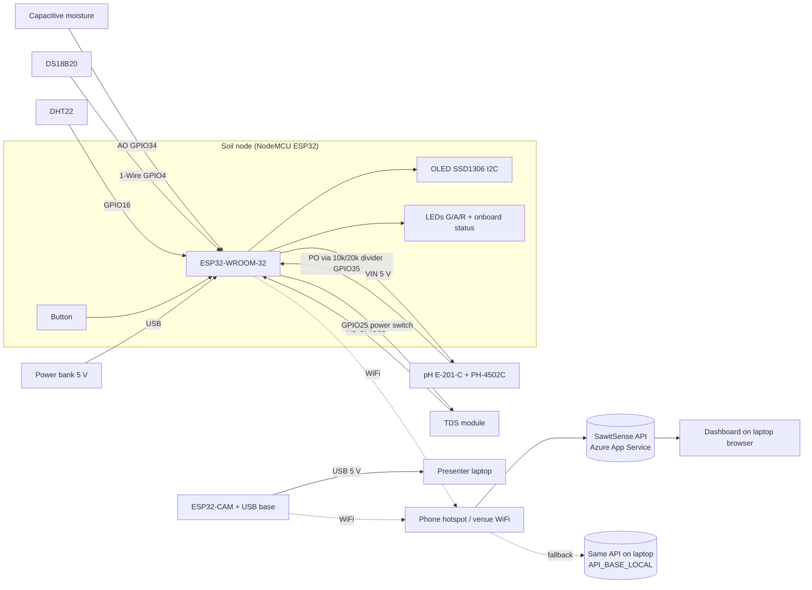
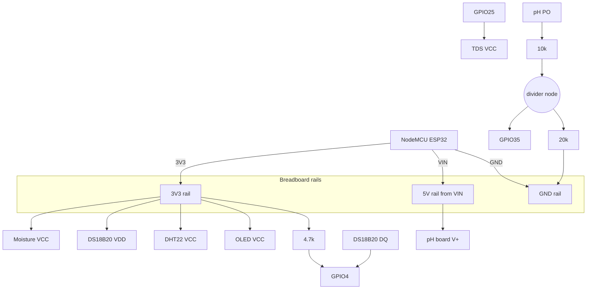
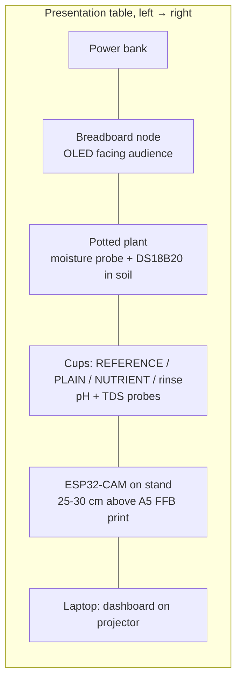

# 02 — System Design (demo hardware)

> Owner: Hardware. Contract: `00_lead/INTERFACES.md` v0.2. Power decision D26. Parts from `components.md` + D27 purchases.

## 1. Block diagram


## 2. Data flow
```mermaid
sequenceDiagram
  participant N as Soil node
  participant A as API /api/v1
  participant D as Dashboard
  participant C as ESP32-CAM
  loop every 10 s or button
    N->>N: read moisture, pH (TDS off), TDS (TDS on), temps, RH
    opt buffer not empty (v0.2.2)
      N->>A: replay up to 5 buffered readings first (buffered:true, age_s); 4xx = drop
    end
    N->>A: POST /readings (JSON, X-Device-Id/Key), cloud first, laptop second
    alt 200 OK
      A-->>N: {action, oled[], led, evidence_id...}
      N->>N: show CLOUD / LAN result
    else both bases fail (transport / 5xx)
      N->>N: local rules (INTERFACES §4) → show LOCAL, buffer reading
    end
  end
  N->>A: GET /devices/soilnode-01/calibration (boot + every 5 min) → cache TDS baseline
  D->>A: POST /devices/cam-01/commands {"cmd":"capture"}
  loop every 2.5 s
    C->>A: GET /devices/cam-01/commands
  end
  A-->>C: {"cmd":"capture"}
  C->>A: POST /infer/ripeness (image/jpeg)
  A-->>C: {label, confidence, heatmap_url...}
  D->>A: GET /latest (dashboard shows result + heatmap)
```
Note: `GET /api/v1/devices/{id}/calibration` returns `{tds_baseline_ppm, tds_margin, updated_at}` (INTERFACES v0.2.1, D30). Until a baseline has been received, LOCAL mode skips TDS rules (INTERFACES §4).

## 3. Pin map — NodeMCU ESP32 (38-pin DevKit)
| GPIO | Direction | Connected to | Notes |
|---|---|---|---|
| 34 | in (ADC1_CH6) | Moisture AO | input-only pin, fine for analog |
| 35 | in (ADC1_CH7) | pH PO via divider node | ≤ ~2.5 V at pin |
| 32 | in (ADC1_CH4) | TDS AO | 0–2.3 V |
| 25 | out | TDS module VCC | sources ≈ 5 mA; LOW while pH is read |
| 4 | in/out | DS18B20 DQ | 4.7 kΩ pull-up to 3V3 |
| 16 | in/out | DHT22 DATA | 10 kΩ pull-up (often on module) |
| 21 / 22 | I²C | OLED SDA / SCL | address 0x3C |
| 18 | out | Green LED (OK) | 220 Ω |
| 19 | out | Amber LED (watch/drain/fertilise/skip) | 220 Ω |
| 23 | out | Red LED (irrigate/lime) | 220 Ω |
| 2 | out | On-board blue LED = WiFi/upload status | strapping pin, output use only |
| 27 | in (pull-up) | Push button to GND | |
| 33, 26, 13, 14 | — | spare | 33 is ADC1 |
| 0, 5, 12, 15 | — | **unused** | strapping [ESPFAQ] |
| 6–11 | — | **unused** | SPI flash |
| ADC2 (0, 2, 4, 12–15, 25–27) | — | **no analog** | ADC2 blocked by WiFi [ESPFAQ] |

LED colour follows the `led` field from the API in CLOUD/LAN mode, and the INTERFACES §4 table in LOCAL mode.

### pH level shifting
`PO ─ 10 kΩ ─┬─ GPIO35` and `┴─ 20 kΩ (2 × 10 kΩ in series) ─ GND`. V_pin = V_PO × 20/30 = 0.667 × V_PO. PO at pH 0 ≈ 3.76 V → 2.51 V at the pin; worst case PO = 5 V → 3.33 V (rail limit, still not over 3.3 V by more than the clamp margin). Firmware divides by `PH_DIVIDER = 0.6667` before applying the pH formula [RAW-PH]. **Measure PO with a multimeter before connecting.**

## 4. Wiring diagram


### Netlist
| Net | Pins |
|---|---|
| 3V3 | ESP 3V3, moisture VCC, DS18B20 VDD (red), DHT22 VCC, OLED VCC, 4.7 k pull-up top |
| 5V | ESP VIN, pH board V+ |
| GND | ESP GND, all module GND, pH board G (both G pins), 20 k bottom, LED cathodes, button side B |
| MOIST | moisture AO → GPIO34 |
| PH_PO | pH PO → 10 k top |
| PH_ADC | 10 k bottom, 20 k top → GPIO35 |
| TDS_AO | TDS A → GPIO32 |
| TDS_PWR | GPIO25 → TDS VCC (+) |
| ONEWIRE | DS18B20 DQ (yellow) → GPIO4, 4.7 k bottom |
| DHT | DHT22 DATA → GPIO16 |
| SDA / SCL | OLED SDA → GPIO21, SCL → GPIO22 |
| LED_G/A/R | GPIO18/19/23 → 220 Ω → LED anode; cathode → GND |
| BTN | GPIO27 → button side A |
pH board TO and DO pins: not connected.

## 5. ESP32-CAM role
Pure capture-and-upload node (no on-device inference [05_hardware_notes §2.5]). AI-Thinker board on its USB base, powered from the laptop USB with a short data cable (D26). SVGA (800×600) JPEG, quality 12 if PSRAM present, else VGA. Triggers per INTERFACES §3: command poll (primary), local `http://<cam-ip>/capture` page, capture on boot (press RST). The on-board flash LED (GPIO4) can light the print briefly (configurable, default off to avoid glare).

## 6. Power budget (estimates, typical datasheet-class values — verify with a USB meter)
| Load | Supply | Typical mA @5 V-equivalent |
|---|---|---|
| ESP32 with WiFi active (avg; peaks ~250 mA) | 5 V USB | 120 |
| pH board (~0.5 W [RAW-PH]) | 5 V | 100 |
| OLED | 3.3 V | 15 |
| TDS + moisture + DHT22 + DS18B20 | 3.3 V | 15 |
| LEDs (one lit) + on-board LED | 3.3 V | 10 |
| **Soil node total** | power bank | **≈ 260 mA ≈ 1.3 W** |
| ESP32-CAM (avg; peaks ~300+ mA while transmitting) | laptop USB | ≈ 180 |

A 10 000 mAh bank delivers roughly 6 000 mAh at 5 V after conversion → ≈ 20 h for the soil node, far above NFR4 (60 min). Low current (~260 mA) may trigger some banks' auto-off — test 15 min idle (`05_demo_plan.md`). The 2-port ≥2 A bank (D27) is the spare supply for the CAM if laptop USB brownouts occur.

## 7. Placement around the plant

- Keep the breadboard away from the water side; put a tray under pot and cups.
- DS18B20 starts in the soil; moved into the cup for pH/TDS steps (TDS compensation uses whatever it reads at that moment — say so if asked).
- pH probe rests in its storage cap or a cup of water between readings; never in soil.
