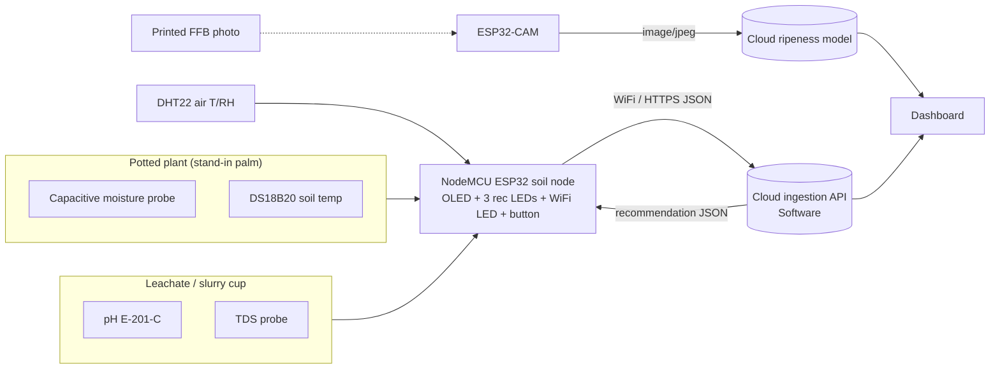

# 02_hardware — PLAN

> Owner: Hardware member. Status: **Step 1 (plan) — awaiting Lead rulings on HW-P1…HW-P9.**
> Inputs: `00_lead/SPEC.md`, `PROJECT_PLAN.md`, `DECISIONS.md` (D17, D20, D21, D23), `INTERFACES.md` v0.1,
> `components.md`, `01_research/00_baseline_brief.md`, `05_hardware_notes.md`, `sources.md`.
> Audience (D23): these documents serve the **live demo, Verification and the presentation** — not the report.
> They are practical build documents; the report only mentions IoT soil sensors as a generic data-source layer.

## 1. Approach

### 1.1 What the demo must prove (in 2–3 minutes)
One ESP32 soil node beside a potted plant turns live readings into an **explained** agronomic action
(irrigate / lime / fertilise / ok) — the IoT input of O3 and the evidence trail of O4 (MSPO requires
fertilising/soil-fertility records [MPOCC-P21]; fertiliser ≈30 % of estate cost [STAR-FERT2026]).
An ESP32-CAM captures a printed FFB photo and gets a ripeness class + confidence back from the cloud model (O1).
Everything else (satellite, drone) is pre-computed by Software. Hardware stays small (SPEC §4).

### 1.2 Design principles
1. **Demo-safe first:** the node works fully offline (OLED + LEDs from D17 thresholds); cloud is an upgrade, not a dependency.
2. **Correct electrical practice:** analog sensors on ADC1 only, no strapping pins for I/O, pH board output divided to ≤3.1 V [ESPFAQ] [RAW-PH].
3. **Honest measurement:** pH/TDS are liquid probes → soil-water slurry/leachate cup, read sequentially; moisture is *relative* %, not VWC [DFR-SEN0193] [DFR-SEN0244].
4. **One contract:** payload, thresholds and action codes exactly as `00_lead/INTERFACES.md`; any change goes via the proposals below.
5. **Beginner-reproducible:** any team member can rebuild and reflash it from `06_assembly_guide_beginner.md`.

### 1.3 Physical concept

DS18B20 sits in the cup during pH/TDS reads (temperature compensation) and in the pot otherwise; the plan picks one in Step 2 after a bench test (default: cup, because compensation matters more than soil temperature for the demo).

### 1.4 Draft pin map (finalised in `02_system_design.md`)
| Function | GPIO | Why |
|---|---|---|
| Soil moisture (AO, 3.3 V supply) | 34 (ADC1_CH6) | ADC1, input-only OK |
| pH PO via 10 k/20 k divider (board on 5 V VIN) | 35 (ADC1_CH7) | ADC1; divider keeps ≤ ~2.5 V |
| TDS AO | 32 (ADC1_CH4) | ADC1; board 0–2.3 V out |
| TDS module power (switched) | 25 (digital out) | power-gate TDS so it never excites while pH is read |
| DS18B20 data (+4.7 k pull-up) | 4 | free digital |
| DHT22 data | 16 | free digital |
| OLED SDA / SCL | 21 / 22 | default I²C |
| LED green / amber / red (recommendation) | 18 / 19 / 23 | non-strapping |
| LED WiFi/upload status | 2 (on-board LED) | saves a part; output-only use is safe |
| Button (short = send now, long = page/mode/cal) | 27 (INPUT_PULLUP) | non-strapping |
| Spare | 33 (ADC1), 26, 13, 14 | — |
Avoided: GPIO0, 5, 12, 15 (strapping), ADC2 pins for analog, 6–11 (flash) [ESPFAQ].

### 1.5 Task breakdown, order, dependencies
| # | Task / deliverable | Depends on | Who depends on it | Blocked by proposal? |
|---|---|---|---|---|
| T1 | `01_requirements_and_specs.md` (objectives → O1/O3/O4, FR/NFR, per-component spec table, demo→real deployment mapping) | baseline brief; R-HW1 (LoRaWAN/field-node sources) | Presentation, Verification | No (mapping row uses assumption until R-HW1 answered) |
| T2 | `02_system_design.md` (block + data-flow Mermaid, pin map, netlist, power budget, placement) | T1 | T4, T7, Verification | HW-P6 (power) |
| T3 | `03_bom.md` (owned + proposed purchases MYR) | T2 | Stakeholder (money) | HW-P8 |
| T4 | `firmware/soil_node/soil_node.ino` + `config.h.example` | T2, INTERFACES | Software (ingestion test), Verification | **HW-P1, P2, P3, P5** |
| T5 | `firmware/cam_node/cam_node.ino` | INTERFACES | Software (inference endpoint) | **HW-P3, P4** |
| T6 | `04_calibration.md` (moisture dry/wet, pH 4.01/6.86, TDS + DS18B20 compensation) | T4; buffers bought (D21) | Demo day | No |
| T7 | `05_demo_plan.md` (2–3 min script, timeline, fallbacks, checklist) | T4, T5, Software dashboard | Presentation | HW-P4, HW-P6 |
| T8 | `06_assembly_guide_beginner.md` | T2, T4, T5 | Any member, Verification | No |
| T9 | `README.md` handoff (kept current after each file) | all | Lead | No |

Order: T1 → T2 → T3 (can be sent to stakeholder early) → T4/T5 (stub endpoint until Software publishes URL) → T6 → T7 → T8 → T9.
Compile check: `arduino-cli` is **not installed** on this machine; in Step 2 I will try a user-local install (no sudo) to compile both sketches for `esp32:esp32:esp32` and `esp32:esp32:esp32cam`; if that is not possible, compilation becomes a Verification item.

**External dependencies:** Software must publish the ingestion URL, inference URL and response formats (INTERFACES v0.2). Stakeholder supplies the pH buffers (D21) and decides purchases. Physical bench testing (multimeter readings of pH PO extremes, moisture dry/wet values) can only be done by the person holding the hardware — the docs give exact procedures and placeholder constants.

## 2. Ideas (beyond the brief)
1. **Explain on the device:** OLED page shows the action *and its reason* ("LIME — pH 3.8 < 4.0"), mirroring the cloud explanation — visible explainability supports the D18 "explain-to-audit" story in the presentation.
2. **Audit-ready readings:** each payload carries a sequence number and a calibration ID (date of last calibration), so the dashboard's evidence log can show "reading #42, sensor calibrated 2026-12-08" — a tangible MSPO-records talking point (HW-P2).
3. **TDS power-gating** (GPIO25): the TDS module is switched off while pH is read, so both probes can sit in one leachate cup without the known excitation interference [05_hardware_notes §2.3]. Zero cost.
4. **One button = one field visit:** long-press on the soil node also asks the ESP32-CAM (same hotspot, local HTTP) to capture — one press shows both sensing paths (HW-P4).
5. **Capture-on-reset fallback** for the CAM: pressing the board's RST button reboots it and it captures + uploads once — a physical trigger with no extra wiring (AI-Thinker GPIO0 is the camera clock, so the IO0 button cannot be used at runtime).
6. **Field-calibrated TDS baseline:** on the day, dip in plain water → long-press stores "low" point in NVS; dip in fertiliser solution → stores "high" point. No reflash needed if room water differs from bench water.
7. **Demo-to-deployment slide row** (for Presentation): breadboard node → sealed LoRaWAN/4G field node per block; power bank → solar + battery; WiFi → estate 4G/LoRaWAN gateway (IOI's estate-wide connectivity is a real precedent [IOI2026]); HTTPS POST → Azure IoT Hub (report-facing framing per D20).

## 3. Conflicts / clarifications
| # | Item | Evidence | Proposed resolution |
|---|---|---|---|
| C1 | INTERFACES pH rule ">5.5 → flag" vs research note ">6.5 → check/stop liming"; also 4.0–4.2 "watch" has no action code; moisture >80 % "drainage warning" has no action code | INTERFACES v0.1 vs `05_hardware_notes.md` §3 [KANANG2026] [AAR-SOIL] | HW-P5: extend action enum; use >5.5 = amber "high – do not lime" (single cut-off, keeps D17) |
| C2 | INTERFACES says recommendation goes "optionally back to the node" but no mechanism | INTERFACES v0.1 | HW-P1: return recommendation in the POST response |
| C3 | `ts` assumes the node knows UTC time; NTP may fail on a captive/hotspot network | — | HW-P2: `ts` from NTP when synced, else `null` and server stamps receipt time |
| C4 | Single power bank vs ESP32-CAM brownouts | [RNT-CAM] | HW-P6: CAM on laptop USB, soil node on power bank |
| C5 | Cloud dashboard cannot reach a CAM on a private hotspot to "trigger" it | network topology | HW-P4: local triggers primary; cloud-poll trigger only if Software wants a dashboard button |

## 4. Proposals
| ID | Proposal | Why (evidence) | Impact on other teams | Lead ruling |
|---|---|---|---|---|
| HW-P1 | Ingestion endpoint returns the recommendation **synchronously** in the POST response body (`{action, reason, confidence}` per INTERFACES). Node shows the cloud result (tag "CLOUD"); if no/failed response it shows its own D17 result (tag "LOCAL"). | Closes C2; one round-trip, no polling; demo still works offline | SW: ingestion handler runs rules/model before replying (≤3 s) | ACCEPTED (INTERFACES v0.2 §2) |
| HW-P2 | Payload additions: `seq` (int, monotonic), `buffered` (bool — true when sent from offline buffer), `cal_id` (string, e.g. `"2026-12-08"`), `rssi_dbm` (int); `ts` may be `null` (server stamps); failed sensor → field `null` (never fake value). | Audit trail (Idea 2, D18); honest data; C3 | SW: schema accepts nullable fields + 4 extras; dashboard can show seq/cal_id in evidence log | ACCEPTED (v0.2 §2) |
| HW-P3 | Simple shared-secret header `X-Api-Key` on both nodes (value in `config.h`, never committed; `config.h.example` committed). HTTPS with root CA in `config.h`; `setInsecure()` only as documented emergency switch. | Avoid an open public endpoint; secrets rule in brief | SW: check header; provide key out-of-band | ACCEPTED, header renamed X-Device-Key, file secrets.h (v0.2 §1) |
| HW-P4 | ESP32-CAM: `POST image/jpeg` (VGA/SVGA) with headers `X-Device-Id: cam-01`, `X-Api-Key`; response JSON per INTERFACES shown on dashboard (+ Serial). Triggers: (a) local `GET http://<cam-ip>/capture` from laptop browser or soil-node long-press, (b) capture-on-reset. Cloud-poll trigger (`GET /cam/trigger` every 2 s) **only if** Software wants a dashboard "Capture" button. | C5; AI-Thinker has almost no free GPIO and the USB base exposes none [RNT-CAM] | SW: inference endpoint accepts raw JPEG body; decide yes/no on cloud-poll | ACCEPTED + dashboard capture via command poll (v0.2 §3); drop soil-node long-press trigger |
| HW-P5 | Action enum extended to `ok \| irrigate \| drain \| lime \| watch_ph \| high_ph \| fertilise \| skip_fertiliser`, priority order lime > irrigate > drain > fertilise > skip > watch/high > ok (one primary action shown, others listed). Thresholds unchanged from D17; TDS low/high points calibrated on the day. | C1; keeps firmware LEDs and backend rules identical | SW: same enum + priority in rules engine; Lead: INTERFACES v0.2 | ACCEPTED with merged vocab: watch_ph/high_ph → `watch` + rule_id; priority irrigate/drain > lime (v0.2 §4) |
| HW-P6 | Power: soil node (+pH board on VIN 5 V) from the power bank; ESP32-CAM from the presenter laptop USB via short data cable. 2-port ≥2 A bank only as nice-to-have. | CAM brownouts on weak supplies [RNT-CAM]; laptop is present (D6) | Presentation: laptop must stay powered/awake; none on SW | ACCEPTED (D26) |
| HW-P7 | Transport for the actual build = HTTPS POST to Software's Azure-hosted endpoint (no MQTT/IoT Hub SDK on the device), unless Software commits to IoT Hub by the INTERFACES v0.2 gate. Report-facing material may still describe IoT Hub (D20). | Smaller firmware, fewer failure points; D20 two-layer framing | SW: confirm endpoint type | ACCEPTED (v0.2 §1) |
| HW-P8 | Purchases (stakeholder to choose) — see §5. | SPEC §5 propose-only | Stakeholder: money (escalate) | Stakeholder: musts + cables + 2-port power + spare buttons/LEDs approved; no 2nd moisture sensor (D27) |
| HW-P9 | Research request R-HW1: 2–3 citable sources on LoRaWAN/cellular soil-sensor field nodes in plantation/agriculture deployments (range, battery life, gateway architecture) for the demo→deployment mapping. | No such key in `sources.md` | Research: one short wave | ACCEPTED — research wave 2 dispatched |

## 5. Proposed purchases (MYR, approximate marketplace prices — **unverified**, confirm before buying)
pH buffer sachets 4.01/6.86 are already being bought (D21) and are not repeated here.

| # | Item | Why | Priority | Approx. MYR |
|---|---|---|---|---|
| 1 | Distilled water 1 L (or bottled RO water) | Mix pH buffers; make clean slurry; rinse probes between cups | **Must** | 3–5 |
| 2 | Small clear plastic cups ×10 | Leachate/slurry cups ("healthy" vs "acidic" block), buffer cups | **Must** | 2–4 |
| 3 | Small pack of water-soluble NPK fertiliser (e.g. 200 g) | Makes the "nutrient solution → TDS rises → skip fertiliser" step real; also day-of TDS calibration | **Must** | 5–10 |
| 4 | Colour A5 prints of FFB images (ripe / unripe / overripe, from D1/D2 CC BY datasets, with attribution) | Camera target for the ripeness demo | **Must** | 3–5 |
| 5 | 2× good micro-USB **data** cables, ≤50 cm | Charge-only cables block flashing; long thin cables cause CAM brownouts [RNT-CAM] | Nice (high) | 8–15 |
| 6 | 2-port power bank ≥2 A per port *or* 5 V/2 A USB adaptor | Removes dependence on laptop USB for the CAM (HW-P6) | Nice | 15–30 |
| 7 | Spare tactile buttons + LEDs pack | Spares if a part fails on the day | Nice | 3–5 |
| 8 | Second capacitive moisture sensor | "Dry block vs wet block" two-pot comparison | Nice (low — adds wiring/payload complexity) | 5–10 |

**Must total ≈ RM13–24; nice total ≈ RM31–60; all items ≈ RM44–84.** Resistors for the 10 k/20 k divider come from the owned kit (20 k = 2 × 10 k in series if needed).
