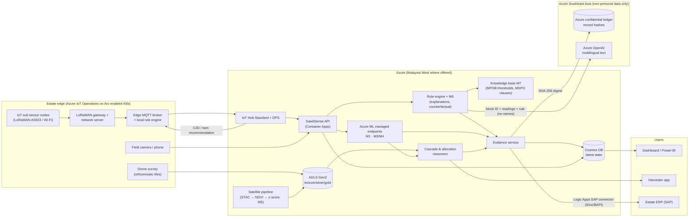
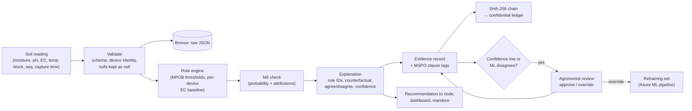
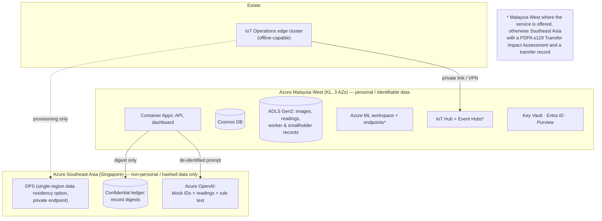

# 02 — SawitSense Architecture

> Report-facing (Part 2: underlying technologies; integration). The target deployment is fully Azure-native (D15, D20). Choices are justified by capability (D23), and the residency and explainability limits follow D32. Keys refer to `01_research/sources.md`.

## 1. Layered architecture (assignment Fig. 4, adapted to oil palm)

```mermaid
flowchart TB
  subgraph L5["5 · Application & user layer"]
    A1["Manager dashboard<br/>(web + Power BI)"]
    A2["Harvester mobile app<br/>(multilingual)"]
    A3["Agronomist review queue<br/>(approve / override)"]
    A4["MSPO audit pack<br/>(clause coverage + chain proof)"]
    A5["ERP work orders<br/>(SAP-type)"]
  end
  subgraph L4["4 · Cloud & deployment layer"]
    D1["Azure ML: training, registry,<br/>managed online endpoints (blue/green)"]
    D2["Azure Container Apps / Functions<br/>(SawitSense API, rule engine)"]
    D3["Azure Monitor + model monitoring<br/>(drift → Event Grid → retrain)"]
    D4["Azure IoT Operations<br/>(estate edge, offline)"]
  end
  subgraph L3["3 · Cognitive services layer"]
    C1["ML models<br/>M1 ripeness · M3/M4 drone Ganoderma + palm count<br/>M5 NDVI anomaly · M6 fertiliser"]
    C2["Knowledge base / ontology<br/>MPOB agronomy thresholds + MSPO MS 2530 clauses (M7)"]
    C3["Reasoning & hypothesis scoring<br/>cascade prioritisation · harvest window (M2)<br/>crew allocation · counterfactuals"]
    C4["NLP<br/>multilingual explanations · audit narrative<br/>(Azure OpenAI, non-personal text only)"]
    C5["Analytics & visualisation<br/>NDVI trends · KPIs · Azure Maps"]
  end
  subgraph L2["2 · Data ingestion & big data layer"]
    I1["Azure IoT Hub (Standard) + DPS<br/>device identity, twins, C2D"]
    I2["Event Hubs (Kafka-compatible)<br/>streaming"]
    I3["Data Lake Storage Gen2<br/>bronze / silver / gold"]
    I4["Planetary Computer STAC<br/>Sentinel-2 L2A ingest"]
    I5["Labelling & curation<br/>(Azure ML data labelling, COCO/JSONL)"]
  end
  subgraph L1["1 · Data sources"]
    S1["Sentinel-2 / Landsat<br/>satellite imagery"]
    S2["UAV RGB / multispectral<br/>surveys"]
    S3["IoT soil-sensor nodes<br/>(moisture, pH, EC, temp)"]
    S4["Field camera / phone<br/>bunch images"]
    S5["Estate ERP<br/>(blocks, harvest, inputs, HR)"]
    S6["Weather / rainfall"]
    S7["MSPO / MPOB documents<br/>(standards, SOPs)"]
  end
  L1 --> L2 --> L3 --> L4 --> L5
  X["Cross-cutting: PDPA 2010 residency split (s129) · Entra ID RBAC · Key Vault · Purview governance & lineage ·<br/>explainability (CAM/Grad-CAM, rule traces, counterfactuals) · tamper-evident evidence ledger (Azure confidential ledger, hashes only) ·<br/>human-in-the-loop review · bias checks across estates/regions"]
  L1 -.- X
  L5 -.- X
```



**How each layer is adapted** (rather than copied from Fig. 4):

| Layer | Oil-palm-specific design decision | Capability justification |
|---|---|---|
| 1 Sources | The three inputs in the brief (satellite, UAV, IoT soil) plus bunch images, ERP and MSPO texts. Satellite is the cheapest way to look at every block, so it screens first; drone and ground follow. | Sentinel-2: 10 m, ~5-day revisit, archive since 2015 (MPC-S2; GEE-S2). The global oil-palm map masks non-palm pixels (GEE-OILPALM). |
| 2 Ingestion | **IoT Hub Standard**, because the system must push recommendations back to nodes (cloud-to-device and device twins), which the Basic tier lacks (AZ-IOTHUB-SCALE). DPS provides zero-touch, X.509-attested provisioning of a large node fleet (AZ-DPS). Event Hubs is Kafka-compatible for the ERP and weather streams (AZ-EVENTHUBS). ADLS Gen2 adds hierarchical, file-level security for the image lake (AZ-ADLS). | First-party IoT platform with a live roadmap. Google Cloud IoT Core and IBM Watson IoT are retired (GCP-IOTCORE; REG-WIOT). |
| 3 Cognitive | Seven models (M1–M7, `03_ai_models.md`). They combine perception (vision), anomaly detection (NDVI), knowledge (MPOB thresholds, MSPO clauses), reasoning (cascade, allocation, counterfactuals) and NLP. | Matches the primary capability per problem in `01_research/02_cognitive_capabilities.md` v2. |
| 4 Cloud | Azure ML managed endpoints with blue/green traffic split and mirroring for safe model updates (AZ-ENDPOINTS). Model monitoring for drift and data quality, with Event Grid triggering retraining (AZ-MONITOR). **IoT Operations at the estate edge**: an MQTT broker keeps processing locally during outages, with recovery validated after up to 45 days offline (AZ-IOTOPS). | Remote estates have patchy links; even IOI's estate-wide 4G rollout is recent (IOI2026). |
| 5 Application | Each user gets their own surface (`01_solution_overview.md` §3). Approvals and overrides are written back as evidence. | Human-in-the-loop review is part of Fig. 4. |
| Cross-cutting | **PDPA residency split (§5)**. Explainability per model. Tamper-evident ledger. Purview lineage (AZ-PURVIEW). | Only where PDPA constrains integration (assignment note, p.6). |

## 2. Component view



The demonstration nodes are a scaled-down stand-in for production LoRaWAN soil nodes. Production nodes connect through a LoRaWAN network server that integrates natively with IoT Hub: uplinks become telemetry, decoded payloads update device twins, and downlinks are scheduled from desired properties (TTS-AZURE). Gateway spacing should be planned for oil-palm foliage loss of 5–9 dB per canopy, not open-field range (ANZUM2022).

## 3. Data flow (soil reading → explained, audited decision)



The image and satellite flows follow the same pattern:
- **Ripeness:** image → M1 endpoint → label + CAM heat-map → M2 harvest rule → evidence record (MSPO 4.1.3.1 harvesting SOP records, 4.2.2 traceability).
- **Cascade:** Sentinel-2 monthly median NDVI → per-block z-score → flagged blocks → drone tiles → M3 palm scores → neighbour-weighted ranking → ground-check list → evidence record (4.1.3.5 IPM).

## 4. Demonstration sequence (live presentation)

```mermaid
sequenceDiagram
  autonumber
  participant Node as IoT soil node
  participant Cam as Field camera
  participant API as SawitSense API
  participant ML as Model endpoints
  participant EV as Evidence log
  participant UI as Dashboard
  Note over UI: Pre-computed: Sentinel-2 NDVI anomaly flags block B2 → drone scores → ranked ground list
  Node->>API: POST reading (pH 3.8, moisture 45 %)
  API->>API: Rules → LIME (PH_LIME), counterfactual "OK if pH ≥ 4.2"
  API->>ML: M6 check → agrees, confidence 0.87
  API->>EV: append record (+ MSPO 4.1.3.1), hash-chain
  API-->>Node: action, short text, colour
  UI->>API: Capture request
  Cam->>API: poll → capture → POST image
  API->>ML: M1 → "ripe 0.9" + heat-map
  API->>EV: append record (harvest SOP, traceability)
  UI->>API: Approve / override recommendation
  API->>EV: append review record
  UI->>API: Verify chain → "all N records intact"; export MSPO pack
```

## 5. Deployment & data residency (PDPA 2010 s129, D32a)



**Residency rules.** These are the D32 design constraints, based on research file 06.
1. **Personal or identifiable data stays in Malaysia West.** This covers worker and smallholder names, IC numbers, and plot geolocation linked to individuals (AZ-REGIONS).
2. **Azure OpenAI runs in Southeast Asia,** because Malaysia West is not listed for it (AZ-AOAI-MODELS). Its prompts carry only block IDs, readings and rule text, never names.
3. **The confidential ledger runs in Southeast Asia.** It always replicates to a paired region, and Malaysia West has none (AZ-ACL-RES; AZ-REGIONS). It stores **SHA-256 digests only**; the full records stay in Malaysia West (AZ-ACL).
4. **DPS uses the Southeast Asia single-region data-residency option with a private endpoint,** so attestation secrets do not transit other regions (AZ-DPS).
5. **Azure ML, IoT Hub and Event Hubs run in Malaysia West where offered, otherwise Southeast Asia.** Any personal data that crosses the border is covered by the amended s129 safeguards: a substantially similar law or adequate protection, a Transfer Impact Assessment valid for up to 3 years, and a record of every transfer (MAYER-PDPA2025).

## 6. Explainability by model (D32b)

| Model | Explanation shown to the user | Tooling in the target design |
|---|---|---|
| M1 ripeness (image) | Class-activation heat-map (Grad-CAM-equivalent for a GAP-linear head), class probabilities, plain-language "where the model looked" | Grad-CAM + open-source **Responsible AI Toolbox** for vision. The Azure RAI dashboard is **not** used for images (AZ-RAI) |
| M3/M4 drone detector | Boxes + confidence + ranked list | Same as M1 |
| M5 NDVI anomaly | z-score against the block's own history; time-series plot | Transparent statistic |
| M6 fertiliser (tabular) | Rule IDs, counterfactual, feature attributions, ML agreement | **Azure Responsible AI dashboard** (interpretability, DiCE counterfactuals, error analysis, PDF scorecard) + **model monitoring** for drift. Both are tabular-only, so they fit M6 (AZ-RAI; AZ-MONITOR) |
| M7 compliance | Which MS 2530 clause each record satisfies, and the gaps | Knowledge-base trace |
| NLP (Azure OpenAI) | Multilingual rewording of the rule-based explanation; it never decides | Prompt is restricted to the structured explanation |
