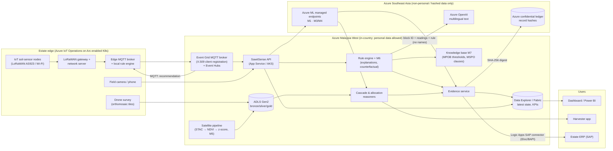
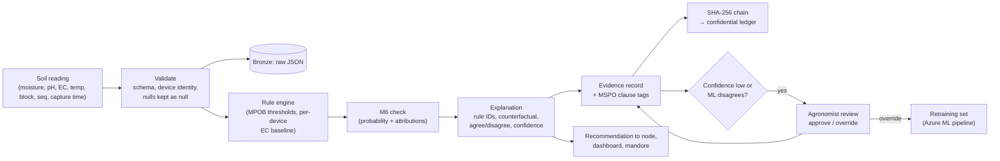
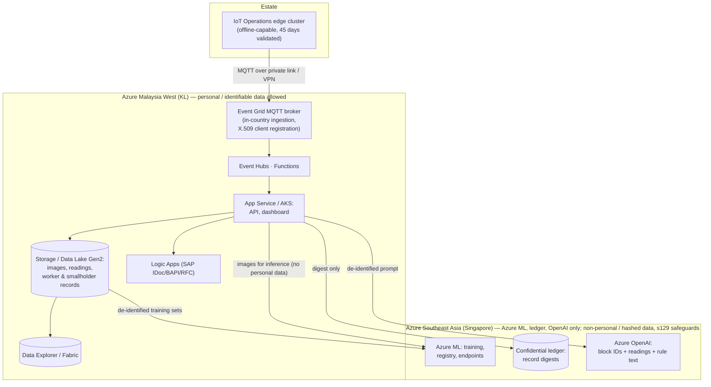

# 02 — SawitSense Architecture

> Report-facing (Part 2: underlying technologies; integration). The target deployment is fully Azure-native (D15, D20). Choices are justified by capability (D23), the residency layout follows D50 and D57, and the explainability limits follow D32. Regional availability is confirmed per Microsoft products-by-region at deployment. Keys refer to `01_research/sources.md`.

## 1. Layered architecture (assignment Fig. 4, adapted to oil palm)

```mermaid
flowchart TB
  subgraph L5["5 · Application & user layer"]
    A1["Manager dashboard<br/>(web + Power BI)"]
    A2["Harvester mobile app<br/>(multilingual)"]
    A3["Agronomist review queue<br/>(approve / override)"]
    A4["MSPO audit pack<br/>(clause coverage + chain proof)"]
    A5["ERP work orders<br/>(SAP-type)"]
  end
  subgraph L4["4 · Cloud & deployment layer"]
    D1["Azure ML: training, registry,<br/>managed online endpoints (blue/green)"]
    D2["Azure App Service / AKS + Functions<br/>(SawitSense API, rule engine)"]
    D3["Azure Monitor + model monitoring<br/>(drift → Event Grid → retrain)"]
    D4["Azure IoT Operations<br/>(estate edge, offline)"]
  end
  subgraph L3["3 · Cognitive services layer"]
    C1["ML models<br/>M1 ripeness · M3/M4 drone Ganoderma + palm count<br/>M5 NDVI anomaly · M6 fertiliser"]
    C2["Knowledge base / ontology<br/>MPOB agronomy thresholds + MSPO MS 2530-3-2 / 4-1 clauses (M7)"]
    C3["Reasoning & hypothesis scoring<br/>cascade prioritisation · harvest window (M2)<br/>crew allocation · counterfactuals"]
    C4["NLP<br/>multilingual explanations · audit narrative<br/>(Azure OpenAI, non-personal text only)"]
    C5["Analytics & visualisation<br/>NDVI trends · KPIs · Azure Maps"]
  end
  subgraph L2["2 · Data ingestion & big data layer"]
    I1["Event Grid MQTT broker (Malaysia West)<br/>certificate-based client registration"]
    I2["Event Hubs (Kafka-compatible)<br/>streaming"]
    I3["Data Lake Storage Gen2<br/>bronze / silver / gold"]
    I4["Planetary Computer STAC<br/>Sentinel-2 L2A ingest"]
    I5["Labelling & curation<br/>(Azure ML data labelling, COCO/JSONL)"]
  end
  subgraph L1["1 · Data sources"]
    S1["Sentinel-2 / Landsat<br/>satellite imagery"]
    S2["UAV RGB / multispectral<br/>surveys"]
    S3["IoT soil-sensor nodes<br/>(moisture, pH, EC, temp)"]
    S4["Field camera / phone<br/>bunch images"]
    S5["Estate ERP<br/>(blocks, harvest, inputs, HR)"]
    S6["Weather / rainfall"]
    S7["MSPO / MPOB documents<br/>(standards, SOPs)"]
  end
  L1 --> L2 --> L3 --> L4 --> L5
  X["Cross-cutting: PDPA 2010 residency split (s129) · Entra ID RBAC · Key Vault · Purview governance & lineage ·<br/>explainability (CAM/Grad-CAM, rule traces, counterfactuals) · tamper-evident evidence ledger (Azure confidential ledger, hashes only) ·<br/>human-in-the-loop review · bias checks across estates/regions"]
  L1 -.- X
  L5 -.- X
```

**How each layer is adapted** (rather than copied from Fig. 4):

| Layer | Oil-palm-specific design decision | Capability justification |
|---|---|---|
| 1 Sources | The three inputs in the brief (satellite, UAV, IoT soil) plus bunch images, ERP and MSPO texts. Satellite screens first because it is the only source that covers every block every ~5 days; drone and ground checks follow only where it flags an anomaly. | Sentinel-2: 10 m, ~5-day revisit, archive since 2015 (MPC-S2; GEE-S2). The global oil-palm map masks non-palm pixels (GEE-OILPALM). |
| 2 Ingestion | **Event Grid MQTT broker in Malaysia West** is the single ingestion path (D57). The estate edge and gateways connect as MQTT clients registered with **X.509 certificates** (certificate-based client registration). They publish telemetry, and receive recommendations and configuration on per-device topics, so all device traffic stays in-country (AZ-PRICES-API). No IoT Hub or DPS is used. Event Hubs is Kafka-compatible for the ERP and weather streams (AZ-EVENTHUBS). ADLS Gen2 adds hierarchical, file-level security for the image lake (AZ-ADLS). | First-party managed MQTT broker in-country. Google Cloud IoT Core and IBM Watson IoT are retired (GCP-IOTCORE; REG-WIOT). |
| 3 Cognitive | Seven models (M1–M7, `03_ai_models.md`). They combine perception (vision), anomaly detection (NDVI), knowledge (MPOB thresholds, MSPO clauses), reasoning (cascade, allocation, counterfactuals) and NLP. | Matches the primary capability per problem in `01_research/02_cognitive_capabilities.md` v2. |
| 4 Cloud | Azure ML managed endpoints with blue/green traffic split and mirroring for safe model updates (AZ-ENDPOINTS). Model monitoring for drift and data quality, with Event Grid triggering retraining (AZ-MONITOR). **IoT Operations at the estate edge**: an MQTT broker keeps processing locally during outages, with recovery validated after up to 45 days offline (AZ-IOTOPS). | Remote estates have patchy links; even IOI's estate-wide 4G rollout is recent (IOI2026). |
| 5 Application | Each user gets their own surface (`01_solution_overview.md` §3). Approvals and overrides are written back as evidence. | Human-in-the-loop review is part of Fig. 4. |
| Cross-cutting | **PDPA residency split (§4)**. Explainability per model. Tamper-evident ledger. Purview lineage (AZ-PURVIEW). | Only where PDPA constrains integration (assignment note, p.6). |

## 2. Component view

Field soil nodes use LoRaWAN (AS923) and connect through a LoRaWAN network server at the estate edge. The network server and the IoT Operations broker bridge decoded uplinks to the Event Grid MQTT broker as registered MQTT clients, and downlinks (recommendations, configuration) travel back on per-device topics. Gateway spacing should be planned for oil-palm foliage loss of 5–9 dB per canopy, not open-field range (ANZUM2022).

## 3. Data flow (soil reading → explained, audited decision)

The image and satellite flows follow the same pattern. Clause numbers are from MS 2530-3-2:2022 for estates > 500 ha and MS 2530-4-1:2022 for mills (MPOCC-P32; MPOCC-P41):
- **Ripeness:** image → M1 endpoint → label + CAM heat-map → M2 harvest rule → evidence record (MSPO 4.1.3.1 harvesting SOP records, 4.2.2 traceability).
- **Cascade:** Sentinel-2 monthly median NDVI → per-block z-score → flagged blocks → drone tiles → M3 palm scores → neighbour-weighted ranking → ground-check list → evidence record (4.1.3.5 IPM).

## 4. Deployment & data residency (PDPA 2010 s129, D50)

Service placement follows an indicative check of Malaysia West service listings (AZ-PRICES-API), and is confirmed **per Microsoft products-by-region at deployment**.

**Residency rules (D50, superseding D32a).**
1. **Malaysia West holds all personal or identifiable data:** worker and smallholder names, IC numbers, and plot geolocation linked to individuals.
   - In-country services: Event Grid (MQTT broker with certificate-based client registration, the only ingestion path; no IoT Hub or DPS), Event Hubs, Functions, App Service, Storage/Data Lake, Data Explorer/Fabric, Logic Apps and AKS. **IoT Operations** runs on the estate edge (AZ-PRICES-API; AZ-IOTOPS).
2. **Southeast Asia hosts only Azure ML, confidential ledger and Azure OpenAI,** which are not evidenced in Malaysia West (AZ-PRICES-API; AZ-AOAI-MODELS; AZ-ACL-RES). They receive **only non-personal or hashed data**:
   - Azure ML: de-identified images and readings.
   - Confidential ledger: SHA-256 digests; the full records stay in Malaysia West (AZ-ACL).
   - Azure OpenAI: block IDs, readings and rule text, never names.
3. **Every cross-border flow is covered by the amended s129 safeguards:** a destination with a substantially similar law or adequate protection, a Transfer Impact Assessment valid for up to 3 years, and a record of each transfer (MAYER-PDPA2025).
4. **Services move in-country as they appear.** At each roadmap phase gate, products-by-region is re-checked, and any service that has become available moves to Malaysia West.

## 5. Explainability by model (D32b)

| Model | Explanation shown to the user | Tooling in the target design |
|---|---|---|
| M1 ripeness (image) | Class-activation heat-map (Grad-CAM-equivalent for a GAP-linear head), class probabilities, plain-language "where the model looked" | Grad-CAM + open-source **Responsible AI Toolbox** for vision. The Azure RAI dashboard is **not** used for images (AZ-RAI) |
| M3/M4 drone detector | Boxes + confidence + ranked list | Same as M1 |
| M5 NDVI anomaly | z-score against the block's own history; time-series plot | Transparent statistic |
| M6 fertiliser (tabular) | Rule IDs, counterfactual, feature attributions, ML agreement | **Azure Responsible AI dashboard** (interpretability, DiCE counterfactuals, error analysis, PDF scorecard) + **model monitoring** for drift. Both are tabular-only, so they fit M6 (AZ-RAI; AZ-MONITOR) |
| M7 compliance | Which MS 2530 clause each record satisfies, and the gaps | Knowledge-base trace |
| NLP (Azure OpenAI) | Multilingual rewording of the rule-based explanation; it never decides | Prompt is restricted to the structured explanation |
