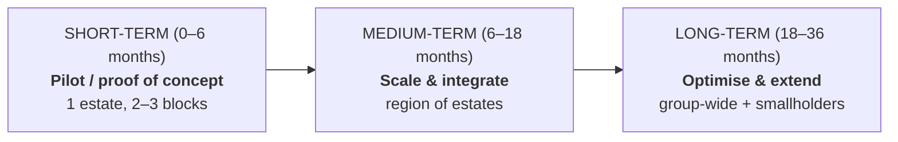

# 04 — Cloud Design on Microsoft Azure, Integration, Roadmap and Risks

> Report-facing (Part 2: technologies 3 marks, platform 5, integration + phased plan 3, risks 2).
> - Platform per D15. Capability-only reasoning per D23: cost appears only as a vendor & cost **risk** (§7).
> - Residency, explainability, DPS and AutoML scope per D32.
> - The demonstration build and its mapping to these services are internal (`07_actual_build_vs_target.md`, D20).
> - Keys refer to `01_research/sources.md`.

## 1. Why Azure: case fit, with AWS as a strong runner-up (D50)

The capability-only matrix was rescored from official documentation on both sides (`01_research/10_audit_wave.md`). **On raw capability AWS edges Azure:**

| Weighting | AWS | Azure | Google Cloud | IBM watsonx |
|---|---|---|---|---|
| Base | **89** | 85 | 67 | 49 |
| Equal weights | **89** | 86 | 66 | 49 |
| Geospatial-heavy | **84** | 80 | 75 | 50 |

The margin is 3–4 points, which is within the subjectivity of 1–5 scoring. **We recommend Azure on case fit**, because it best meets the three constraints that Part 1 makes decisive for this case:

1. **SAP-run estates.** Major Malaysian planters run SAP: IOI uses S/4HANA across its estates and mills (IOI-S4HANA2020), and SD Guthrie's estate master data and accounting are in SAP (BSI-SDG-RSPO2023).
   - The Azure Logic Apps SAP connector covers **IDoc, BAPI and RFC on both ECC and S/4HANA** (AZ-SAP).
   - AWS AppFlow is **OData-only** (NetWeaver 7.40 SP02+) and is not in the AWS Malaysia service list. The SDK for SAP ABAP requires ABAP development inside SAP (AWS-APPFLOW-SAP; AWS-REGTABLE; AWS-SDK-ABAP).
2. **Weeks-offline operation under canopy.** Azure IoT Operations has validated recovery after **up to 45 days offline** (AZ-IOTOPS). AWS Greengrass "acts locally", but no validated offline duration was found (AWS-GG).
3. **MSPO-audit-ready explanations.** The Responsible AI dashboard adds DiCE counterfactuals ("what would change this decision") and an exportable PDF scorecard for the fertiliser model (AZ-RAI). Clarify offers SHAP and partial-dependence plots, without counterfactuals (AWS-CLARIFY).

**AWS is the strong runner-up and the named lock-in fallback (§7).** It hosts IoT Core, Greengrass, SageMaker and Rekognition **in its Malaysian region** (AWS-REGTABLE; AWS-MYREGION). It offers fleet provisioning comparable to DPS (AWS-FLEETPROV), low-data vision training with Rekognition Custom Labels (AWS-RCL), and **image** explainability through Clarify (AWS-CLARIFY). An estate that is not on SAP, or that needs its ML hosted in-country, could reasonably choose AWS.

**The other two platforms:**
- **Google Cloud** leads on geospatial work and vision AutoML. However, it has no Malaysian region (GCP-REGIONS) and retired IoT Core in 2023 (GCP-IOTCORE).
- **IBM** retired Watson IoT without a replacement (REG-WIOT).

**Azure limitations, stated openly:**
- IoT Hub, Azure ML, confidential ledger and Azure OpenAI are **not evidenced in Malaysia West**, so they run in Southeast Asia on non-personal data (§3) (AZ-PRICES-API; AZ-AOAI-MODELS; AZ-ACL-RES).
- The Responsible AI dashboard and built-in monitoring are tabular-only (AZ-RAI; AZ-MONITOR).
- AutoML for images needs GPU compute (AZ-AUTOML-IMG).

The design below works around each of these.

## 2. Services per architecture layer

Service availability per region is confirmed **per Microsoft products-by-region at deployment**. The layout below follows an indicative check of Malaysia West service listings (AZ-PRICES-API; D50).

| Layer (Fig. 4) | Azure service | Role in SawitSense | Capability that justifies it | Region (D32a) |
|---|---|---|---|---|
| 1 Sources → 2 | **Azure IoT Operations** on Arc-enabled Kubernetes (estate edge) | Edge MQTT broker; local rule engine during outages; data flows to Event Hubs/ADLS | Offline processing, 45-day recovery validated (AZ-IOTOPS) | Estate (on-premises) |
| 2 Ingestion | **Event Grid MQTT broker** | **In-country ingestion**: the estate edge publishes soil telemetry and receives recommendations over MQTT | Managed MQTT broker in Event Grid, listed for Malaysia West (AZ-PRICES-API) | **Malaysia West** |
| 2 | **IoT Hub Standard** | Fleet device management: per-device identity, **device twins + cloud-to-device**, firmware/config. Carries device IDs and readings keyed to pseudonymous block IDs only | Standard tier needed for twins/C2D; 400k msgs/day per S1 unit (AZ-IOTHUB-SCALE) | **Southeast Asia**, non-personal data only |
| 2 | **Device Provisioning Service** | Zero-touch X.509 provisioning of the node fleet | Attestation, allocation policies (AZ-DPS) | **Southeast Asia**, single-region data residency + private endpoint (D32c) |
| 2 | **Event Hubs** | Streams from weather feeds, ERP change events, drone upload notifications | Kafka-compatible, millions of events/s (AZ-EVENTHUBS) | **Malaysia West** |
| 2 | **Data Lake Storage Gen2** | Bronze/silver/gold lake: raw readings, images, orthomosaics, NDVI rasters, curated training sets | Hierarchical namespace, file-level ACLs (AZ-ADLS) | **Malaysia West** |
| 2 | **Planetary Computer STAC** (+ Planetary Computer Pro GeoCatalog when GA) | Sentinel-2 L2A search and ingest; estate geospatial catalogue | Global L2A archive, STAC standard (MPC-S2; AZ-MPCPRO) | Data source / Malaysia West copy |
| 3 Cognitive | **Azure Machine Learning** (workspace, pipelines, registry, data labelling) | Train M1/M3/M6; scheduled M5 pipeline; versioned models and data | Managed MLOps; MLflow models | **Southeast Asia**: trains on de-identified data only (images, readings, pseudonymous block IDs) |
| 3 | **AutoML for images** (enterprise design only, D32d) | Benchmark/accelerate M1 and M3 against custom models | Classification, detection, segmentation with sweeps; needs NC/ND GPU (AZ-AUTOML-IMG) | Southeast Asia (as Azure ML) |
| 3 | **Responsible AI dashboard** (M6 only) + **RAI Toolbox (open source)** for images | Interpretability, DiCE counterfactuals, error analysis, PDF scorecard (M6); Grad-CAM for M1/M3 | Dashboard is tabular/sklearn only (AZ-RAI) | — |
| 3 | **Azure OpenAI** | Multilingual rewording of structured explanations; audit-pack narrative | Model availability in Southeast Asia (AZ-AOAI-MODELS) | **Southeast Asia**, non-personal prompts only |
| 3 | **Azure Maps** | Block maps, satellite basemap, **matrix routing** for crew movement | Multipoint optimisation, matrix routing, geofencing (AZ-MAPS) | Southeast Asia; block geometry only, no personal data |
| 4 Deployment | **Azure ML managed online endpoints** | Real-time M1/M3 inference | Blue/green split, traffic mirroring, autoscale, private network (AZ-ENDPOINTS) | **Southeast Asia**; receives bunch/drone images, no personal data |
| 4 | **Azure App Service** (API, rule engine, M6, reasoners) or **AKS** at group scale, + **Azure Functions** (event handlers) | SawitSense API and dashboard back-end | Managed web hosting / Kubernetes; event-driven functions | **Malaysia West** |
| 4 | **Azure Data Explorer / Microsoft Fabric** | Time-series of readings, latest state per block/device, evidence records, KPIs for Power BI | Fast time-series analytics over the lake | **Malaysia West** |
| 4 | **Azure ML model monitoring** + **Azure Monitor** + **Event Grid** | Drift, data quality (M6); custom class-shift signal (M1/M3); retrain triggers | Built-in tabular signals + Event Grid alerts (AZ-MONITOR) | — |
| 5 Application | App Service (dashboard), **Power BI** (group reporting), mobile app (harvester) | User surfaces | — | **Malaysia West** (App Service) |
| Cross-cutting | **Azure confidential ledger** | Anchor SHA-256 digests of evidence records → tamper-evidence for MSPO auditors | Append-only, tamper-evident (AZ-ACL); paired-region replication (AZ-ACL-RES) | **Southeast Asia**, digests only |
| Cross-cutting | **Microsoft Purview**, **Entra ID**, **Key Vault**, Private Link | Lineage, classification of personal data, RBAC, secrets, private networking | Unified governance & sensitive-data protection (AZ-PURVIEW) | Malaysia West |
| Integration | **Logic Apps** (SAP connector), **API Management** | ERP work orders, master data, MPOB/MSPO exports | IDoc/BAPI/RFC to S/4HANA & ECC (AZ-SAP) | **Malaysia West** |

## 3. Data residency & PDPA 2010 (constrains integration only)

The 2024 amendment replaced the old s129 "whitelist" with a test: the destination must have a substantially similar law or adequate protection, or a listed exception must apply. Guidelines from April 2025 require a Transfer Impact Assessment (valid for up to 3 years) and a record of every transfer. A DPO and breach notification have applied since June 2025 (MAYER-PDPA2025).

**Residency layout (D50).** Availability is confirmed per Microsoft products-by-region at deployment.

| Region | Services | Data allowed |
|---|---|---|
| **Malaysia West** (in-country) | Event Grid MQTT broker (in-country ingestion), Event Hubs, Functions, App Service, Storage / Data Lake Gen2, Data Explorer / Fabric, Logic Apps (SAP), AKS; **IoT Operations** on the estate edge | All data, including **personal or identifiable** data: worker and smallholder identities, IC numbers, individually linked plot locations, ERP extracts |
| **Southeast Asia** (Singapore) | IoT Hub + DPS, Azure ML (training, registry, endpoints), confidential ledger, Azure OpenAI, Azure Maps | **Only non-personal or hashed data**, under PDPA s129 safeguards |

**Integration constraints that follow:**
1. **Personal data never leaves Malaysia West.** Purview classifies these fields, and the ERP mapping from pseudonyms to people stays in-country.
2. **What each Southeast Asia service receives:**
   - IoT Hub/DPS: device IDs and readings keyed to pseudonymous block IDs. DPS uses the single-region option with a private endpoint (AZ-DPS).
   - Azure ML: de-identified training sets (bunch and drone images, soil readings).
   - Confidential ledger: SHA-256 digests only.
   - Azure OpenAI: block IDs, readings and rule text, never names.
3. **The transfers are still recorded under s129.** Even for non-personal data, each flow has a Transfer Impact Assessment (valid up to 3 years) and an entry in the transfer record (MAYER-PDPA2025). Then, if a field is later found to be personal, the safeguards are already in place.
4. **ML datasets contain no personal identifiers.** Harvester IDs in allocation plans are pseudonymised.

## 4. Enterprise cost drivers (context for the vendor & cost risk in §7)

Cost was **not** a selection criterion (D23). The table only shows which design choices drive enterprise spend, so that the risk in §7 can be managed.

| Driver | Why it grows | Design control |
|---|---|---|
| GPU training (AutoML for images, M1/M3 fine-tunes) | NC/ND compute required (AZ-AUTOML-IMG) | Scheduled retrains triggered by drift only; low-priority compute; custom transfer learning before AutoML sweeps |
| Online endpoints (always-on instances) | ≥3 instances recommended for HA (AZ-ENDPOINTS) | Autoscale on schedule (harvest hours); batch scoring for drone tiles |
| IoT message volume | Units are sized by messages per day (AZ-IOTHUB-SCALE) | Edge aggregation in IoT Operations (send changes and anomalies, not every sample) |
| Image/orthomosaic storage | Drone surveys are large | Lifecycle tiers in ADLS (hot → cool → archive) |
| Azure OpenAI calls | Per-request usage | Cache per rule ID and language; LLM only for user-facing text |

## 5. Integration with existing estate IT

| Existing system | Integration | Direction | Mechanism |
|---|---|---|---|
| **ERP (SAP S/4HANA or ECC)**: block master, planting dates, harvest tickets, fertiliser stock and work orders, HR rosters | Block master and planting dates seed the block reference (MSPO 4.1.3.4). Approved fertiliser/lime actions become **work orders**. Harvest tickets close the loop for yield KPIs | Both | Logic Apps SAP connector over IDoc/BAPI/RFC (AZ-SAP); API Management facade |
| **Mill weighbridge / grading** | FFB grades and tonnage per block, used for ripeness-model feedback and OER KPIs | In | Event Hubs / batch file to ADLS |
| **MSPO traceability & GHG reporting** (MS 2530-3-2:2022 for estates > 500 ha; MS 2530-4-1:2022 for mills (MPOCC-P32; MPOCC-P41)) | Evidence pack per block and period; N quantities → MSPO GHG Calculator input (4.5.4) | Out | Export from the evidence service (Markdown/PDF/CSV) |
| **MPOB e-submission** (monthly returns) | Production figures pre-filled from ERP + SawitSense KPIs | Out | Report export; manual submission retained |
| **Microsoft 365 / Power BI** | Management reporting, Teams alerts ("Block B2 flagged") | Out | Power BI dataset on gold layer; Logic Apps → Teams |
| **Existing drone vendor** | Orthomosaics uploaded to ADLS; detection results returned as GeoJSON | In/Out | SAS-scoped upload; STAC catalogue |
| **Estate network** (4G/LTE where available (IOI2026); LoRaWAN for sensors) | LoRaWAN network server → IoT Hub integration (TTS-AZURE) | In | Device twins, downlinks |

## 6. Phased implementation plan (Fig. 6 structure)

| | Short-term: pilot | Medium-term: scale & integrate | Long-term: optimise & extend |
|---|---|---|---|
| **Scope** | One estate (e.g. Johor), 2–3 blocks incl. one with known BSR history | All estates in one region; drone programme quarterly | Whole group; smallholder cooperatives (MSPO Part 2) |
| **Data** | Install soil nodes; monthly Sentinel-2 pipeline; one drone survey; collect graded bunch images | LoRaWAN + IoT Operations edge per estate; weather and mill feeds; M6 rule-based baseline replaced by estate-trained data | Multispectral drone data; leaf-nutrient lab results; yield history → **yield forecasting model** |
| **Models** | M1, M5, M6 (rules + tree), M7; M3 as screening trial | Retrain M1/M3 on estate data (AutoML benchmark); M2 learns time-to-ripe from logged grades; drift monitoring live | Satellite nutrient mapping (KOK2021); multispectral BSR detection; LLM audit narrative in 4 languages |
| **Integration** | Read-only ERP block master; evidence pack exported manually | **SAP work orders** from approved actions; Power BI; Teams alerts; confidential-ledger anchoring | MSPO GHG Calculator export; EUDR geolocation package; partner APIs for cooperatives |
| **People** | Train 1 manager, 2 mandores, 1 agronomist; human approval required for every action | Review queue only for low confidence or disagreement; champions per estate | Extension officers; multilingual harvester app |
| **Success measures (baseline first)** | Baseline: round length, under-ripe share at mill, fertiliser kg/ha, BSR found per survey hour. Target: agronomist agreement ≥ 80 %; audit pack accepted by internal MSPO auditor | Round length back within 10–15 days (AHMAD2020; MPOB-NEWS2020); fewer over-ripe bunches; fertiliser rounds skipped where EC is high | Measurable OER gain; BSR found earlier per hectare surveyed; MSPO audits with zero record findings |

## 7. Integration & implementation risks (prioritised)

Each risk is scored likelihood × impact (1–3); the highest are listed first.

| # | Risk (Fig. 6 category) | L×I | Concrete mitigation | Owner |
|---|---|---|---|---|
| 1 | **Technical: model accuracy and data gaps.** Early BSR detection is moderate even in research (64–84 %) (AHMADI2023; KWANG2025); no public soil-sensor or harvest-timing data; Indonesia → Malaysia domain shift in M1 | 3×3 | Position M3 as **screening, not diagnosis**, with ground confirmation for every positive. Report cross-country accuracy honestly and fine-tune on estate images in the pilot. Rules stay authoritative for M6, and human review is required until agreement ≥ 80 %. Overrides feed retraining | Data science lead |
| 2 | **Operational: user adoption and trust.** A largely foreign field workforce (STAR-LAB2026) with mixed literacy; supervisors distrust black boxes | 3×2 | Counterfactual, plain-language explanations in BM, English, Bahasa Indonesia and Nepali. One-tap approve/override. Mandore champions. Paper fallback during the pilot. Measure agreement weekly | Estate manager |
| 3 | **Technical: legacy ERP compatibility.** Customised SAP ECC, inconsistent block codes | 2×3 | Integrate through the Logic Apps SAP connector (IDoc/BAPI) behind API Management (AZ-SAP). Block-master clean-up in phase 1. Read-only first, write-back in phase 2 | IT lead |
| 4 | **Technical: connectivity at remote blocks** | 2×3 | IoT Operations edge with local rules and buffering (AZ-IOTOPS). LoRaWAN planned with plantation-specific canopy loss of 5–9 dB (ANZUM2022). Store-and-forward with capture timestamps | IoT engineer |
| 5 | **Vendor & cost: lock-in** | 2×2 | Open formats: ONNX models, STAC catalogues, Kafka protocol on Event Hubs, MLflow. Containerised API. AWS identified as fallback (Malaysian region + IoT Core) (AWS-MYREGION; AWS-IOTCORE) | Architecture board |
| 6 | **Vendor & cost: enterprise spend growth** (GPU training, always-on endpoints, message volume; §4) | 2×2 | Budgets and alerts per resource group; edge aggregation; autoscale schedules; drift-triggered rather than calendar retraining; a quarterly FinOps review | Finance + IT |
| 7 | **Vendor & cost: service availability and residency.** IoT Hub, Azure ML, confidential ledger and OpenAI are not evidenced in Malaysia West; Planetary Computer Pro is in preview (AZ-PRICES-API; AZ-AOAI-MODELS; AZ-ACL-RES; AZ-MPCPRO) | 2×2 | Residency split (§3): in-country ingestion via the Event Grid MQTT broker; only non-personal or hashed data in Southeast Asia. Re-check products-by-region at each phase gate and move services in-country as they arrive. Template-text fallback when the LLM is unavailable. Local SHA-256 chain remains verifiable without the ledger. STAC access via the open Planetary Computer API until Pro reaches GA | Architecture board |
| 8 | **Operational: workflow disruption during harvest peaks** | 1×3 | Go-live outside peak months. Allocation suggestions are advisory in phase 1. Rollback via blue/green endpoints (AZ-ENDPOINTS) | Estate manager |
| 9 | **Operational/compliance: PDPA cross-border transfer** | 1×3 | Residency split; TIA and transfer records (MAYER-PDPA2025); Purview classification; DPO sign-off before phase 2 | DPO |
