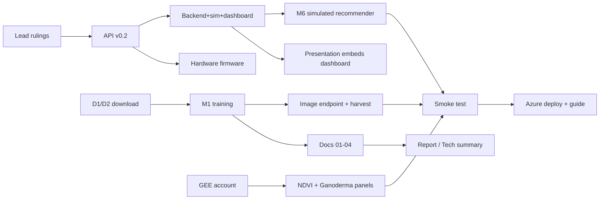

# Software & Cloud AI — PLAN

> Owner: Software & Cloud AI member. Status: **Step 1 (plan), waiting for Lead rulings.** 
> Inputs read: SPEC, PROJECT_PLAN, DECISIONS D1–D23, INTERFACES v0.1, assignment PDF pp.5–8 (Fig. 4, Fig. 6), `01_research/00_baseline_brief.md`, 01–05, `sources.md`.
> Two layers of truth (D20): docs 01–05 = report-facing, fully Azure-native, capability-justified (D23). `src/`, `training/`, 06, 07 = actual build (Kaggle/CPU training, Azure for Students deployment, Earth Engine pre-compute).

## 1. Approach

### 1.1 What the system is (one paragraph)
A cognitive decision-support platform for an estate (working name **SawitSense**, see SW-P1) that fuses three inputs from the brief (Sentinel-2 satellite, UAV imagery, IoT soil sensors) plus ground images and estate records into four explained decisions: **where to harvest and with whom** (O1, P1), **which palms to check for Ganoderma first** (O2, P2), **what to apply to each block** (O3, P3) and **an audit-ready MSPO evidence log + productivity KPIs** (O4, P3). Every decision is stored with its inputs, model version, explanation and geolocation → "explain-to-audit" (D18).

### 1.2 Models (consistent with D16; simulated parts labelled)
| ID | Outcome | Data | Method (build) | Explainability | Status |
|---|---|---|---|---|---|
| M1 Ripeness | O1 | D1 train/val (Indonesia) → **D2 test (Malaysia)**, 4 harmonised classes `unripe/underripe/ripe/overripe` (D2 Empty/Damaged excluded) | EfficientNet-B0 transfer learning (frozen-backbone head first, then partial fine-tune), export **ONNX** for CPU inference | **CAM from final-layer weights** (exactly Grad-CAM for a GAP→linear head, so no gradients/torch needed at inference) + per-class probabilities | Real data |
| M2 Harvest window | O1 | M1 output + ripening rule 19–24 weeks after anthesis (RAMLI2026) | Rule: class → "harvest now / next round in N days" | Rule trace | **Rule-based / SIMULATED schedule** |
| M3 Ganoderma screening | O2 | D4 UAV RGB, provided geographic split | YOLOv8n detector, class weights; report Ganoderma recall (stretch, see SW-P6) | Box + confidence; rank list | Real data (RGB proxy for multispectral) |
| M4 Palm count | O2/O4 | D4 boxes collapsed to "palm" | same YOLO model, one class | — | Real data (stretch) |
| M5 Satellite stress | O2/O4 | Sentinel-2 L2A + Cloud Score+ + global oil-palm mask (GEE) over a real Malaysian estate AOI | Monthly NDVI median per block → z-score anomaly; pre-computed, exported PNG/GeoJSON | z-score + time-series plot | Real data, unlabelled |
| M6 Fertiliser / irrigation | O3 | **SIMULATED** dataset from D17 thresholds + noise; live soil readings | **Hybrid:** rule engine (D17, hard safety guard) + shallow decision tree / gradient boosting for confidence & ranking | Rule IDs + SHAP top features + **counterfactual** ("would be OK if pH ≥ 4.2") | **SIMULATED agronomy** |
| M7 Compliance reasoner | O4 | Evidence log + MSPO MS 2530:2022 criteria map (MPOCC-P21) | Knowledge base (criterion → required evidence) + coverage check | Which criterion each record satisfies / what is missing | Knowledge-based |

No public yield or harvest-timing dataset exists (SPEC §8) → yield **forecasting** is described report-facing as a medium-term capability that the pilot's own logged data enables; the build shows NDVI-trend and evidence-log KPIs only.

### 1.3 Actual build (internal)
- **Backend:** Python FastAPI + SQLite (file on persistent storage) — ingest soil JSON, rules+ML recommender, ONNX image endpoint, evidence log (SHA-256 hash chain), pre-computed satellite/drone panels, harvester view.
- **Simulator:** emits realistic soil payloads (scenarios: normal, dry, acidic, low-nutrient, over-fertilised) → demo works without hardware.
- **Dashboard:** one static page served by FastAPI (vanilla JS, Chart.js + Leaflet **vendored locally**, no CDN dependency on presentation day), polls API every 2 s; panels: live readings, recommendation + reasoning, camera result + heatmap, satellite/drone pre-computed, evidence log, harvester view (mobile layout).
- **Deploy:** Azure App Service (Linux, Python) + Blob Storage on Azure for Students; **local fallback** = same app on the presenting laptop (`uvicorn`, ESP32s point at laptop IP). Training: Kaggle notebook, with a **CPU path** that runs on an ordinary laptop (feature extraction + head training) so training is not blocked on accounts (see Open issues).
- Mapped to production Azure equivalents in `07_actual_build_vs_target.md`.

### 1.4 Report-facing target (docs 01–05)
Adapted Fig. 4: **Data sources** (Sentinel-2/Landsat, UAV, IoT soil nodes, field images, estate ERP, weather, MSPO records) → **Ingestion & big data** (Azure IoT Hub + DPS, Azure IoT Operations at estate edge, Event Hubs endpoint, Data Lake Storage Gen2 bronze/silver/gold, Planetary Computer STAC for Sentinel-2) → **Cognitive services** (Azure ML models M1–M6, MSPO/MPOB knowledge base M7, reasoning/prioritisation cascade, NLP: plain-language explanations + audit narrative via Azure OpenAI, analytics) → **Cloud & deployment** (Azure ML managed endpoints, registry, pipelines, Responsible AI dashboard, data-drift monitoring; Container Apps/Functions; Malaysia West) → **Application** (manager dashboard/Power BI, harvester mobile app, agronomist review queue, MSPO audit pack) with cross-cutting PDPA 2010 residency, Entra ID, Key Vault, Purview governance, tamper-evident ledger (Azure Confidential Ledger, see SW-P4). Every choice justified by capability only (D23); cost appears only as a vendor & cost risk.

## 2. Task breakdown, order, dependencies

| # | Task (Step 2) | Output | Depends on | Others depend on it |
|---|---|---|---|---|
| T0 | `.gitignore` (data/, models/, .venv, secrets), README | 03_software/ | — | — |
| T1 | API contract v0.2 draft (`05_api_spec.md`) | 05 | Lead ruling SW-P2/P3 | **Hardware firmware**, SW tester |
| T2 | FastAPI skeleton: `/readings`, rules engine (D17), evidence log, `/health` + simulator + dashboard skeleton | `src/` | T1 | Presentation (embeds dashboard), SW tester |
| T3 | M6 simulated dataset + tree/GBM + SHAP + counterfactual | `training/fertiliser/`, `src/` | T2 | — |
| T4 | M1 training notebook (Kaggle) + CPU script; metrics on D1 test and D2 Malaysian test; ONNX export | `training/ripeness/`, `models/` (gitignored) | D1/D2 download | T5 |
| T5 | `/infer/ripeness` (ONNX + CAM heatmap) + M2 harvest rule + harvester allocation | `src/` | T4 | Hardware ESP32-CAM, Presentation |
| T6 | M5 Earth Engine script → NDVI anomaly PNG/GeoJSON; M3 YOLOv8n on D4 (stretch) → screening panel; cascade ranking | `training/satellite/`, `training/ganoderma/`, `src/static/precomputed/` | GEE account (Open issue) | Presentation visuals |
| T7 | Smoke test simulator → API → dashboard, record in README | README | T2–T5 | SW tester gate |
| T8 | Docs 01–04 (report-facing, cited) | 01–04 | Rulings; T4 metrics for 03 | **Report** Part 2/3, Technical summary |
| T9 | Deploy to Azure for Students; `06_implementation_guide_beginner.md`; `07_actual_build_vs_target.md` | 06, 07 | Azure sign-up (Open issue) | Presentation (live URL), HW (endpoint URL) |

Order: T0 → T1 → T2 → (T3 ∥ T4) → T5 → T6 → T7 → T8 → T9. Docs 01–02 can be drafted in parallel with T2 once SW-P1/P4/P5 are ruled. Target: code + smoke test by **30 Nov**, docs by **2 Dec**, deployment by **3 Dec** (P2 gate).

## 3. Ideas (beyond the brief) — Part 3 novelty, all building on D18
1. **Tamper-evident explain-to-audit ledger.** Each decision record = input snapshot + model version + explanation + counterfactual + human approve/override + block geolocation + MSPO criterion IDs, chained by SHA-256 (build) / Azure Confidential Ledger (target). One click exports an **MSPO audit pack** (per block, per period) and a verification check proves nothing was edited afterwards. Grounded in MS 2530:2022 records/traceability/GHG criteria (MPOCC-P21) and EUDR geolocation gaps (MSPO-EFI2025). Turns compliance from paperwork into a by-product of operations.
2. **Counterfactual + plain-language explanations** for every recommendation ("Lime: pH 3.8 is below 4.0; if pH were ≥ 4.2 the action would be OK") — readable by a supervisor, not just a data scientist; multilingual (BM/EN, Bahasa Indonesia/Nepali for foreign harvesters) as a target-design feature, template-based in the build.
3. **Satellite → drone → ground cascade with spatial priority.** Sentinel-2 anomaly selects blocks → UAV model scores palms → ground check list ranked by P(Ganoderma) × proximity to confirmed cases (BSR spreads root-to-root to neighbours — source requested) → "screening, not diagnosis" (SPEC §8). Saves scarce labour, links P2 to P1.
4. **Harvester allocation from ripeness.** Ripe-bunch estimate per block (M1+M2) + crew availability → greedy assignment of the limited crew to blocks with most ripe FFB this round; directly attacks P1 instead of only reporting ripeness.
5. **Human-in-the-loop learning loop.** Low-confidence results go to an agronomist review queue; their corrections become new labels and trigger Azure ML retraining (MLOps story, closes the data gap for M2/M6 in the pilot).
6. **Cross-country validation.** Train on Indonesian D1, test on Malaysian D2 and report the drop honestly — uncommon in student work and credible for "validated on Malaysian estates".
7. **Extension (Part 3, 2 marks):** same stack for rubber and cocoa (EUDR commodities), smallholder app via cooperatives/MPOB, carbon/N₂O accounting from the fertiliser log.

## 4. Conflicts / gaps found
1. **Recommendation action enum too narrow (INTERFACES v0.1).** D17 and `05_hardware_notes.md` §3 define *watch* (pH 4.0–4.2), *flag* (pH > 5.5), *drainage warning* (moisture > 80 %) and *over-fertilised → skip round* (TDS high), but the response enum is only `fertilise|irrigate|lime|ok`, and one reading can trigger several actions. → SW-P2.
2. **Payload carries both `tds_ppm` and `ec_us_cm`**, but the hardware only has a TDS sensor; EC ≈ TDS/0.5 is a derived approximation (DFR-SEN0244). Sending both invites inconsistency. → SW-P3.
3. **`ts` needs NTP on the ESP32**; if Wi-Fi/NTP fails the timestamp is wrong. → SW-P3 (server adds `received_at`; `ts` optional).
4. **TDS "calibrated on the day" has no owner/location** in INTERFACES. → SW-P3 (backend stores per-device calibration, set from the dashboard).
5. **Brief item 3 asks for an O4 "yield" model** but no public yield data exists (SPEC §8). → handled as M7 + NDVI KPIs; yield forecasting is target-design only (labelled). → SW-P5.
6. **Fig. 4 has an NLP box; our design had none.** → SW-P5 adds NLP (plain-language explanations + audit narrative).
7. **ESP32-CAM "HTTP trigger" cannot work from the cloud** (device is behind the venue NAT). → SW-P3: button press primary; optional poll of a command endpoint.
8. **Internal only:** Azure for Students may restrict regions; if Malaysia West is not allowed for the student subscription, the build deploys to Southeast Asia — the report-facing design stays Malaysia West. Also IoT Hub F1 allows 8,000 msgs/day, below 10 s × 24 h (8,640) → demo uses HTTPS direct (SW-P3).

## 5. Proposals

| ID | Proposal | Why (evidence) | Impact on other teams | Lead ruling |
|---|---|---|---|---|
| SW-P1 | App name: **SawitSense** (recommended; "sawit" = oil palm in Malay, "sense" = sensing + sense-making); alternatives *PalmPulse*, *Sawit360*. Tagline "From sensor to signed-off decision". | Local identity + says what it does; needs a quick name-collision check | Report, Presentation, dashboard title | |
| SW-P2 | **INTERFACES v0.2 recommendation response:** keep `action`, `reason`, `confidence` (backward-compatible) and add `actions[]` (each `{action, severity, rule_id, reason}`), `counterfactual`, `simulated` (bool), `evidence_id`, `oled` (≤ 2 × 16-char lines), `led` (`green|amber|red`). Action enum: `ok \| irrigate \| drain \| lime \| fertilise \| skip_fertiliser \| watch`. Primary action priority: drain/irrigate > lime > fertilise/skip_fertiliser > watch > ok. | Conflict 1; D17; explain-to-audit (D18) needs an id per decision; node shows server's decision on OLED/LED | **Hardware:** parse `oled`/`led` from the POST response; keep local D17 pH/moisture rules only as offline fallback. SW tester: new fields | |
| SW-P3 | **Transport & payload v0.2:** HTTPS `POST /api/v1/readings` (JSON) returns the recommendation in the same response (no second call). Header `X-Device-Key` (per-device key in an uncommitted `secrets.h`). `ec_us_cm` optional (backend derives EC = TDS/0.5, labelled approximation); `ts` optional, server adds `received_at`; add optional `seq` (for offline buffer replay) and `rssi_dbm`. TDS low/high calibration stored in the backend per device (`PUT /api/v1/devices/{id}/calibration`, set from dashboard on the day). ESP32-CAM: `POST /api/v1/infer/ripeness` raw `image/jpeg` with `X-Device-Key`; trigger = button; optional `GET /api/v1/devices/{id}/commands` poll for a dashboard "capture" button. Response `{label, confidence, explanation}` kept + `class_probs`, `harvest_advice`, `heatmap_url`, `model_version`, `evidence_id`. TLS: root-CA pinned in firmware for Azure, plain HTTP allowed only for the local-laptop fallback. MQTT/IoT Hub = report-facing target only. | Conflicts 2, 3, 4, 7; HTTPS is the simplest reliable path on ESP32 and keeps one endpoint for cloud + local fallback | **Hardware:** firmware HTTP client, headers, buffer/replay with `seq`, CA cert. Presentation: live URL. | |
| SW-P4 | **Part 3 novelty package (extends D18):** tamper-evident hash-chained evidence log with human approve/override + MSPO criterion mapping + one-click audit pack (Idea 1); counterfactual explanations (Idea 2); cascade with spatial priority (Idea 3); harvester allocation (Idea 4); HITL retraining loop (Idea 5). Target design names **Azure Confidential Ledger**; build uses SHA-256 chain in SQLite. | Rubric Part 3 rewards explainability, unique combinations, new interfaces (SPEC §2); MPOCC-P21, MSPO-EFI2025 | Report Part 3 and Presentation demo story (add "verify ledger" + "audit pack" moment); Research: sources requested | |
| SW-P5 | **Cognitive-services scope:** O4 = knowledge-based MSPO compliance reasoner (M7) + NDVI/evidence KPIs, **no yield ML in the build** (yield forecasting = medium-term roadmap once estate data is logged). Add an **NLP** component to Fig. 4: plain-language/multilingual explanations and audit-narrative generation (Azure OpenAI in target design; template NLG in the build, no LLM dependency in the demo). | Conflicts 5, 6; honest data gaps (SPEC §8); Fig. 4 lists NLP | Report Part 1 capability table (NLP for P3), Part 2 technologies | |
| SW-P6 | **Training scope:** M1 (must) — EfficientNet-B0 → ONNX, metrics on D1 test **and** D2 Malaysian test; M6 (must, simulated); M5 NDVI pre-compute (must, real Sentinel-2 if GEE access works, else Copernicus Browser export); **M3/M4 YOLOv8n on D4 = stretch** (train only if M1 is done by 28 Nov; otherwise show D4 ground-truth boxes labelled "dataset annotations, model in roadmap"). | Protects the demo-critical path; D4 1.12 GB + YOLO training is the costliest item | SW tester: what to verify; Presentation: which panels are real model output | |
| SW-P7 | **Build platform specifics (internal, D20):** Azure App Service (Linux, Python) + Blob Storage for the API/dashboard; region Malaysia West if the student subscription allows, else Southeast Asia (internal only); local laptop fallback always ready. Training: Kaggle notebook **plus** a CPU-only script (frozen-backbone features + head) so the agent can produce a working model without Kaggle credentials. | No GPU/Kaggle/Azure CLI on the build machine; avoids blocking on accounts | Stakeholder: Azure sign-up + GEE registration (Open issues); SW tester: run both paths | |
| SW-P8 | **Research request** (appended to `01_research/REQUESTS.md` as R1): official docs for Azure services named in the target design (Azure ML managed endpoints / Responsible AI dashboard / data-drift monitoring, IoT Hub + DPS tiers, IoT Operations, Event Hubs, ADLS Gen2, Planetary Computer STAC, Azure OpenAI and Confidential Ledger availability in Malaysia West, Azure Maps, Purview, Logic Apps SAP connector); MS 2530:2022 criterion numbers for fertiliser records/traceability/GHG; PDPA 2010 cross-border transfer section; Ganoderma neighbour-spread evidence; typical harvesting round interval and harvester productivity. | Docs 02–04 need cited vendor capabilities (Research marked many as "not opened"); D11 citations in every section | Research wave 2 | |

## 6. Work unaffected by proposals (first on resume)
`.gitignore`, dataset download scripts (D1/D2), M1 training script, simulator scenarios, rule engine core using D17 numbers. Nothing touching the API shape, app name or report-facing docs until SW-P1–P5 are ruled.
