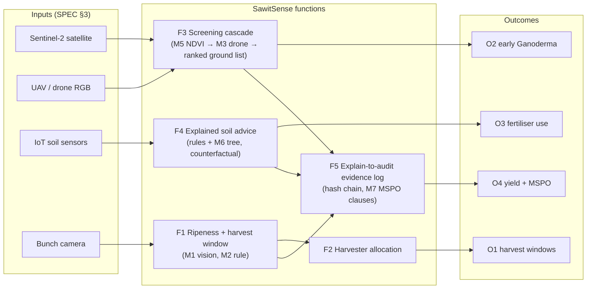
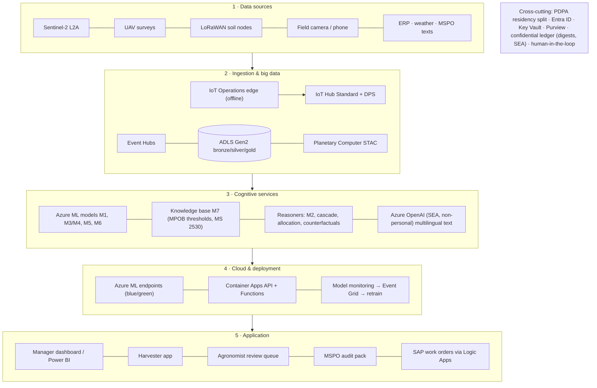

# SawitSense — Technical Summary (whole system)

> **Audience:** the team, presenters, and anyone taking over the build. **Internal document (D20):** it covers **both layers of truth**: the **target (enterprise) design**, which the report and presentation describe, and the **actual build** in this repo. Every section is labelled **[TARGET]**, **[BUILD]** or **[BOTH]**.
> Status as of 23 Nov 2026 (after D44). Sources: `00_lead/` (SPEC, DECISIONS D1–D44, INTERFACES v0.2.4), `01_research/`, `02_hardware/`, `03_software/`, `07_verification/`. Citation keys in brackets refer to `01_research/sources.md` (Harvard list).
> **Rule for reuse:** do not copy [BUILD] content (Kaggle, Azure for Students, App Service, laptop fallback, hardware detail, simulated numbers) into report-facing material (D20, D23, D40).

---

## 1. System overview [BOTH]

**Case.** ITS69404 Case #4, Smart Palm Oil Plantation Management (Malaysia). Malaysia planted 5.70 M ha and produced a record 20.28 Mt CPO in 2025 [MPOB2025]. About 80 % of plantation workers are foreign and the sector was 30,000 workers short in Oct 2026 [STAR-LAB2026] [EDGE-LAB2026].

**Problems (D19 order) → outcomes → SawitSense functions** (`03_software/01_solution_overview.md`):

| Problem (D19) | Key evidence | Outcome | SawitSense function |
|---|---|---|---|
| **P1** Labour shortage & harvest losses | Harvesting is not mechanised [EDGE-SDG2025]; rounds stretch to 20–25 days against a recommended 7–13 [AHMAD2020]; under-ripe harvesting loses oil [MA-POEB] | **O1** predict ripe-FFB harvest windows | **F1** ripeness grading + harvest window · **F2** harvester allocation |
| **P2** Declining stand productivity: Ganoderma BSR (primary) + ageing | BSR on 9.2 % of surveyed smallholdings [IBRAHIM2020]; asymptomatic until 60–70 % infected [KHOO2023]; published early detection only 64–84 % [KWANG2025] [AHMADI2023] | **O2** detect Ganoderma early | **F3** satellite → drone → ground screening cascade (**screening, not diagnosis**, D32e) |
| **P3** MSPO sustainability & fertiliser compliance | MS 2530:2022 requires fertiliser/soil SOP records, traceability and a GHG criterion [MPOCC-P31]; fertiliser ≈ 30 % of cost [STAR-FERT2026]; EUDR applies from 30 Dec 2026 [HL-EUDR2026] | **O3** optimise fertiliser · **O4** yield + MSPO | **F4** explained fertiliser/lime/irrigation advice · **F5** explain-to-audit evidence log · F6 productivity & compliance analytics |

**Novelty anchor (Part 3, D18/D28):** every AI decision becomes a tamper-evident MSPO evidence record with inputs, model version, explanation, counterfactual and human approval. The supporting ideas are the cross-scale cascade, turning ripeness grades into crew allocation, the train-Indonesia/test-Malaysia generalisation check, and a human-review retraining loop.

> Note: the brief names F1–F5. `01_solution_overview.md` also defines **F6** (analytics: NDVI trends, clause coverage, evidence KPIs), which is kept here for completeness.

---

## 2. Target (enterprise) architecture [TARGET]

Summarises `03_software/02_architecture.md`, `03_ai_models.md` and `04_cloud_design.md`. The platform is **Microsoft Azure** (D15). The capability-only matrix gives Azure 88, AWS 79, Google 67, IBM 49 (D32d; `01_research/08_…`). Azure is the only one of the four that combines an in-country region (Malaysia West, 3 AZs) [AZ-REGIONS], a live first-party IoT platform with an offline-capable edge [AZ-IOTHUB-SCALE] [AZ-IOTOPS], and native SAP integration [AZ-SAP]. Google Cloud IoT Core and IBM Watson IoT are both retired [GCP-IOTCORE] [REG-WIOT].

**Data residency split (D32a, mandatory in report-facing docs).**
- Personal or identifiable data (worker and smallholder identities, plot locations linked to individuals) stays in **Malaysia West**.
- **Azure OpenAI** is not offered in Malaysia West [AZ-AOAI-MODELS], so it runs in **Southeast Asia** and receives only block IDs, readings and rule text.
- **Azure confidential ledger** always replicates to a paired region, and Malaysia West has none [AZ-ACL-RES]. It therefore runs in Southeast Asia and stores **SHA-256 digests only** [AZ-ACL].
- **DPS** uses the Southeast Asia single-region option with a private endpoint [AZ-DPS].
- Azure ML, IoT Hub and Event Hubs run in "Malaysia West where offered, otherwise Southeast Asia", with PDPA s129 safeguards (2024 amendment: a Transfer Impact Assessment and transfer records) [MAYER-PDPA2025].

**Models (target).** M1 ripeness CNN, M2 harvest-window rule, M3/M4 YOLO drone Ganoderma screening and palm count, M5 Sentinel-2 NDVI z-score anomaly, M6 rules + tabular tree for fertiliser/lime/irrigation, M7 MSPO compliance knowledge base, plus an NLP layer that rewords explanations but **never decides** (D28).

**MLOps.** Models are registered in the Azure ML registry and served from managed online endpoints with blue/green traffic split and mirroring [AZ-ENDPOINTS]. Model monitoring raises alerts through Event Grid, which triggers retraining [AZ-MONITOR]. Agronomist and grader overrides become labels. AutoML for images appears as an enterprise benchmark only (D32d) [AZ-AUTOML-IMG].

**Explainability (D32b).** The Azure Responsible AI dashboard and built-in monitoring are **tabular-only**, so they cover **M6** (importance, DiCE counterfactuals, error analysis, scorecard) [AZ-RAI]. The image models (M1, M3) use CAM/Grad-CAM and the open-source RAI Toolbox. M5 is a transparent statistic. M7 shows clause traces.

**Roadmap and risks** (Fig. 6 structure, `04_cloud_design.md` §6–7):
- **Short (0–6 months):** pilot on one estate.
- **Medium (6–18 months):** regional scale-up, SAP write-back, and the rule-based baseline replaced by estate-trained models.
- **Long (18–36 months):** group-wide rollout, smallholders, yield forecasting, multispectral BSR detection.
- **Top risk:** cold-start and data gaps plus model accuracy (D40).

---

## 3. Actual build [BUILD]

Summarises `03_software/07_actual_build_vs_target.md`. The demo is a **scaled-down instance of the same API**. ONNX is the shared model format.

| Function | In the repo (build) | Target equivalent |
|---|---|---|
| Backend / API | **FastAPI** (`03_software/src/app/`): `main.py` endpoints, `rules.py`, `recommender.py` (rules + M6), `evidence.py`, `compliance.py` (M7), `inference.py` (M1 ONNX + CAM, M2), `analytics.py` (allocation, cascade), SQLite `db.py` | Container Apps + API Management; Cosmos DB + ADLS |
| Dashboard | Static page served by the API (`src/static/`: vanilla JS, Chart.js vendored under the MIT licence), `/harvester` mobile page; Approve/Override, Verify chain, MSPO audit pack, TDS calibration card, Capture button | Web app + Power BI + native harvester app |
| Simulator | `src/simulator.py` (stdlib): scenarios such as dry, wet, acidic, low_nutrient, over_fertilised, plus `cycle`; optional camera image | — (stand-in for the soil node) |
| Device link | HTTPS POST with `X-Device-Id`/`X-Device-Key`; the recommendation comes back synchronously; the camera polls for commands | IoT Hub + DPS X.509; C2D/twins |
| Evidence log | SHA-256 hash chain in SQLite; `/evidence/verify`; audit pack prints the chain head hash as an external anchor (S-10) | Confidential-ledger anchoring (SEA, digests) |
| NLP | Template text from rule IDs (English) | Azure OpenAI, multilingual |
| Auth | Device keys from `SAWIT_DEVICE_KEYS`; admin token; **cloud mode fails closed** (demo keys off, token mandatory, reads protected) | Entra ID RBAC |

**Models in the build:**
- **M1 ripeness.** EfficientNet-B0, served as ONNX on CPU with an exact CAM heat-map.
  - The **provisional** model (`m1-effb0-0.1-provisional`) was trained locally on CPU on D2 only. It is a sanity check and **not reportable** (D38, D42).
  - The **final** model is D1 (Indonesia) → D2 (Malaysia) from the **stakeholder's Kaggle GPU run** (`training/RUN_ON_KAGGLE.md`, D31). Its output files are `m1_ripeness.onnx`, `.json` and `m1_metrics.json`.
- **M2 harvest window.** A rule in `inference.harvest_advice`; the round interval defaults to 10 days [AHMAD2020] [MPOB-NEWS2020]. Ripening runs 19–24 weeks after anthesis [RAMLI2026].
- **M6 fertiliser.** The rule engine is authoritative. A depth-7 JSON decision tree, trained on **SIMULATED** data (`training/fertiliser/train_m6.py`), tempers confidence. Below 0.6 confidence, or when the tree disagrees with the rules, the case goes to review.
- **Rules (INTERFACES §4).** These are shared with the firmware LOCAL mode (see §4).
- **Cascade.** Satellite z ≤ −1.5 → drone P(Ganoderma) → priority = p × (1 + 0.5·e^(−d/36 m)). Root contact spreads BSR across about 4 rows [KHOO2023], and spores cause scattered cases [COOPER2011]. **Stage 2 shows "not yet available"** because M3/M4 is not trained (stretch, SW-P6).
- **M5 satellite.** The Earth Engine script `gee/ndvi_estate.py` (stakeholder) builds Sentinel-2 monthly NDVI over the oil-palm mask [GEE-S2] [GEE-OILPALM]. **Until it runs, the panel shows a labelled SIMULATED placeholder.**
- **Crew allocation.** A greedy allocator over a **SIMULATED** 8-block estate with a crew of 30 (`static/precomputed/estate_blocks.json`). Productivity by palm height follows [AHMAD2020].

**Deployment options (D29, D39):**
1. **Azure App Service B1 (Linux) + Blob Storage** for the model, in Malaysia West, else Southeast Asia (`deploy/DEPLOY_AZURE.md`, stakeholder-run).
2. **Laptop-local backend** (uvicorn): first-class and already tested (`deploy/ALTERNATIVES.md`, which also covers a hotspot, an HTTPS tunnel and other free hosts).
3. **One backend at a time (D39).** The cloud and the laptop keep separate databases and command queues. At rehearsal, pick a primary (cloud if it is deployed and stable, else the laptop). Point `API_BASE` and the dashboard at the primary; `API_BASE_LOCAL` (the laptop) is used only if the primary fails. **Both backends use the same `SAWIT_DEVICE_KEYS`** (S-02).

---

## 4. Hardware demo [BUILD]

Summarises `02_hardware/` (README, docs 01–06, firmware). The hardware is a **small live demo of the IoT soil-sensor layer only** (SPEC §4). It never goes into the report (D23).

**Nodes.**
- **Soil node:** NodeMCU ESP32 running firmware 0.2.3, on a potted plant that stands in for a block. It carries capacitive moisture, pH E-201-C with a PH-4502C board, TDS, DS18B20, DHT22, an OLED, 3 LEDs and a button. It runs on a power bank (D26).
- **ESP32-CAM** (AI-Thinker, firmware 0.2.2): captures and uploads only, with no on-device inference. It is powered from the laptop USB.

**Pin map (soil node)**, from `02_system_design.md` §3:

| GPIO | Connected to | Notes |
|---|---|---|
| 34 | Moisture AO | ADC1_CH6 |
| 35 | pH PO via 10 kΩ/20 kΩ divider | ADC1_CH7; pin = 0.667 × PO, must stay ≤ 3.1 V |
| 32 | TDS AO | ADC1_CH4, 0–2.3 V |
| 25 | TDS VCC (switched) | LOW while pH is read (prevents probe interference) |
| 4 | DS18B20 DQ | 4.7 kΩ pull-up |
| 16 | DHT22 DATA | 10 kΩ pull-up |
| 21 / 22 | OLED SDA / SCL | I²C 0x3C |
| 18 / 19 / 23 | LED green / amber / red | 220 Ω |
| 2 | On-board LED (network status) | output only |
| 27 | Button to GND | short = send now, 1.5 s = next page, 5 s on CALIB page = dry/wet capture |

All analog inputs are on **ADC1**, because ADC2 fails while Wi-Fi is on. No strapping pins are used as inputs [ESPFAQ].

**Data flow.**
1. Every 10 s, or on a button press, the node reads moisture, then pH with TDS off, then TDS, temperatures and RH.
2. It **replays up to 5 buffered readings first**, then posts the fresh one (v0.2.2).
3. The backend answers synchronously with `action`, `oled[]`, `led` and `evidence_id`.
4. The node fetches its TDS baseline (`GET /devices/{id}/calibration`) at boot and periodically.
5. The camera polls `GET /devices/cam-01/commands` every 2.5 s. On `capture` it POSTs a raw JPEG to `/infer/ripeness`, and the dashboard shows the label and heat-map.

**Network modes (INTERFACES §2, v0.2.2–0.2.3).** The result shown on the node is tagged by who answered:
- **CLOUD:** `API_BASE` answered.
- **LAN:** `API_BASE_LOCAL`, the laptop, answered. While on LAN, the node retries the cloud every 5 min.
- **LOCAL:** neither answered. The node applies the on-device rules and buffers the reading in a 30-entry ring buffer.

In every mode:
- A buffered reading that gets a 4xx response is dropped and does not block the queue.
- If all soil sensors are null, the node shows amber **NO DATA**, never green.
- LOCAL and CLOUD compare the same 1-decimal rounded values.
- TLS pins DigiCert Global Root G2, with Microsoft RSA Root CA 2017 as backup [AZ-CA].

**Power** (estimates, to be checked with a USB meter):
- Soil node ≈ 260 mA (≈ 1.3 W), which gives ≈ 20 h on a 10,000 mAh bank.
- ESP32-CAM ≈ 180 mA average, with peaks above 300 mA, so brownouts are a risk.
- Risks to test: the power bank auto-off at low current, and CAM brownouts on laptop USB.

**Calibration** (`04_calibration.md`, stored in NVS; `cal_id` travels in every payload as the audit trail):
- **Moisture:** two-point dry/wet. The result is relative %, not volumetric water content. The ADC is accurate only over ≈ 150–2450 mV [ESP32-DS].
- **pH:** first check PO and set the offset to ≈ 2.50 V. Then calibrate with the 6.86 and 4.01 buffers (D21); the expected slope is 0.16–0.19 V/pH, with Nernst temperature correction [RAW-PH]. Probes measure a 1:2.5 soil-water slurry, not raw soil.
- **TDS:** DFRobot formula with DS18B20 temperature compensation [DFR-SEN0244]. The rules are **relative to a per-device baseline held in the backend**. The demo uses three cups: REFERENCE sets the baseline, PLAIN gives FERTILISE, NUTRIENT gives SKIP (D-01, D33).

**Shared thresholds and actions (INTERFACES §4; D17, D25).** Priority order: `irrigate`/`drain` > `lime` > `fertilise`/`skip_fertiliser` > `watch` > `ok`.

| Rule | Condition | Action | LED |
|---|---|---|---|
| MOIST_LOW | moisture < 30 % | irrigate | red |
| MOIST_HIGH | moisture > 80 % | drain | amber |
| PH_LIME | pH < 4.0 | lime | red |
| PH_LOW_WATCH | 4.0 ≤ pH < 4.2 | watch | amber |
| — | 4.2–6.5 (5.5–6.5 noted as above the typical band) | ok | green |
| PH_HIGH | pH > 6.5 | watch (check/stop liming) | amber |
| TDS_LOW / TDS_HIGH | below/above baseline × (1 ∓ 0.30) | fertilise / skip_fertiliser (**simulated agronomy**) | amber |

- The pH bands come from the literature [KANANG2026] [AAR-SOIL].
- The moisture thresholds are demo calibration values, motivated by the yield loss from water deficit [CARR2011].

**Demo script.** About 2:30 (`05_demo_plan.md`): dry pot → IRRIGATE; water → OK; PLAIN cup → FERTILISE (simulated); NUTRIENT cup → SKIP; FFB print under the CAM → ripeness + heat-map. Optional: acidic cup → LIME. Fallbacks run CLOUD → LAN → LOCAL, then the camera's local `/capture` page, then the recorded video.

---

## 5. Interfaces (INTERFACES v0.2.4) [BUILD]

Base path `/api/v1`. Full spec: `03_software/05_api_spec.md`.

| Method & path | Caller / auth | Purpose |
|---|---|---|
| `POST /readings` | Soil node (device headers) | Store a reading → synchronous recommendation + evidence |
| `GET /readings?device_id=&limit=` | Dashboard | Chart series ordered by `captured_at` |
| `GET` / `POST /devices/{id}/calibration` | Device (GET) / admin (POST) | Per-device `{tds_baseline_ppm, tds_margin, updated_at}` (v0.2.1, D30) |
| `POST` / `GET /devices/{id}/commands` | Admin (POST) / camera poll (GET) | `{"cmd":"capture"}` / `{"cmd":"none"}`; coalesced, 60 s expiry, cleared on delivery |
| `POST /infer/ripeness` | Camera (raw `image/jpeg`) | M1 label, probs, harvest advice, CAM heat-map URL, evidence ID (503 if no model) |
| `GET /latest` | Dashboard (2 s poll) | Latest **non-buffered** reading per device (highest seq), last ripeness, devices |
| `GET /evidence`, `GET /evidence/{id}` | Dashboard | Evidence log / one record + reviews |
| `POST /evidence/{id}/review` | Admin | Approve/override, appended as a new record; overrides flagged `retraining_candidate` |
| `GET /evidence/verify` | Dashboard | Recompute the SHA-256 chain → `ok`, `head`, or `first_bad` |
| `GET /evidence/export` | Dashboard | MSPO audit pack (Markdown: chain status, clause coverage, decisions) |
| `GET /compliance/coverage` | Dashboard | M7 clause coverage and gaps |
| `GET /harvest/plan?crew=` | Dashboard / harvester page | Allocation over the SIMULATED estate |
| `GET /screening?z=&p=` | Dashboard | Satellite → drone → ground cascade |
| `GET /satellite` | Dashboard | Pre-computed M5 panel (SIMULATED until GEE runs) |
| `GET /meta`, `GET /health` | Any | Thresholds/model info; liveness (`mode`, `ripeness_model`) |

In cloud mode (`SAWIT_MODE=cloud`), every read except `/health` needs the admin token (header or `?token=`); image and heat-map paths stay open (S-08).

**Soil payload (v0.2.4):**
- **Fields:** `device_id`, `seq`, `ts` (ISO-8601 UTC or null), `age_s`, `buffered`, `block_id`, `soil_moisture_pct`, `soil_ph`, `tds_ppm`, `ec_us_cm`, `soil_temp_c`, `air_temp_c`, `air_rh_pct`, `rssi_dbm`, `cal_id`, `fw_version`.
- **Rules:**
  - A failed sensor is sent as `null`, never as a fabricated value.
  - If `ec_us_cm` is null, the server derives EC ≈ TDS/0.5 and flags it as approximate.
  - The server sets `captured_at` to `ts`, else `received_at − age_s`.
  - An unparseable `ts` is treated as null.
  - **Idempotency (v0.2.4, S-06 deviation accepted, D42):** the same `(device_id, seq)` with identical values returns the original response with `duplicate: true` and no new evidence. The same seq with different values is stored as new, so a device whose seq reset after a reboot is not silenced.
- **Response:** `action`, `reason`, `confidence`, `actions[]` (each with action, severity, rule_id and reason), `counterfactual`, `simulated`, `evidence_id`, `oled` (2 lines of ≤ 16 characters), `led`.

**Ripeness response:** `label`, `confidence`, `probs`, `harvest_advice`, `explanation`, `heatmap_url`, `model_version`, `evidence_id`.

---

## 6. Datasets & models [BOTH — status column is BUILD]

| Model | Data | Licence | Status | Metrics |
|---|---|---|---|---|
| M1 ripeness (EfficientNet-B0 + CAM) | D1 Kamal et al., 4,728 images, Indonesia, train [D1-KAMAL2024]; D2 Rosbi, 466 images, Malaysia (Johor, N. Sembilan, Perak), cross-country test [D2-ROSBI2024] [OMAR2024] | CC BY 4.0 (both) | **Provisional** model (D2-only, CPU) is loaded locally. **Final** model = stakeholder Kaggle run, **pending** | Provisional, **not reportable**: D2 test n = 89, accuracy 0.93, macro-F1 0.94, recall unripe 0.82 / ripe 1.00 / overripe 1.00. Same-country test, and D2 has no *underripe* class. Final D1-test / D2 cross-country numbers: **pending** |
| M2 harvest window | Rule from ripening physiology and round intervals [RAMLI2026] [AHMAD2020] | — | **Rule-based** (no public timing data) | n/a |
| M3/M4 drone Ganoderma + palm count (YOLO) | D4 Mimboro et al. v2: 1,352 UAV tiles, 9,400 crowns (722 BSR), geographically disjoint split, 1.12 GB [D4-MIMBORO2026] | CC BY 4.0 | **Not trained** (stretch SW-P6); cascade stage 2 is a placeholder | Planned: Ganoderma recall, mAP@0.5 on the disjoint test blocks |
| M5 NDVI anomaly | Sentinel-2 L2A + global oil-palm mask, via Earth Engine [GEE-S2] [GEE-OILPALM] | Copernicus notice [COPERNICUS-LEGAL]; mask CC BY 4.0; GEE noncommercial [GEE-NONCOM] | Script ready; **SIMULATED placeholder** until the stakeholder runs it | Flagged blocks (z ≤ −1.5) |
| M6 fertiliser/lime/irrigation | **SIMULATED** sensor dataset generated from literature thresholds [KANANG2026] [AAR-SOIL] [CARR2011] | own | Trained (`m6_tree.json`); rules authoritative | Simulated hold-out n = 4,000: accuracy **0.88** vs noisy labels (irrigate F1 0.94, drain 0.92, lime 0.88, fertilise 0.82, watch 0.58) — **simulated** |
| M7 MSPO compliance | MS 2530:2022 clauses (4.1.3 incl. .1/.4/.5, 4.2.2, 4.5.4, 4.5.5) [MPOCC-P31] [MPOCC-P21] | — | Built (`compliance.py`) | Coverage per block/period |
| Allocation | **SIMULATED** 8-block estate, crew 30; productivity by palm height [AHMAD2020] | own | Built | n/a |

There is no public data for harvest timing, oil-palm soil sensors or multispectral BSR (`01_research/03_datasets.md`). Every output that relies on simulated data carries `simulated: true` in the API and a SIMULATED badge in the UI.

---

## 7. Verification status [BUILD]

**Passing now:**
- Owner suite **32/32 pytest** (re-run for this summary on 23 Nov 2026).
- The asserted smoke test passes (`src/tests/smoke_output.txt`).
- SW verification pass 1: 22/22 owner tests; 132/154 independent checks passed; 0 blockers (D39).
- HW verification pass 1: 2 major, 10 minor, 0 blockers (D33).

**Defects:**
- All HW defects (D-01…D-12) and SW defects (S-01…S-15) are **reported fixed by their owners** (Software 9bd2e04, Hardware firmware 0.2.3).
- They have **not yet been independently retested**: SW verification pass 2 is deferred (D42), and the HW pass 2 trigger (a compile) has not happened (D43).
- The `07_verification/*/README.md` files therefore still list them as open.

**Still to verify on real hardware and accounts:**
- **Firmware compile:** not done (D43); run `arduino-cli compile` on the builder's machine.
- **Bench tests B-01…B-16** (`07_verification/hardware/TEST_PLAN.md` §B):
  - **B-01, the pH PO maximum, must be done before PO is wired to GPIO35.**
  - B-02 divider; B-03 3V3 rail; B-04 TDS supply from GPIO25; B-05/06 moisture.
  - B-07 pH two-point slope; B-08 pH/TDS interference; B-09 TDS cups; B-10 temperatures.
  - B-11 null on sensor failure; B-12/13 power bank auto-off and 60 min run; B-14 CAM brownout.
  - B-15 boot with full wiring; B-16 button.
- **M1 final metrics** after the Kaggle run; model checks RI-05…09 in SW pass 2.
- **Azure deployment** (health shows `mode: cloud`); **GEE satellite export**; the TLS root pin against the real `*.azurewebsites.net` URL.

**Presentation-day rehearsal:**
- Run `07_verification/software/TEST_PLAN.md` §H, **R-01…R-14** (fresh tests, cloud settings, matching keys, one backend, demo beats, kill-backend fallback, chain verify, clean DB, no secrets committed).
- Also run the hardware pre-show checklist in `02_hardware/05_demo_plan.md` §6.

---

## 8. Build & run order for the team [BUILD]

**D43:** heavy downloads and installs (ESP32 core, full datasets, training environments) happen **on the builder's (stakeholder's) machine**, never on the shared dev machine. **D31:** account-bound steps (Kaggle, Azure, Earth Engine) are run by the stakeholder; secrets live only in env vars, App Service settings or git-ignored `secrets.h`.

1. **Get the code:** `git pull`. Read this summary, then `00_lead/INTERFACES.md`.
2. **Software locally (no hardware).** Follow `03_software/06_implementation_guide_beginner.md` §1–3:
   - create a venv and install `src/requirements.txt`;
   - start `uvicorn app.main:app --host 0.0.0.0 --port 8000` and run `simulator.py --scenario cycle`;
   - run `pytest -q` and `./smoke_test.sh`.
3. **Train M1 (stakeholder).** Follow `03_software/training/RUN_ON_KAGGLE.md`: a phone-verified Kaggle account, a GPU, Internet on, Run All.
   - Copy `m1_ripeness.onnx`, `.json` and `m1_metrics.json` into `03_software/models/`, and copy the metrics to `training/ripeness/m1_metrics_kaggle.json`.
   - Report the numbers to update `03_ai_models.md` §9.
4. **Satellite panel (stakeholder).** Follow `03_software/gee/RUN_EARTH_ENGINE.md` with `EE_PROJECT`, then commit `satellite.json` and the PNG.
5. **Assemble the hardware.** Follow `02_hardware/06_assembly_guide_beginner.md`:
   - install Arduino IDE 2.x, the ESP32 core 3.x and the libraries;
   - do the Blink test;
   - **do bench test B-01 before wiring pH PO**;
   - add one sensor at a time (pin map in §4 above).
6. **Flash.** Copy `secrets.h.example` → `secrets.h` (git-ignored) for each board. Set the Wi-Fi, `API_BASE` (the primary), `API_BASE_LOCAL` (laptop IP), the device key and the root CA. Compile and upload. Then run bench tests B-02…B-16 and record the values.
7. **Calibrate.** Follow `02_hardware/04_calibration.md`: moisture dry/wet, then pH 6.86/4.01, then `cal id <date>`. The TDS baseline is set from the REFERENCE cup in the dashboard.
8. **Deploy (stakeholder, optional but preferred).** Follow `03_software/deploy/DEPLOY_AZURE.md`:
   - App Service B1 + Blob in Malaysia West, else Southeast Asia;
   - set `SAWIT_MODE=cloud`, `SAWIT_DEVICE_KEYS` and `SAWIT_ADMIN_TOKEN`.
   - If Azure is unavailable, use `deploy/ALTERNATIVES.md` (laptop first).
9. **Connect the devices.** Follow guide §4. Start the laptop backend with the **same `SAWIT_DEVICE_KEYS`**, and make sure the OLED tag matches the dashboard pill.
10. **Rehearse.** Run checklist R-01…R-14 and the demo plan §4 timeline. Pick the **one primary backend** (D39). Record the fallback video.
11. **On the day.** Reset the DB (new `SAWIT_RUNTIME_DIR`) and seed 3 warm-up readings. Afterwards, stop the servers and confirm no secrets are committed.

---

## 9. Known limitations & next steps [BOTH]

**Limitations:**
- **M1:**
  - Only the provisional D2-only model exists, so there is no cross-country result yet.
  - D2 has no *underripe* class.
  - The Indonesia → Malaysia domain shift is untested.
- **M3/M4 not trained.** The cascade's drone stage is a placeholder. Ganoderma stays **screening, not diagnosis**, consistent with the 64–84 % early-detection range in the literature [KWANG2025].
- **Simulated agronomy:**
  - M6 training data, the TDS fertilise rules and the estate/crew data are SIMULATED.
  - TDS is a relative nutrient proxy, not NPK.
  - Moisture is a relative %.
- **Integrity:** the local hash chain is tamper-evident, not tamper-proof. Without an external anchor it cannot detect truncation of the newest records; the printed head hash is the interim mitigation.
- **Demo-scale plumbing:** SQLite with a single worker; shared-secret device keys; polling instead of C2D; English templates instead of multilingual NLP; no ERP integration.
- **Unverified hardware:** no compile and no bench run yet. The power figures are estimates.

**Next steps (priority order):**
1. Stakeholder Kaggle run → final M1 metrics into `03_ai_models.md` §9.
2. Hardware compile + B-01…B-16 on the builder's machine.
3. Azure deployment + TLS check, or confirm the laptop as primary.
4. GEE export.
5. Independent verification pass 2 (SW and HW retests of the fixed defects, model checks).
6. Full rehearsal R-01…R-14.
7. Stretch: train M3/M4 on D4 on a GPU with the disjoint split kept.
8. Target roadmap (report): estate-trained M6, a learned time-to-ripe model for M2, yield forecasting, multispectral BSR detection, SAP write-back and ledger anchoring [AZ-SAP] [AZ-ACL].
