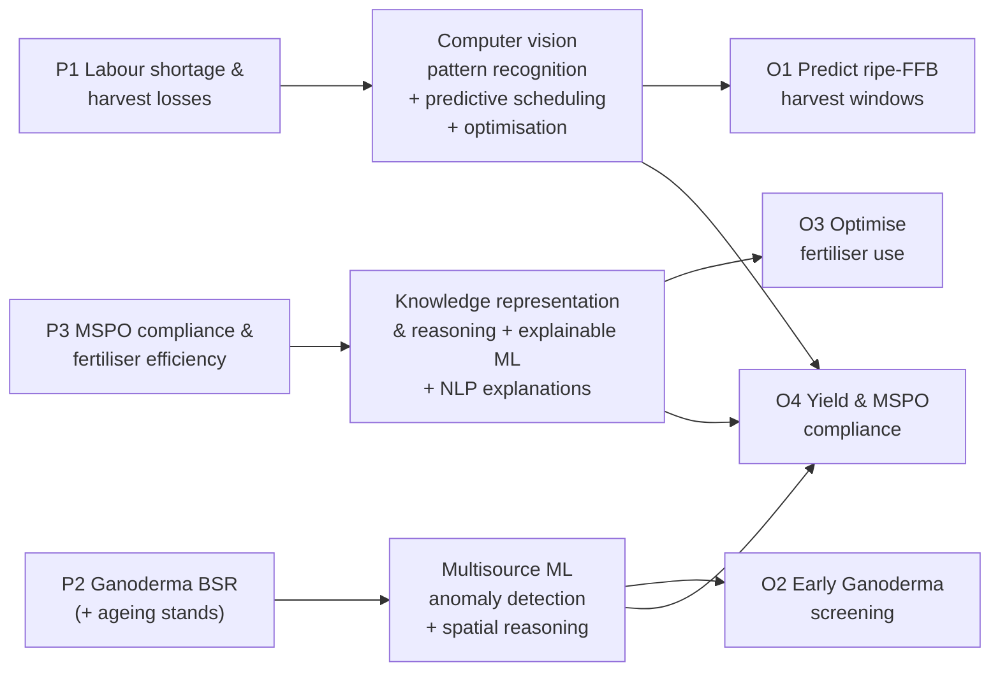

# SawitSense: A Cognitive Computing System for Smart Palm Oil Plantation Management in Malaysia

**ITS69404 Cognitive Computing and Applications**
**Group Assignment One — September 2026 Semester**
**Case Study #4: Agriculture — Smart Palm Oil Plantation Management**

School of Computer Science, Taylor's University

**Group:** ITS69404+[GroupNo]

| No. | Name (as per IC/Passport) | Student ID | Signature |
|---|---|---|---|
| 1 | [Member 1 – Leader] | [ID] | |
| 2 | [Member 2] | [ID] | |
| 3 | [Member 3] | [ID] | |
| 4 | [Member 4] | [ID] | |
| 5 | [Member 5] | [ID] | |

**Lecturer:** [Lecturer name]
**Submission:** Week 12 (14 December 2026)

---

## Table of Contents

- Executive Summary
- 1 Introduction
- Part 1 — Case Analysis & Problem Identification
  - 1.1 The Case: Organisations, Stakeholders and Current Situation
  - 1.2 Key Problems, Evidence and Prioritisation
  - 1.3 Cognitive Computing Capabilities for Each Problem
- Part 2 — Technology Evaluation & Solution Proposal
  - 2.1 The Proposed Application: SawitSense
  - 2.2 Underlying Technologies and Layered Architecture
  - 2.3 Evaluation of Enterprise Platforms and Recommendation
  - 2.4 Integration with Existing IT and Phased Implementation Plan
  - 2.5 Integration and Implementation Risks and Mitigation
- Part 3 — Creative Thinking & Innovation
  - 3.1 Novelty Compared with an Off-the-Shelf Implementation
  - 3.2 Future Extension to the Organisation and Other Sectors
- Conclusion
- References
- Appendix A — Progress Report
- Appendix B — Rubric Cross-Reference

---

## Executive Summary

*[To be written last: problems P1–P3, SawitSense, Azure recommendation, roadmap and novelty in about 300 words.]*

---

## 1 Introduction

Palm oil is one of Malaysia's most important export industries. In 2025 the sector covered 5.70 million hectares, produced a decade-high 20.28 million tonnes of crude palm oil and earned RM112.43 billion in export revenue (Malaysian Palm Oil Board (MPOB), 2026). About three-quarters of the planted area is run by private and government estates, and the remainder by independent and organised smallholders such as the settlers in FELDA schemes (Parveez et al., 2025). The case study for this report, Smart Palm Oil Plantation Management, concerns three of the producers that shape this landscape: FELDA, SD Guthrie (formerly Sime Darby Plantation) and IOI Corporation.

Behind the record output, the production system is under strain. Harvesting is still manual and depends on a mostly foreign workforce that is again in short supply (Ramendran, 2026; The Edge Malaysia, 2026). Ganoderma basal stem rot is spreading through mature plantings and is usually found only when it is far advanced (Khoo and Chong, 2023; Laeng, 2025). Producers must also meet the stricter Malaysian Sustainable Palm Oil (MSPO) standard MS 2530:2022 and, for European buyers, the EU Deforestation Regulation, which applies from 30 December 2026 (Malaysian Sustainable Palm Oil (MSPO) and European Forest Institute (EFI), 2025; Ritz et al., 2026). Each of these challenges requires judgement over large volumes of images, sensor readings and regulatory rules, and that judgement is exactly what the shrinking workforce can no longer supply at scale.

Cognitive computing systems are designed for this kind of task. They perceive patterns in unstructured data, reason over domain knowledge, learn from feedback and explain their conclusions to the people who must act on them. This report proposes **SawitSense** ("sawit" is Malay for oil palm), a cognitive plantation-management application. It fuses satellite imagery, drone data and Internet of Things (IoT) soil sensors to predict ripe fresh fruit bunch (FFB) harvest windows, screen for Ganoderma early, optimise fertiliser use and generate MSPO evidence automatically.

The report is organised in three parts that follow the assignment brief. **Part 1** analyses the case, then identifies, evidences and prioritises three problems: (P1) labour shortage and harvest losses, (P2) declining stand productivity caused mainly by Ganoderma, with ageing trees as a secondary factor, and (P3) MSPO compliance and fertiliser efficiency. It then explains which cognitive capability addresses each problem and why that capability outperforms conventional systems. **Part 2** describes SawitSense and its underlying technologies, evaluates four enterprise platforms against criteria drawn from the case, recommends one, and sets out an integration approach, a phased implementation plan and the main risks with their mitigations. **Part 3** explains what makes SawitSense novel compared with an off-the-shelf implementation, in particular its explain-to-audit evidence log, and how it could be extended to smallholders and to other commodities. Data-protection obligations under the Personal Data Protection Act 2010, as amended in 2024, are discussed only where they constrain integration (Mayer Brown, 2025).

---

# Part 1 — Case Analysis & Problem Identification

## 1.1 The Case: Organisations, Stakeholders and Current Situation

### 1.1.1 A record year built on a fragile base

Malaysia's oil palm sector entered 2026 in apparently good health. In 2025 the country had 5.70 million hectares under oil palm, produced 20.28 million tonnes of crude palm oil (CPO), its highest output in ten years, and earned RM112.43 billion from palm product exports (MPOB, 2026). Estate yields rose 6.4 % to 17.77 tonnes of fresh fruit bunches (FFB) per hectare, and the national oil extraction rate (OER) climbed to 19.74 %. The Malaysian Palm Oil Board (MPOB) attributes both gains to two operational factors: better labour availability and a larger share of ripe, good-quality bunches reaching the mills (MPOB, 2026).

That explanation is the starting point of this analysis. If the best year in a decade was driven mainly by having enough harvesters and cutting bunches at the right stage, then the sector's performance rests on exactly the inputs that are hardest to secure. Labour is again short in late 2026 (The Edge Malaysia, 2026), a large share of palms is past its productive peak (Sarmidi, 2025), a soil-borne disease is spreading through mature plantings (Laeng, 2025), and sustainability certification is becoming stricter just as European due-diligence rules take effect (MSPO and EFI, 2025; Ritz et al., 2026). The case is therefore not about rescuing a failing industry. It is about protecting a high-performing one whose gains are fragile.

Table 1 summarises the facts that frame the case.

*Table 1: Key facts on the Malaysian oil palm sector*

| Indicator | Value | Source |
|---|---|---|
| Planted area (2025) | 5.70 M ha (Peninsular 2.54 M, Sabah 1.50 M, Sarawak 1.66 M) | MPOB (2026) |
| CPO production (2025) | 20.28 Mt, a ten-year high (+4.9 %) | MPOB (2026) |
| Estate FFB yield (2025) | 17.77 t/ha (+6.4 %) | MPOB (2026) |
| National OER (2025) | 19.74 % | MPOB (2026) |
| Export revenue, all palm products (2025) | RM112.43 bn | MPOB (2026) |
| Share of exports to the EU (2025) | 6.8 % of palm oil exports | MPOB (2026) |
| Ownership of planted area (2024) | Estates 73.6 %, independent smallholders 14.6 %, organised smallholders 11.8 % | Parveez et al. (2025) |
| Foreign share of plantation workforce | About 80 % | Ramendran (2026) |
| MSPO-certified planted area (Apr 2024) | 87 % | MSPO and EFI (2025) |

### 1.1.2 The organisations

The case names three producers, and they differ in ways that matter for the design of a cognitive system.

- **FELDA** runs Malaysia's land-development settlement schemes, the main form of *organised* smallholding, which together account for 11.8 % of the national planted area (Parveez et al., 2025). Its growers farm small, contiguous plots under central management, so FELDA combines smallholder-style exposure to disease and traceability gaps with the ability to deploy technology at scheme level [CITE NEEDED: FELDA planted area and settler numbers — R-REP1].
- **SD Guthrie** (formerly Sime Darby Plantation) holds 32 % of its planted area (181,359 ha) in Indonesia, which implies that most of its estate base is in Malaysia. It has raised its land-to-labour ratio from 10.7 ha per worker in 2019 to 13–13.5 ha, targets 15 ha by 2028, and states openly that harvesting still has no mechanisation solution (The Edge Malaysia, 2025).
- **IOI Corporation** completed more than 100 4G/LTE sites across more than 100 estates in January 2026, explicitly to support IoT-based fleet and asset management and data-led decisions (IOI Corporation Berhad, 2026). Large estates now have the connectivity that an IoT and cloud analytics layer requires, which removes one traditional barrier to the system proposed here.

Together these organisations represent the three operating models of the sector: the organised-smallholder scheme, the integrated multinational estate group, and the digitising estate group. A useful solution must serve all three, not only the best-connected estate.

### 1.1.3 Stakeholders

*Table 2: Key stakeholders and their interest in a cognitive plantation system*

| Stakeholder | Role and interest | Source |
|---|---|---|
| Estate managers and harvest supervisors | Plan harvest rounds and allocate scarce harvesters; accountable for yield and OER | The Edge Malaysia (2025); Ahmad et al. (2020) |
| Agronomists and plant-protection staff | Decide fertiliser, liming and irrigation; run Ganoderma census and sanitation | Khoo and Chong (2023); Chong (2026) |
| Sustainability / MSPO officers | Maintain SOPs, records, traceability and GHG reports for audits | MPOCC (2023a; 2023b) |
| Mill graders | Grade incoming FFB; negotiate OER with estates | Ma (n.d.) |
| Independent and organised smallholders | 26 % of planted area; most exposed to disease and traceability gaps | Parveez et al. (2025); MSPO and EFI (2025) |
| Regulators and industry bodies | MPOB (licensing, statistics, R&D), MSPO scheme owner (mandatory certification), MPOC (market promotion), Ministry of Plantation and Commodities (foreign-worker policy) | MSPO and EFI (2025); The Star (2025); The Edge Malaysia (2026) |
| Foreign and local workers | Harvesters and field staff whose data (identity, location, productivity) the system would process under PDPA 2010 | Ramendran (2026); Mayer Brown (2025) |
| EU buyers and refiners | Must prove deforestation-free, plot-traceable supply under the EUDR | Ritz et al. (2026) |

### 1.1.4 Current situation

Four observations describe how plantations are run today.

1. **Decisions rely on human observation.** Harvesters judge ripeness by fruit colour and loose fruit on the ground, on fixed rounds of roughly 10–15 days (Ahmad et al., 2020; Ma, n.d.). Ganoderma is found by visual census, which is how MPOB's national surveillance was carried out (Ibrahim et al., 2020). Fertiliser is applied on blanket schedules by palm age and soil type, with periodic sampling (Chong, 2026; Applied Agricultural Resources, n.d.).
2. **Records are kept for audit, not for decisions.** MSPO requires documented SOPs and records for fertilising, soil fertility, water management and harvesting, plus traceability and GHG reporting (MPOCC, 2023a; 2023b). These records are typically produced as separate paperwork rather than as a by-product of operations, a gap the 2025 EUDR gap assessment makes visible: MSPO data do not yet provide EUDR-format polygon geolocation for plots above 4 ha or plot-level traceability for dealer-supplied smallholder FFB (MSPO and EFI, 2025).
3. **Digitalisation has started but is fragmented.** IOI's estate-wide connectivity (IOI Corporation Berhad, 2026) and MPOB's AI-based smallholder apps MySawit and Tekno Sawit (Business Today, 2025) show appetite for digital tools. However, these initiatives address single functions, and none combines satellite, drone and soil-sensor evidence into one decision and audit trail (see Part 3).
4. **External pressure is rising.** The EU Deforestation Regulation (EUDR) applies to large and medium operators from 30 December 2026 (Ritz et al., 2026), and Malaysia has been rated "standard risk", a rating the Malaysian Palm Oil Council contested (The Star, 2025). At home, the government plans to reduce foreign workers to 10 % of the workforce by 2030 (The Edge Malaysia, 2026).

The current situation can therefore be summarised as **high output, labour-intensive decisions, and audit records that are disconnected from field operations**. The next section shows why this combination produces three priority problems.

## 1.2 Key Problems, Evidence and Prioritisation

### 1.2.1 Prioritisation method

The three problems in the case brief (labour shortage, ageing trees and MSPO requirements) were tested against published evidence rather than assumed. Two adjustments followed. First, Ganoderma basal stem rot (BSR) emerged as a more serious and more *cognitively addressable* cause of declining stand productivity than tree age alone, so it is treated as the primary component of Problem 2. Second, fertiliser efficiency was grouped with MSPO compliance because the standard regulates fertiliser records and fertiliser-derived emissions directly (MPOCC, 2023b).

Each problem was then ranked on four criteria:

- **Scale of loss**: the quantified economic or production impact.
- **Urgency**: how soon harm occurs if nothing changes.
- **Labour dependence of today's remedy**: whether the current fix needs the very workers who are scarce.
- **Cognitive addressability**: whether the binding constraint is *information and judgement*, which cognitive computing can improve, or something else, such as capital.

*Table 3: Problem prioritisation against four criteria*

| Problem | Scale of loss | Urgency | Labour dependence of current remedy | Cognitive addressability | Rank |
|---|---|---|---|---|---|
| **P1** Labour shortage and harvest losses | Very high: RM7.5–20 bn/yr (employer estimate); about RM2.2 bn per 0.5-point OER (authors' calculation) | High: shortage re-emerging in late 2026 | Very high: grading and scheduling are done by the scarce workers themselves | High: ripeness grading and scheduling are perception and planning tasks | **1** |
| **P2** Declining stand productivity: Ganoderma BSR (primary) + ageing | High: 43 % loss within six months in affected plantations; projected 860,610 ha at risk by 2040 | Medium–high: disease is progressive and invisible early | High: visual census needs trained field staff | Medium–high for BSR (detection); low for ageing (capital-bound) | **2** |
| **P3** MSPO compliance and fertiliser efficiency | Medium–high: fertiliser is about 30 % of production cost; market access at stake | High: EUDR from 30 Dec 2026; MS 2530:2022 in force | Medium: record-keeping is clerical work | High: rule-based reasoning, recommendation and evidence generation | **3** |

Sources: Ramendran (2026); MPOB (2026); The Edge Malaysia (2026); Khoo and Chong (2023); Chong (2026); Ritz et al. (2026); MSPO and EFI (2025).

### 1.2.2 P1 — Labour shortage and harvest losses (highest priority)

**Problem statement.** Malaysian plantations cannot reliably harvest FFB at the right stage of ripeness because harvesting is manual and depends on a scarce, largely foreign workforce. The result is lost crop and lower oil yield.

**Evidence.**

- About 80 % of plantation workers, and most harvesters, are foreign. The Malaysian Employers Federation estimates the cost of labour shortages at RM7.5–20 billion a year (Ramendran, 2026). This is an employer-body estimate, not an official figure, and is cited as such.
- In October 2026 the minister reported a shortage of 30,000 workers (11.16 % of the approved migrant quota), with 268,691 foreign workers employed and about six months needed to recruit and train a replacement. National policy aims to cut the foreign share of the workforce to 10 % by 2030 (The Edge Malaysia, 2026).
- The previous shortage was costly: CPO output fell 3.63 % in 2020 and 5.33 % in 2021, and about RM1 billion of ripe FFB was left unharvested in 2021 (The Edge Malaysia, 2026). In 2020 some estates went 20 days without harvesting (The Malaysian Reserve, 2020).
- Harvesting cannot yet be mechanised; it remains the industry's unsolved problem, and about half of estate workers are harvesters (The Edge Malaysia, 2025).
- Recommended harvesting rounds are 7–13 days, but labour shortages have stretched them to 20–25 days (Ahmad et al., 2020). A worker with a sickle or chisel cuts about 1 tonne of FFB a day, and a two-person team manages only 50–90 bunches a day on palms taller than 12 m, against 400–1,000 on short palms (Ahmad et al., 2020).

**Why the shortage destroys value, not just volume.** When harvesters are scarce, estates cut more under-ripe bunches to avoid collecting loose fruit, and the oil yield falls; in the industry's own phrase, the oil is made in the field, not in the mill (Ma, n.d.). Fully mature fruit holds more than 40 % oil, while under-ripe fruit gives less oil and poorer CPO, with lower carotene and DOBI and higher chlorophyll and chloride (Ramli, Abdul Hammid and Yaakub, 2026). Leaving bunches to ripen fully is no cure either, because ripe and over-ripe bunches shed loose fruit that must be gathered by hand, which again needs labour (Ma, n.d.). The value lost is large. Using MPOB (2026) figures, mills processed about 103 Mt of FFB in 2025 (20.28 Mt CPO ÷ 0.1974 OER). A loss of 0.5 percentage points of OER on that volume is about 0.51 Mt of CPO, or about **RM2.2 billion** at the 2025 average CPO price of RM4,292.50 per tonne (authors' calculation, following the method in Ma, n.d.).

**Critical nuance.** The shortage is cyclical rather than continuously worsening. It eased in 2024–25, which is why yields rose (Parveez et al., 2025; MPOB, 2026), and it is returning in 2026 (The Edge Malaysia, 2026). The argument for a cognitive solution is therefore *structural resilience*: estates need to get more ripe crop from every available harvester-hour, whatever the labour supply in a given year. The problem is also a measurement problem: estate and mill often disagree on OER because neither side knows how much oil is in a given consignment of FFB (Ma, n.d.).

P1 ranks first because it has the largest quantified loss, a near-term trigger, and a current remedy (human grading and fixed rounds) that depends on the missing resource.

### 1.2.3 P2 — Declining stand productivity: Ganoderma BSR (primary) and ageing trees

**Problem statement.** Stand productivity is being eroded by Ganoderma basal stem rot, which is detected too late by labour-intensive census, and by an ageing palm population that is replanted too slowly.

**Evidence on Ganoderma BSR.**

- MPOB surveillance of 37,360 ha of smallholdings in the replanting incentive scheme found BSR on 9.2 % of the area (3,451 ha), rising to 14 % in coastal areas (Ibrahim et al., 2020).
- In October 2025 the MPOB Director-General reported infection above 20 % in some mature plantings and potential losses of hundreds of millions of ringgit a year (Laeng, 2025).
- BSR can cause a 43 % economic loss within six months in an affected plantation, and modelling suggests it could destroy 860,610 ha of Malaysian mature palms by 2040. There is, however, no published figure for the area actually damaged nationally (Khoo and Chong, 2023), a data gap in itself.
- **Detection is the bottleneck.** Infected palms show no symptoms early, and foliar symptoms often appear only once the infection is about 60–70 % advanced. Laboratory methods (PCR, ELISA, selective-medium culture) are accurate but slow, expensive and labour-intensive, and spectral methods can confuse disease with nutrient deficiency (Khoo and Chong, 2023).
- The disease spreads through root contact with infected stumps and palms, and palm roots reach the first four planting rows; sanitation at replanting reduced incidence to below 1 % compared with more than 13 % without it (Khoo and Chong, 2023). Airborne spores are also an important source of new infections, so cases are not always next to old ones (Cooper, Flood and Rees, 2011).

**Evidence on ageing trees.** About 8.5 % of palms were older than 25 years at the start of 2024, and only about 2 % of the planted area (114,000 ha) was replanted in 2024 against a 4–5 % benchmark; replanting costs RM20,000–30,000 per hectare (Sarmidi, 2025). Palms kept beyond 25–27 years yield only 4–5 t/ha compared with up to 28 t/ha for well-managed mature stands (The Vibes, 2025). Ageing also feeds P1, because tall palms sharply reduce harvester output (Ahmad et al., 2020).

**Critical nuance.** The two components differ in what limits them. Ageing is constrained mainly by capital and smallholder income, not by information (Sarmidi, 2025), so cognitive computing can only help to *prioritise* which blocks to replant first. Ganoderma, in contrast, is an information problem: the disease is present long before anyone can see it. This is why BSR is the primary component of P2 and why the realistic role for AI is screening and prioritisation of palms for confirmation, not diagnosis (Section 1.3.2).

P2 ranks second: its losses are severe and compounding, but they build up over seasons rather than weeks, and part of the problem (ageing) lies outside what cognitive computing can solve.

### 1.2.4 P3 — MSPO compliance and fertiliser efficiency

**Problem statement.** Producers must prove sustainable practice, including fertiliser use, soil fertility management, traceability and greenhouse-gas emissions, under a stricter mandatory standard. At the same time they need to spend their largest controllable input, fertiliser, more precisely. Today both are handled with blanket schedules and paper records.

**Evidence.**

- MSPO certification has been mandatory since 2020. By April 2024, 87 % of planted area and 87 % of mills were certified, but only 66 % of independent smallholders. The MS 2530:2022 standard, applied from 2025, adds a deforestation cut-off of 31 December 2019, a dealer standard for traceability, and indicators on child and forced labour (MSPO and EFI, 2025).
- The standard's guidance requires SOPs and implementation records for fertilising and soil-fertility management (criterion 4.1.3), a block reference system (4.1.3.4), FFB traceability to the plantation or smallholding (4.2.2), stepwise GHG reporting that names nitrous oxide from fertiliser as an emission source (4.5.4), and a water-management plan (4.5.5) (MPOCC, 2023a; 2023b).
- MSPO data fall short of EUDR needs: there is no EUDR-format polygon geolocation for plots above 4 ha, and smallholder FFB sold through dealers is not traceable to the plot (MSPO and EFI, 2025). The EUDR applies from 30 December 2026 (Ritz et al., 2026).
- Fertiliser accounts for about 30 % of estate production costs. Growers who cut fertiliser by 40 % risk yield losses of at least 20 % over the following 18–24 months, and planters themselves are calling for nutrient-use efficiency and precision agriculture (Chong, 2026). Wrong application also acidifies soil and pollutes water (Applied Agricultural Resources, n.d.), and soil pH outside the 4.2–5.5 band limits nutrient uptake (Kanang and Mohidin, 2026).

**Critical nuance.** The EU took only 6.8 % of Malaysia's palm oil exports in 2025 (MPOB, 2026), so the EUDR is an accelerator for EU-exposed groups such as SD Guthrie and IOI rather than a universal driver. MSPO, which is domestic and mandatory, is the universal driver. P3 ranks third because the current remedy (paperwork and blanket schedules) is costly but does not depend as heavily on scarce field labour as P1 and P2, and because its losses are spread across cost and market access rather than lost crop.

### 1.2.5 How the problems interact

The three problems are not independent. Visual Ganoderma census and manual compliance record-keeping consume the same scarce field and supervisory labour that harvesting needs (Ibrahim et al., 2020; The Edge Malaysia, 2026). Ageing, tall palms lower harvester productivity (Ahmad et al., 2020), so P2 deepens P1. Under-fertilised or acidic blocks yield less (Chong, 2026; Kanang and Mohidin, 2026), so P3 also lowers the crop that scarce harvesters can collect. The interactions support two conclusions. P1 is the root priority, and the solution should be one integrated system that shares data and labour savings across all three problems rather than three separate tools.

## 1.3 Cognitive Computing Capabilities for Each Problem

Each problem is matched to one *primary* cognitive capability, the one that removes the binding constraint, plus supporting capabilities. For each, this section explains the conventional approach, why it falls short, and why a cognitive approach is better suited. Figure 1 gives the mapping and Table 5 summarises the comparison.

*Figure 1: Mapping of prioritised problems to cognitive capabilities and case outcomes (O1–O4)*

### 1.3.1 P1: Computer vision pattern recognition for ripeness and harvest planning

**Capability.** Deep-learning image models (convolutional neural networks and YOLO-family detectors) recognise the visual patterns that separate unripe, under-ripe, ripe and over-ripe bunches. Applied to drone footage at estate scale or to ground images at block scale, they produce per-block counts of ripe bunches. Two supporting capabilities turn these counts into action: *predictive modelling* estimates each block's harvest window, and *optimisation* allocates the available harvesters to the blocks where ripe crop is at greatest risk.

**Evidence that the capability is mature.** A YOLO11 model trained on 11,613 drone images of palms with visible bunches, covering six ripeness classes, reached 98.3 % mAP, 94.0 % precision and 97.2 % recall at about 7.7 ms per frame. It tracked bunches across video frames and logged results per tree through QR-coded tree identifiers (Che Hassan et al., 2026). With ground images, a YOLOv5m detector reached mAP@0.5:0.95 of 0.842 on four classes from only 304 images (Mansour, Dambul and Choo, 2022). A Malaysian outdoor dataset with on-tree and ground images (Omar et al., 2024) allows models to be tested on local conditions. Because these results come from different datasets and metrics, they are not directly comparable, but together they show that ripeness grading is a solved perception task under field conditions.

**Conventional approach and its limits.** Harvesters judge ripeness by eye on fixed rounds, and graders at the mill judge it again. This approach fails in three ways. It needs the workers who are missing. It is inconsistent, since grading varies between people and shifts, which fuels estate–mill disputes over oil content (Ma, n.d.). It is also blind between rounds, so when rounds stretch from 7–13 days to 20–25 days (Ahmad et al., 2020), bunches over-ripen unseen. A conventional ERP or scheduling system cannot fix this, because it cannot read images; it only records what people enter.

**Why cognitive computing is better suited.**

1. **It scales without labour.** One drone flight can grade every visible bunch in a block, whereas a human census requires the scarce harvesters it is meant to support.
2. **It is consistent and auditable.** The model applies one grading standard everywhere, and each grade carries a confidence score and a Grad-CAM heatmap showing which part of the image drove the decision. This gives estates and mills a shared, explainable reference.
3. **It turns perception into decisions.** By linking image recognition to scheduling and allocation, the system answers the question managers actually face, *which block should the available crew harvest today?*, rather than just counting bunches.

**Limits.** Bunches hidden by fronds are not visible to drones, and accuracy falls on small or unbalanced datasets. No public time-series dataset exists for harvest-window prediction, so the initial window model uses the agronomic rule that bunches ripen 19–24 weeks after anthesis (Ramli, Abdul Hammid and Yaakub, 2026), to be replaced by a learned model as estates log their own data.

### 1.3.2 P2: Multisource machine learning for Ganoderma anomaly detection

**Capability.** Machine-learning anomaly detection combines several weak signals into one risk estimate. In a three-stage screening cascade: (i) Sentinel-2 satellite time series of the normalised difference vegetation index (NDVI) flag blocks whose canopy vigour is falling, with a revisit of about five days (Microsoft Planetary Computer, n.d.); (ii) an object detector trained on drone images flags suspect crowns within those blocks; and (iii) a spatial reasoning rule raises the risk of neighbouring palms within the four-row root zone (Khoo and Chong, 2023). The output is a ranked list of palms for ground confirmation.

**Evidence.** Published early-detection results are promising but moderate, as Table 4 shows.

*Table 4: Published Ganoderma detection results relevant to SawitSense*

| Approach | Reported result | Source |
|---|---|---|
| UAV and Pleiades multispectral imagery, convolutional SVM | About 64–68 % overall accuracy for early-stage infection | Ahmadi et al. (2023) |
| UAV hyperspectral imagery with PCA and fine-tuned ResNet50 | 84 % overall; 74 % sensitivity for early infection; 86 % specificity | Kwang et al. (2025) |
| Smartphone images (Malaysia and Thailand), MobileNetV2 on-device | 77 % overall; most errors between early-infected and healthy palms | Daranagama and Takeuchi (2025) |
| UAV RGB images with field-confirmed labels, geographically separate test split | 9,400 crowns, 722 Ganoderma-affected; basis for a detector | Mimboro et al. (2026) |

**Conventional approach and its limits.** Trained workers inspect palms visually, and suspect palms are confirmed by laboratory tests. Visual census detects BSR only once symptoms appear, often when the infection is already 60–70 % advanced, and laboratory tests are accurate but too slow and costly to apply to every palm (Khoo and Chong, 2023). Census also depends on field staff, the resource P1 shows to be scarce.

**Why cognitive computing is better suited.**

1. **It sees earlier and wider.** Learned spectral and texture patterns can indicate stress before obvious symptoms appear, and satellite screening covers every palm on every revisit rather than a sampled fraction.
2. **It reasons over evidence.** It fuses satellite trend, crown appearance, neighbour status and block history into one risk score. A conventional census records only what an inspector sees on the day.
3. **It directs scarce experts.** Laboratory tests and sanitation teams are sent to the highest-risk palms first, which turns a fixed testing budget into earlier interventions. Because root-contact spread is known, finding one case early also protects its neighbours (Khoo and Chong, 2023), while blanket satellite screening still catches spore-borne infections that are not clustered (Cooper, Flood and Rees, 2011).

**Limits and positioning.** With published early-detection accuracy of about 64–84 %, the system must be positioned as **screening and prioritisation, not diagnosis**. A human expert confirms every case, and confirmed results are fed back as new training labels. For ageing stands the same NDVI and yield-trend analytics rank blocks for replanting, but they cannot remove the capital constraint (Sarmidi, 2025).

### 1.3.3 P3: Knowledge representation and reasoning with explainable machine learning

**Capability.** A *knowledge base* encodes agronomic thresholds and MSPO requirements: soil pH bands for oil palm, with 4.2–5.5 as the favourable range and liming below 4.0 (Kanang and Mohidin, 2026), land-suitability limits (Applied Agricultural Resources, n.d.), the yield penalty of soil-water deficit, about 10 % per 100 mm (Carr, 2011), and the MS 2530:2022 criteria on fertiliser records, traceability, GHG and water (MPOCC, 2023a; 2023b). A machine-learning *recommender* trained on soil-sensor readings (moisture, pH, electrical conductivity, temperature) and block context proposes an action (fertilise, lime, irrigate or skip), and the knowledge base constrains and explains it. *Natural language processing* generates the explanation and the audit narrative in English and Bahasa Malaysia for field staff and auditors. Remote sensing adds evidence: Landsat-8 imagery with random-forest and SVM classifiers has predicted leaf nitrogen and potassium levels in Malaysian variable-rate fertiliser plots with about 80 % and 77 % accuracy, though not phosphorus, magnesium or calcium (Kok et al., 2021).

**Conventional approach and its limits.** Fertiliser is applied on blanket schedules by palm age and soil type, informed by periodic leaf and soil sampling, and recorded on paper or spreadsheets for the auditor. This approach is blind between sampling rounds, treats every block in a class the same, and produces compliance evidence as a separate clerical task. Because fertiliser is about 30 % of production cost and deep cuts reduce yields for up to two years (Chong, 2026), both over- and under-application are expensive. A conventional dashboard can display a pH of 3.8 but cannot conclude what to do about it.

**Why cognitive computing is better suited.**

1. **Site-specific and continuous.** Recommendations change with live readings per block rather than once a season.
2. **Reasoning, not display.** The system infers that a block with pH below 4.0 should be limed before it is fertilised, because nutrient uptake is poor in acid soil (Kanang and Mohidin, 2026), and it states that reason.
3. **Explainable and contestable.** Feature-importance and counterfactual explanations, for example "had pH been 4.2 or higher, the advice would have been to fertilise", let agronomists check and challenge the model. For tabular models such as this recommender, the Azure Machine Learning Responsible AI dashboard provides these explanations and an exportable scorecard (Microsoft, 2025a).
4. **Audit-ready by design.** Every recommendation is stored with its data, explanation and the MSPO criterion it supports, so the records required by criteria 4.1.3, 4.2.2 and 4.5.4 (MPOCC, 2023b) are produced as a by-product of normal work. Fertiliser quantities logged this way also feed the nitrous-oxide estimate required for GHG reporting.

**Limits.** No public dataset links oil-palm soil-sensor readings to agronomic outcomes, so the initial recommender is trained on simulated data derived from the published thresholds above and must be retrained on estate-logged data during the pilot. The knowledge base must also be kept up to date as MSPO guidance changes.

### 1.3.4 Summary: why cognitive rather than conventional

*Table 5: Conventional and cognitive approaches compared for each problem*

| Problem | Conventional approach | Its limit | Cognitive capability | Why it is better suited |
|---|---|---|---|---|
| P1 Labour and harvest losses | Visual ripeness judgement on fixed 10–15-day rounds; mill grading by eye | Needs the scarce workers; inconsistent; blind between rounds; ERP cannot read images (Ma, n.d.; Ahmad et al., 2020) | Computer vision pattern recognition + predictive scheduling + optimisation | Grades every visible bunch without extra labour, consistently and with explanations; converts images into a harvest plan for the crew available |
| P2 Ganoderma BSR (+ ageing) | Visual census; laboratory confirmation | Detects only at 60–70 % infection; tests too slow and costly for every palm; labour-bound (Khoo and Chong, 2023) | Multisource ML anomaly detection + spatial reasoning | Screens all palms continuously, fuses weak signals, ranks palms so experts confirm the highest risks first; framed as screening, not diagnosis |
| P3 MSPO and fertiliser | Blanket schedules; periodic sampling; paper records | Blind between samples; uniform dosing on a 30 %-of-cost input; compliance as separate paperwork (Chong, 2026; MPOCC, 2023b) | Knowledge representation and reasoning + explainable ML + NLP | Site-specific, continuous and explained advice; produces MSPO evidence and GHG inputs automatically |

The common thread is that each problem is constrained by **judgement over unstructured or fast-changing evidence** (images, spectral time series, sensor streams and regulatory rules) that must be applied at a scale the available workforce cannot provide. Conventional information systems store and display such data, but cognitive systems can perceive, reason over and explain it, which is why cognitive computing is the better fit for all three problems. Part 2 turns these capabilities into one application, SawitSense.

---

# Part 2 — Technology Evaluation & Solution Proposal

## 2.1 The Proposed Application: SawitSense

*[Pending Software design docs: name, core functions and target users of SawitSense.]*

## 2.2 Underlying Technologies and Layered Architecture

*[Pending Software design docs: each underlying technology justified by capability, with the adapted Figure 4 layered architecture as a Mermaid figure.]*

## 2.3 Evaluation of Enterprise Platforms and Recommendation

*[Pending: capability-only comparison of Azure, AWS, Google "Gemini platform (formerly Vertex AI)" and IBM watsonx, with scoring matrix, sensitivity checks and a single recommendation linked to P1–P3.]*

## 2.4 Integration with Existing IT and Phased Implementation Plan

*[Pending Software design docs: integration with estate ERP, IoT and data estate, the PDPA residency split, and a short/medium/long-term roadmap following PDF Figure 6.]*

## 2.5 Integration and Implementation Risks and Mitigation

*[Pending: technical, operational and vendor & cost risks, prioritised, each with concrete mitigation.]*

---

# Part 3 — Creative Thinking & Innovation

## 3.1 Novelty Compared with an Off-the-Shelf Implementation

*[Pending: explain-to-audit evidence log, counterfactual explanations, satellite→drone→ground cascade, harvester allocation and cross-country validation.]*

## 3.2 Future Extension to the Organisation and Other Sectors

*[Pending: extension to smallholders and mills, and to other EUDR commodities such as rubber and cocoa.]*

---

## Conclusion

*[To be written last: how SawitSense answers the case and the three problems.]*

---

## References

Ahmad, M.R., Jamaludin, N., Jelani, A.R., Bakri, A. and Shuib, A.R. (2020) 'The effect of design parameters on the force and energy requirement for cutting oil palm fronds using magnetic force', *Jurnal Teknologi (Sciences & Engineering)*, 82(4), pp. 141–150. doi:10.11113/jt.v82.14236 (Accessed: 23 November 2026).

Ahmadi, P., Mansor, S.B., Ahmadzadeh Araji, H. and Lu, B. (2023) 'Convolutional SVM networks for detection of *Ganoderma boninense* at early stage in oil palm using UAV and multispectral Pleiades images', *ISPRS Annals of the Photogrammetry, Remote Sensing and Spatial Information Sciences*, X-4/W1-2022, pp. 25–30. doi:10.5194/isprs-annals-X-4-W1-2022-25-2023 (Accessed: 23 November 2026).

Applied Agricultural Resources Sdn Bhd (AAR) (n.d.) *Soil management: soil requirements of plantation tree crops*. Available at: https://aarsb.com.my/soil-management-soil-requirements-of-plantation-tree-crops (Accessed: 23 November 2026).

Business Today (2025) 'MPOB introduces AI-powered apps for palm oil smallholders', 12 March; republished by MPOB Palm News. Available at: https://prestasisawit.mpob.gov.my/ms/palmnews/news/37718 (Accessed: 23 November 2026).

Carr, M.K.V. (2011) 'The water relations and irrigation requirements of oil palm (*Elaeis guineensis*): a review', *Experimental Agriculture*, 47(4), pp. 629–652. doi:10.1017/S0014479711000494 (Accessed: 23 November 2026).

Che Hassan, C.A.Z., Muhammad Razif, M.R., Mohd, M.N., Abd Halim, A., Mohd Mustapha, N.H. and Azman, M.N. (2026) 'Real-time oil palm fresh fruit bunch drone image classification using YOLO11 architecture', *Journal of Oil Palm Research* (article in press, published online 17 August). doi:10.21894/jopr.2026.0033 (Accessed: 23 November 2026).

Chong, R. (2026) 'Lower palm oil yields loom as Sabah growers cut fertiliser', *The Star*, 20 August. Available at: https://www.thestar.com.my/news/nation/2026/08/20/lower-palm-oil-yields-loom-as-sabah-growers-cut-fertiliser (Accessed: 23 November 2026).

Cooper, R.M., Flood, J. and Rees, R.W. (2011) '*Ganoderma boninense* in oil palm plantations: current thinking on epidemiology, resistance and pathology', *The Planter*, 87(1024), pp. 515–526. Available at: https://www.gov.uk/research-for-development-outputs/ganoderma-boninense-in-oil-palm-plantations-current-thinking-on-epidemiology-resistance-and-pathology (Accessed: 23 November 2026).

Daranagama, D.A.S. and Takeuchi, W. (2025) 'Smartphone application for detecting and visualizing basal stem rot disease stages in oil palm', *Frontiers in Remote Sensing*, 6, 1553844. doi:10.3389/frsen.2025.1553844 (Accessed: 23 November 2026).

Ibrahim, M.S., Abu Seman, I., Rusli, M.H., Izzuddin, M.A., Kamarudin, N., Hashim, K. and Abd Manaf, Z. (2020) 'Surveillance of *Ganoderma* disease in oil palm planted by participants of the Smallholders Replanting Incentive Scheme in Malaysia', *Journal of Oil Palm Research*, 32(2), pp. 237–244. doi:10.21894/jopr.2020.0024 (Accessed: 23 November 2026).

IOI Corporation Berhad (2026) *IOI accelerates digital transformation across our plantations with estate-wide high-speed connectivity* [Media release], 15 January. Available at: https://www.ioigroup.com/media-releases/ioi-accelerates-digital-transformation-across-our-plantations-with-estate-wide-high-speed-connectivity (Accessed: 23 November 2026).

Kanang, K.D. and Mohidin, H. (2026) 'Liming and soil acidity management in tropical peatlands under oil palm: a review', *Journal of Smart Science and Technology*, 6(1), pp. 55–74. doi:10.24191/jsst.v6i1.116 (Accessed: 23 November 2026).

Khoo, Y.W. and Chong, K.P. (2023) '*Ganoderma boninense*: general characteristics of pathogenicity and methods of control', *Frontiers in Plant Science*, 14, 1156869. doi:10.3389/fpls.2023.1156869 (Accessed: 23 November 2026).

Kok, Z.H., Shariff, A.R.B.M., Khairunniza-Bejo, S., Kim, H.-T., Ahamed, T., Cheah, S.S. and Wahid, S.A.A. (2021) 'Plot-based classification of macronutrient levels in oil palm trees with Landsat-8 images and machine learning', *Remote Sensing*, 13(11), 2029. doi:10.3390/rs13112029 (Accessed: 23 November 2026).

Kwang, C.S., Razak, S.F.A., Yogarayan, S., Bin Muhammad, A.M.M., Ling, C.A., Bakar, S.A. and Abidin, H. (2025) 'Ganoderma detection in oil palm plantations using UAV hyperspectral imaging and AI', *TENCON 2025 – IEEE Region 10 Conference*, Kota Kinabalu, 27–30 October. Available at: https://shdl.mmu.edu.my/15767/ (Accessed: 23 November 2026).

Laeng, J. (2025) 'MPOB pledges stronger R&D and industry ties to fight Ganoderma', *Borneo Post*, 1 October. Available at: https://www.theborneopost.com/2025/10/01/mpob-pledges-stronger-rd-and-industry-ties-to-fight-ganoderma/ (Accessed: 23 November 2026).

Ma, A.N. (n.d.) 'Challenges facing the palm oil industry', *Palm Oil Engineering Bulletin*, No. 94, pp. 19–22. Bangi: MPOB. Available at: https://palmoilis.mpob.gov.my/publications/POEB/poeb94-ma2.pdf (Accessed: 23 November 2026).

Malaysian Palm Oil Board (MPOB) (2026) *Overview of the Malaysian Oil Palm Industry in 2025*. Bangi: MPOB. Available at: https://bepi.mpob.gov.my/images/overview/Overview2025.pdf (Accessed: 23 November 2026).

Malaysian Palm Oil Certification Council (MPOCC) (2023a) *Guidance document for MS2530-2-1:2022 General principles for independent smallholders*, Version 1.0, May. Available at: https://mspo.org.my/wp-content/uploads/2025/08/Guidance-document-for-MSPO-Part-2-1.pdf (Accessed: 23 November 2026).

Malaysian Palm Oil Certification Council (MPOCC) (2023b) *Guidance document for MS2530-3-1:2022 General principles for oil palm plantations (40.46 hectares to 500 hectares)*, Version 1.0, May. Available at: https://mspo.org.my/wp-content/uploads/2025/08/Guidance-document-for-MSPO-Part-3-1.pdf (Accessed: 23 November 2026).

Malaysian Sustainable Palm Oil (MSPO) and European Forest Institute (EFI) (2025) *Joint gap assessment of the EUDR information needs and information availability from the Malaysian Sustainable Palm Oil (MSPO) certification*. Available at: https://www.forest-trends.org/wp-content/uploads/2022/01/2025-MSPO_EUDR-Joint_Gap_Assessment.pdf (Accessed: 23 November 2026).

Mansour, M.Y.M.A., Dambul, K.D. and Choo, K.Y. (2022) 'Object detection algorithms for ripeness classification of oil palm fresh fruit bunch', *International Journal of Technology*, 13(6), pp. 1326–1335. doi:10.14716/ijtech.v13i6.5932 (Accessed: 23 November 2026).

Mayer Brown (2025) *From legislative reform to practical guidance: key amendments to Malaysia's PDPA and the launch of cross-border transfer guidelines*, 25 July. Available at: https://www.mayerbrown.com/en/insights/publications/2025/07/from-legislative-reform-to-practical-guidance-key-amendments-to-malaysias-pdpa-and-the-launch-of-cross-border-transfer-guidelines (Accessed: 23 November 2026).

Microsoft (2025a) *Assess AI systems and make data-driven decisions with Azure Machine Learning Responsible AI dashboard*. Microsoft Learn. Available at: https://learn.microsoft.com/en-us/azure/machine-learning/concept-responsible-ai-dashboard (Accessed: 23 November 2026).

Microsoft Planetary Computer (n.d.) *Sentinel-2 Level-2A* STAC collection. Available at: https://planetarycomputer.microsoft.com/api/stac/v1/collections/sentinel-2-l2a (Accessed: 23 November 2026).

Mimboro, P., Soeparno, H., Soewito, B. and Budiharto, W. (2026) *UAV RGB image dataset for object detection of Ganoderma-affected oil palm trees* [Dataset], Mendeley Data, V2. doi:10.17632/s23jvbpnr3.2 (Accessed: 23 November 2026).

Omar, Z., P P Abdul Majeed, A., Rosbi, M., Ghazalli, S.A. and Selamat, H. (2024) 'Outdoor oil palm fruit ripeness dataset', *Data in Brief*, 55, 110667. doi:10.1016/j.dib.2024.110667 (Accessed: 23 November 2026).

Parveez, G.K.A., Ghazali, R., Mohd Hassan, N.A., Madihah, A.Z., Othman, A., Kannan, P., Teh, S.S., Voon, P.T., Idris, Z. and Moslim, R. (2025) 'Oil palm economic performance in Malaysia and R&D progress in 2024', *Journal of Oil Palm Research*, 37(2), pp. 187–208. doi:10.21894/jopr.2025.0031. Available at: https://jopr.mpob.gov.my/wp-content/uploads/2025/06/joprinpress2025-ghulam.pdf (Accessed: 23 November 2026).

Ramendran, C. (2026) 'Plantation sector hit hard by labour shortage', *The Star*, 1 March. Available at: https://www.thestar.com.my/news/nation/2026/03/01/plantation-sector-hit-hard-by-labour-shortage (Accessed: 23 November 2026).

Ramli, M.R., Abdul Hammid, A.N. and Yaakub, Z. (2026) 'Processing of under and overripe oil palm fruits and its effects on yield and oil quality', *Journal of Oil Palm Research*, 38(2), pp. 384–390. doi:10.21894/jopr.2025.0033 (Accessed: 23 November 2026).

Ritz, C., Gräler, S., Werner, F. and Deutschmann, M. (2026) *EU Deforestation Regulation: Commission publishes simplification package ahead of December 2026*. Hogan Lovells, 15 May. Available at: https://www.hlc.com/en/publications/eu-deforestation-regulation-commission-publishes-simplification-package-ahead-of-december-2026 (Accessed: 23 November 2026).

Sarmidi, T. (2025) *Economic implications of low replanting rates and aging oil palm trees*. Kursi MPOB-UKM, Universiti Kebangsaan Malaysia, 11 September. Available at: https://www.ukm.my/kursimpobukm/?p=12820 (Accessed: 23 November 2026).

The Edge Malaysia (2025) 'Cover Story: Positioning SD Guthrie for next stage of growth', *The Edge Malaysia Weekly*, 15–21 December. Available at: https://theedgemalaysia.com/node/786139 (Accessed: 23 November 2026).

The Edge Malaysia (2026) 'Cover Story 1: Can Malaysian planters avert another migrant worker crunch?', *The Edge Malaysia Weekly*, 9–15 November. Available at: https://theedgemalaysia.com/node/825330 (Accessed: 23 November 2026).

The Malaysian Reserve (2020) 'Labour shortage heightens losses in palm oil yield', 14 September; republished by MPOB Palm News. Available at: https://prestasisawit.mpob.gov.my/en/palmnews/news/30341 (Accessed: 23 November 2026).

The Star (2025) 'EU: All countries subject to deforestation risk ratings', *The Star*, 26 May. Available at: https://www.thestar.com.my/news/nation/2025/05/26/eu-all-countries-subject-to-deforestation-risk-ratings (Accessed: 23 November 2026).

The Vibes (2025) 'Replanting crucial to safeguard palm oil yields and exports, says Johari', 5 August. Available at: https://www.thevibes.com/articles/news/111239/replanting-crucial-to-safeguard-palm-oil-yields-and-exports-says-johari (Accessed: 23 November 2026).

---

## Appendix A — Progress Report

*[Pending: meeting and timeline table and each member's contribution (placeholders for names and IDs).]*

---

## Appendix B — Rubric Cross-Reference

*Table B1: Mapping of each assignment sub-task and rubric requirement to the report sections that address it*

| Part (weight) | Sub-task from the brief | Marks | Section(s) | How the Outstanding-band requirement is addressed |
|---|---|---|---|---|
| 1 Case Analysis & Problem Identification (10 %) | Describe the case: organisation(s), key stakeholders, current situation | 2 | 1.1 (Tables 1–2) | Sector facts from MPOB and JOPR; three organisations contrasted by operating model; stakeholder map; current practice and external pressure (MSPO, EUDR, workforce policy) |
| | Identify and justify at least three key problems, supported by evidence | 4 | 1.2 (Table 3) | Three problems ranked on explicit criteria (scale, urgency, labour dependence, cognitive addressability); quantified evidence from government, academic and industry sources; critical nuances (cyclical labour shortage, capital-bound ageing, limited EU export share); interaction between problems |
| | Explain how specific cognitive capabilities address each problem | 4 | 1.3 (Figure 1, Tables 4–5) | One primary capability per problem plus supporting ones; state-of-the-art evidence; conventional approach and its limits; explicit reasons why cognitive computing is better suited for each problem; stated limits (screening, not diagnosis; simulated training data) |
| 2 Technology Evaluation & Solution Proposal (15 %) | Propose a cognitive application: name, core functions, target users | 2 | 2.1 | *Pending* |
| | Identify and justify underlying technologies | 3 | 2.2 (adapted Figure 4 architecture) | *Pending* |
| | Evaluate and compare at least three enterprise solutions against case criteria; recommend one, justified against Part 1 problems | 5 | 2.3 | *Pending:* four platforms (Azure, AWS, Google "Gemini platform (formerly Vertex AI)", IBM watsonx), capability-only weighted matrix with sensitivity checks; recommendation linked to P1–P3 |
| | Integration with existing IT; phased implementation plan (short vs long term) | 3 | 2.4 (following PDF Figure 6) | *Pending* |
| | Integration and implementation risks (technical, operational, vendor & cost) and mitigations | 2 | 2.5 (following PDF Figure 6) | *Pending:* prioritised risks with concrete mitigations; PDPA 2010 (as amended 2024) only where it constrains integration |
| 3 Creative Thinking & Innovation (5 %) | Novelty versus a standard, off-the-shelf implementation | 3 | 3.1 | *Pending:* explain-to-audit evidence log, counterfactual explanations, satellite→drone→ground cascade, harvester allocation, cross-country validation |
| | Future extension for the organisation or other sectors | 2 | 3.2 | *Pending* |
| General requirements | Harvard referencing with in-text citations in every section; at least 10 credible sources | — | All sections; References | Every section cites in Harvard (Author, Year) style; 37 sources cited so far (industry, government, academic, vendor documentation) |
| | Progress report with each member's contribution | — | Appendix A | *Pending* |
| | Cover page with names and student IDs | — | Cover page | Placeholders for group number, names and IDs |
