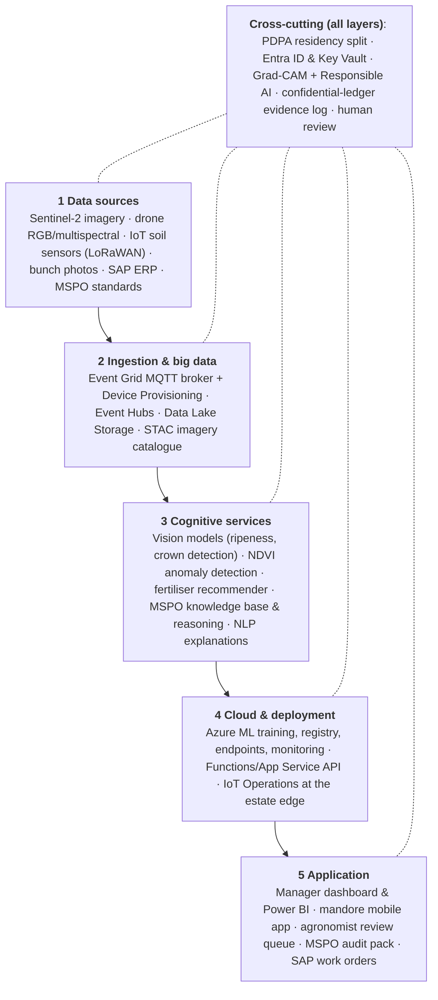

## Executive Summary

Malaysia's palm oil sector produced record output in 2025 (MPOB, 2026). That output rests on scarce harvesters, healthy palm stands and certified practice. This report analyses the case of FELDA, SD Guthrie and IOI and ranks three problems:
- **P1** labour shortage and harvest losses;
- **P2** declining stand productivity, driven mainly by *Ganoderma* basal stem rot;
- **P3** MSPO compliance and fertiliser efficiency.

It proposes **SawitSense**, a cognitive decision-support application. SawitSense fuses satellite, drone and IoT soil-sensor data through computer vision, multisource anomaly detection and knowledge-based reasoning, so that estates can plan harvests, screen for disease and act on explained fertiliser advice.

Four enterprise platforms were compared on seven capability criteria. AWS scores marginally highest (89 vs Azure 85). However, Microsoft Azure is recommended because it best meets the case's three deciding constraints: estates that run SAP, weeks of offline operation, and audit-ready explanations.

A three-phase roadmap moves from a one-estate pilot to group-wide use. The main novelty is an explain-to-audit evidence log that turns every decision into tamper-evident MSPO and EUDR evidence.

---

## 1 Introduction

In 2025 Malaysia's 5.70 million hectares of oil palm produced 20.28 million tonnes of crude palm oil (CPO), the highest in ten years, and palm product exports earned RM112.4 billion (Malaysian Palm Oil Board (MPOB), 2026). The case concerns three producers that typify the sector: the FELDA settlement scheme, the multinational SD Guthrie and the digitising IOI Corporation.

All three face the same difficulty. Key field decisions depend on human judgement over images, sensor readings and regulations: when to harvest, which palms are diseased and how much fertiliser to apply. The workforce that supplies that judgement is shrinking (The Edge Malaysia, 2026). Cognitive computing systems perceive patterns, reason over domain knowledge and explain their conclusions, which suits them to this task.

The report is in three parts. Part 1 analyses the case and ranks the problems. Part 2 proposes SawitSense, evaluates platforms and plans integration. Part 3 explains the solution's novelty and how it can be extended.

---

# Part 1 — Case Analysis & Problem Identification

## 1.1 The Case: Organisations, Stakeholders and Current Situation

**Organisations.**
- **FELDA**, the national land-settlement agency, controls about 870,000 ha. Around 490,000 ha are worked by settlers, and about 330,000 ha of commercial estates are run by FGV, which FELDA has taken private (The Edge Malaysia, n.d.). The scheme supports 112,635 settler families (New Straits Times, 2019).
- **SD Guthrie** (formerly Sime Darby Plantation) has raised its land-to-labour ratio from 10.7 to 13–13.5 ha per worker, and its target is 15 ha by 2028. It states that harvesting still has no mechanised solution (The Edge Malaysia, 2025). Its estate master data and accounting run on SAP (BSI Services Malaysia, 2023).
- **IOI** has rolled out SAP S/4HANA across its estates, mills and refinery (IOI Corporation Berhad, 2020).

These are three distinct operating models: a settler scheme, a multinational estate group and a digitising estate group. A useful solution must work for smallholders as well as for ERP-integrated estates.

**Stakeholders and their stakes.**
- **Estate managers and harvest supervisors (*mandores*)** are accountable for crop recovered per worker.
- **Agronomists** must balance yield against a fertiliser bill that makes up about 30 % of production cost (Chong, 2026).
- **MSPO officers** must evidence certified practice.
- **Mill graders** settle oil-content disputes.
- **Settlers and smallholders** need certification at low cost.
- **The regulators, MPOB and MSPO, and EU buyers** require traceable, deforestation-free supply (MSPO and EFI, 2025; European Commission, 2026).

**Current situation.** MPOB attributes the 2025 gains to better labour supply and a higher share of ripe bunches (MPOB, 2026). Field decisions, however, remain largely manual:
- **Ripeness grading.** Bunches are still mostly graded by eye. Mills inspect only 50–100 bunches from each 5–20 t consignment, which leads to disputes (Abdul Hadi et al., 2026).
- ***Ganoderma* detection.** The disease is found by visual census once symptoms appear (Khoo and Chong, 2023).
- **Fertiliser.** Growers apply uniform per-palm rates and cut them across the board when prices rise (Chong, 2026).
- **Certification records.** MSPO records are compiled as separate paperwork, and they lack the plot polygons and plot-level traceability that the EUDR requires (MSPO and EFI, 2025).

The sector is therefore high-performing but fragile.

## 1.2 Key Problems, Evidence and Prioritisation

The problems in the case brief were tested against published evidence and ranked on four criteria (Table 1):
- scale of loss;
- urgency;
- how far today's remedy depends on scarce labour;
- *cognitive addressability*, meaning whether the binding constraint is information and judgement.

*Table 1: Problem prioritisation*

| Problem | Scale of loss | Urgency | Labour dependence of current remedy | Cognitive addressability | Rank |
|---|---|---|---|---|---|
| P1 Labour shortage & harvest losses | RM7.5–20 bn/yr (employer estimate); ≈RM2.2 bn per 0.5-pt OER | High: 30,000 workers short (2026) | Very high: grading and rounds by scarce harvesters | High | **1** |
| P2 *Ganoderma* BSR (+ ageing) | 43 % loss within 6 months; 860,610 ha at risk by 2040 | Medium–high: progressive, hidden | High: visual census | High for BSR; low for ageing | **2** |
| P3 MSPO compliance & fertiliser | Fertiliser ≈30 % of cost; market access | High: EUDR from Dec 2026 | Medium: clerical | High | **3** |

**P1 Labour shortage and harvest losses.**
- *Workforce.* About 80 % of plantation workers are foreign. Employers estimate the cost of shortages at RM7.5–20 billion a year (Ramendran, 2026).
- *Current shortfall.* In October 2026 the sector was 30,000 workers short, and replacing a worker takes about six months. In 2021 about RM1 billion of ripe fruit went unharvested (The Edge Malaysia, 2026).
- *Harvesting rounds.* Shortages stretch rounds from the recommended 7–13 days to 20–25 days, which degrades bunch quality (Ahmad et al., 2020).
- *Oil extraction rate.* OER is sensitive to that quality: MPOB credits the 2025 OER gain to a higher share of ripe fruit (MPOB, 2026). Mills processed about 103 Mt of fresh fruit bunches (FFB) in 2025 (20.28 Mt CPO ÷ 19.74 % OER). Each 0.5-point OER loss is therefore about 0.51 Mt of CPO, or RM2.2 billion at RM4,292.50/t (authors' calculation from MPOB, 2026).

The shortage eased in 2024–25 and is now returning (The Edge Malaysia, 2026), so the need is structural resilience.

**P2 Declining stand productivity: *Ganoderma* (primary) and ageing.**
- *Scale.* Basal stem rot (BSR) can cut a plantation's economic return by 43 % within six months. It could destroy 860,610 ha of Malaysian mature palms by 2040 (Olaniyi and Szulczyk, 2020, cited in Khoo and Chong, 2023).
- *Detection.* Palms show no symptoms until infection is about 60–70 % advanced. Laboratory tests are too slow and costly to apply to every palm (Khoo and Chong, 2023).
- *Ageing.* Ageing stands also depress yield, but the constraint there is replanting capital. Blocks that miss the replanting window stay unsuited to mechanisation for decades (The Edge Malaysia, 2025).

BSR is therefore the cognitively addressable part of P2.

**P3 MSPO compliance and fertiliser efficiency.**
- *Certification.* MSPO certification is mandatory and covers 87 % of planted area. The 2022 standard adds a deforestation cut-off of 31 December 2019 (MSPO and EFI, 2025).
- *Which parts apply.* Large estates are certified under MS 2530-3-2:2022 (>500 ha), and mills under MS 2530-4-1:2022.
- *What is required.* The standard requires site-management SOPs with implementation records, for example for fertilising (4.1.3); FFB traceability (4.2.2); and annual GHG reporting (4.5.4) (MPOCC, 2023a; 2023b).
- *Fertiliser.* Fertiliser is about 30 % of production cost, and a 40 % cut can reduce yields by at least 20 % (Chong, 2026).
- *EUDR.* The EUDR applies to large operators from 30 December 2026 (European Commission, 2026). The EU takes only 6.8 % of exports, however (MPOB, 2026), so MSPO is the driver that applies to every producer.

**Interaction.** *Ganoderma* census and compliance paperwork draw on the same scarce labour as harvesting (Khoo and Chong, 2023; The Edge Malaysia, 2026). P1 is therefore the root priority, and one integrated system is preferable to three tools.

## 1.3 Cognitive Computing Capabilities for Each Problem

Each problem is matched to the capability that removes its binding constraint (Table 2).

**P1: computer-vision pattern recognition with forecasting and optimisation.**
- *Capability.* Deep-learning detectors classify bunch ripeness from drone and ground images. A YOLO11 model trained on 11,613 drone images reached 98.3 % mAP at about 7.7 ms per frame (Che Hassan et al., 2026).
- *From grades to a plan.* Per-block counts of ripe bunches feed a time-to-ripe regression model, which starts from an agronomic rule baseline and learns from logged grades. A greedy assignment optimiser then allocates the available crews to the blocks where the most ripe bunches would otherwise over-ripen.
- *Why conventional methods fall short.* Human grading needs the workers who are missing, samples under 0.4 % of each load and invites disputes (Abdul Hadi et al., 2026). An ERP system cannot read images at all.
- *Explanation.* Grad-CAM heat-maps and confidence scores explain each grade.

**P2: multisource machine-learning anomaly detection with spatial reasoning.**
- *Capability.* A screening cascade fuses weak signals. Sentinel-2 NDVI time series flag blocks that are losing vigour. A drone-image detector flags suspect crowns. A rule then raises the risk of palms within the four-row root-contact zone (Khoo and Chong, 2023).
- *Why conventional methods fall short.* Census finds palms only once symptoms show, whereas satellite screening covers every palm.
- *Limits.* Published early-detection accuracy is 64–84 % (Kwang et al., 2025), so SawitSense ranks palms for laboratory confirmation and does not diagnose them.

**P3: knowledge representation and reasoning with explainable machine learning.**
- *Capability.* A knowledge base encodes agronomic thresholds and MSPO criteria (MPOCC, 2023a). A recommender reads soil-sensor data (moisture, pH, conductivity, temperature) and proposes to fertilise, lime, irrigate or skip. The knowledge base constrains and explains each proposal. Natural language processing (NLP) renders the explanations in Bahasa Malaysia and English.
- *Why conventional methods fall short.* A conventional dashboard can display an acidic reading. It cannot infer that the block needs lime before fertiliser, or record why.
- *Counterfactual explanations.* These state what would change the advice, for example "had pH been inside the knowledge base's optimal band, the advice would be to fertilise". They let agronomists challenge the model, and the Azure Responsible AI dashboard generates them for tabular models such as this one (Microsoft, 2025).
- *Audit evidence.* Each recommendation is stored with its data and its MSPO clause, so compliance evidence becomes a by-product of work.

*Table 2: Conventional and cognitive approaches compared*

| Problem | Conventional method and its limit | Cognitive capability | Why it is better suited |
|---|---|---|---|
| P1 | Visual grading on fixed rounds: needs scarce harvesters, samples <0.4 % of loads, blind between rounds | Computer vision + time-to-ripe forecasting + crew assignment | Grades every visible bunch consistently without extra labour and produces a harvest plan |
| P2 | Visual census + laboratory tests: finds BSR only at 60–70 % infection | Multisource anomaly detection + spatial reasoning | Screens all palms continuously and sends experts to the highest-risk palms first |
| P3 | Uniform per-palm rates + paper records: blind between samples | Knowledge-based reasoning + explainable ML + NLP | Site-specific, explained advice; MSPO evidence produced automatically |

In each case the constraint is judgement over unstructured, fast-changing evidence, applied at a scale the workforce cannot supply. Conventional systems store such data; cognitive systems perceive it, reason over it and explain their conclusions.

---

# Part 2 — Technology Evaluation & Solution Proposal

## 2.1 The Proposed Application: SawitSense

**SawitSense** joins *sawit*, Malay for oil palm, with *sense*, meaning both sensing and sense-making. It is a cognitive decision-support platform that turns satellite, drone, soil-sensor and bunch-image data into explained decisions. Its five core functions map onto the Part 1 problems and the case outcomes O1–O4:

- **F1 Ripeness grading and harvest window** (P1, O1). Grades bunches from images; a time-to-ripe model forecasts when each block is ready.
- **F2 Harvester allocation** (P1, O4). Assigns the available crews to the blocks with the most ripe bunches at risk.
- **F3 *Ganoderma* screening cascade** (P2, O2). Works from satellite to drone to ground and produces a ranked check-list of palms for confirmation.
- **F4 Explained fertiliser, lime and irrigation advice** (P3, O3). Combines soil sensors with the agronomic knowledge base.
- **F5 Explain-to-audit evidence log** (P3, O4). Links each decision to an MSPO criterion and exports audit packs (MPOCC, 2023a).

**Target users** are:
- estate managers, through a dashboard of daily priorities and KPIs;
- harvest *mandores*, through a mobile app with multilingual text for a largely foreign workforce (Ramendran, 2026);
- agronomists, through a review queue to approve or override advice;
- plant-health officers, through ranked palm check-lists;
- MSPO officers, through audit packs;
- the IT team, through the model registry and ERP integration.

Smallholder co-operatives, including FELDA's 112,635 settler families (New Straits Times, 2019), are a later-phase user group.

## 2.2 Underlying Technologies and Layered Architecture

Figure 1 adapts the assignment's layered reference architecture to the plantation case. Each technology was chosen for a capability that a Part 1 problem requires.

*Figure 1: SawitSense layered architecture (adapted from the assignment's Figure 4)*

- **Data sources.** P2 needs evidence at several scales. Open Sentinel-2 Level-2A imagery covers every block (Google Earth Engine, n.d.), drones resolve individual crowns, and soil sensors give P3 the continuous readings that periodic sampling lacks.
- **Ingestion and big data.** An MQTT broker handles device telemetry and commands, Event Hubs streams events, and the data lake stores raw and curated imagery and readings. Azure IoT Operations feeds these services from each estate (Microsoft, 2026b).
- **Cognitive services.** Convolutional detectors suit ripeness grading (Che Hassan et al., 2026). Anomaly detection over NDVI time series suits a disease that is invisible early (Khoo and Chong, 2023). A rule-constrained recommender with a knowledge base suits a regulated decision.
- **Cloud and deployment.** Azure Machine Learning provides managed training, versioned models and monitored endpoints. Its Responsible AI dashboard gives interpretability and counterfactuals for the tabular fertiliser model only (Microsoft, 2025), so the image models use Grad-CAM.
- **Edge.** IoT Operations keeps processing locally during outages and has been validated after up to 45 days offline (Microsoft, 2026b). This matters for remote blocks under the canopy.
- **NLP.** A language model rewrites the structured explanations into Bahasa Malaysia and English. It receives only non-personal text and never makes the decision.

## 2.3 Evaluation of Enterprise Platforms and Recommendation

Four platforms were compared: Microsoft Azure, Amazon Web Services (AWS), Google Cloud's Gemini platform (formerly Vertex AI) and IBM watsonx. Seven criteria were derived from the Part 1 problems and scored from 1 to 5 against vendor documentation (Table 3). Price was excluded; at enterprise scale, cost is managed as a risk (Section 2.5).

*Table 3: Weighted capability matrix (scores 1–5; total = Σ score × weight ÷ 5). Sensitivity: equal weights; geospatial-heavy = C4 30, C1/C2/C5/C7 10, C3/C6 15*

| Criterion (weight) | Linked problem | Azure | AWS | Google | IBM |
|---|---|---|---|---|---|
| C1 First-party IoT & device provisioning (15) | P3 | 5 | 5 | 2 | 1 |
| C2 In-country hosting & residency (15) | P1, P3 | 4 | 5 | 2 | 1 |
| C3 Vision model training (15) | P1, P2 | 4 | 5 | 5 | 3 |
| C4 Geospatial & satellite services (15) | P2, P3 | 3 | 3 | 5 | 2 |
| C5 Edge & offline operation (10) | P1–P3 | 5 | 4 | 2 | 2 |
| C6 MLOps, monitoring & explainability (15) | P1–P3 | 4 | 5 | 4 | 5 |
| C7 Integration with estate ERP (15) | P1, P3 | 5 | 4 | 3 | 3 |
| **Total /100 (base)** | | **85** | **89** | **67** | **49** |
| Equal weights / geospatial-heavy | | 86 / 80 | 89 / 84 | 66 / 75 | 49 / 50 |

**Reading the matrix honestly.** On breadth of capability, AWS ranks first under every weighting, and its lead over Azure is 3–4 points, within the subjectivity of 1–5 scoring. AWS is a strong runner-up on three counts:
- its Malaysian region hosts IoT Core, Greengrass, SageMaker and Rekognition (Amazon Web Services, 2025);
- SageMaker Clarify explains image classifiers and detectors as well as tabular models (Amazon Web Services, n.d.a);
- for Azure, IoT Hub and Azure ML do not currently appear in the Malaysia West regional listings (Microsoft, 2026a).

Google leads on vision and geospatial data, but it retired Cloud IoT Core in 2023 (Google Cloud, n.d.) and lists no Malaysian region (Google Cloud, 2026). IBM retired its Watson IoT Platform (Clark, 2022). Both would leave the soil-sensor fleet without first-party device management.

**Recommendation: Microsoft Azure, on case fit.** A generic score weights every capability equally. The case, however, has three constraints from Part 1 that any solution must meet, and Azure meets them best:

1. **SAP-run estates (P1, P3).** IOI runs SAP S/4HANA across its estates and mills (IOI Corporation Berhad, 2020), and SD Guthrie keeps its estate master data on SAP (BSI Services Malaysia, 2023). Harvest plans and fertiliser actions are only useful if they become ERP work orders.
   - Azure's Logic Apps SAP connector supports IDoc, BAPI and RFC on both ECC and S/4HANA (Microsoft, n.d.a).
   - AWS AppFlow connects only through OData (Amazon Web Services, n.d.b) and is not offered in AWS's Malaysian region (Amazon Web Services, 2025).
2. **Weeks offline under the canopy (P1–P3).** Azure IoT Operations is validated to recover after up to 45 days offline (Microsoft, 2026b). The Greengrass documentation describes local action but states no validated offline duration (Amazon Web Services, n.d.c).
3. **MSPO-audit-ready explanations (P3).** Azure's Responsible AI dashboard adds counterfactual what-if explanations and a PDF scorecard that compliance staff can file (Microsoft, 2025). Clarify offers feature attributions without counterfactuals (Amazon Web Services, n.d.a).

**What choosing Azure costs.** Azure ML, Azure OpenAI and the ledger run in Southeast Asia (Singapore), under the residency safeguards in Section 2.4. Image models are explained with Grad-CAM rather than a managed service. If an estate group did not run SAP, or had reliable connectivity, AWS would be the better choice. The recommendation is therefore conditional on the case, and it is stated as such.

## 2.4 Integration with Existing IT and Phased Implementation Plan

**Integration.** SawitSense connects to the systems estates already run:
- **SAP.** The SAP connector (Microsoft, n.d.a) seeds the MSPO block reference from the SAP block master. Approved fertiliser and lime actions become SAP work orders, and harvest tickets close the yield loop. For FGV, the same pattern applies to its estate ERP.
- **Mill grading.** Mill grading results return as ripeness feedback and OER KPIs.
- **MSPO reporting.** Evidence packs and fertiliser quantities flow out for traceability (4.2.2) and GHG (4.5.4) reporting (MPOCC, 2023a; 2023b).
- **Microsoft 365.** Power BI dashboards and Teams alerts serve management.
- **Field devices.** Soil sensors reach the cloud through a LoRaWAN network server and an IoT Operations edge cluster on the estate network (Microsoft, 2026b).

**PDPA residency split.** Service placement follows Microsoft's products-by-region listing at deployment (Microsoft, 2026a).
- **Malaysia West** holds every service that touches personal data, such as worker and smallholder identities and individually linked plots: the Event Grid MQTT broker, Event Hubs, Functions, App Service, Storage and Data Lake, Data Explorer/Fabric, Logic Apps and AKS. The IoT Operations edge stays on the estate.
- **Southeast Asia** runs Azure ML, Device Provisioning, the confidential ledger and Azure OpenAI. These receive only non-personal or hashed data. This matters for the ledger in particular, because it always replicates to a paired region (Microsoft, n.d.b).
- **Safeguards.** Any personal-data transfer relies on the amended PDPA section 129 safeguards: a transfer impact assessment and a record of each transfer (Mayer Brown, 2025).

*Table 4: Phased implementation plan*

| Phase | Scope | Functions and models | Integration | Success measure |
|---|---|---|---|---|
| Short term (0–6 months): pilot | One estate, 2–3 blocks including one with BSR history | F1, F4, F5 on a rule-based baseline; F3 screening trial; human approval of every action | ERP read-only; manual audit export | Baseline recorded (e.g. round length vs the 7–13-day norm); agronomist agreement ≥80 %; audit pack accepted by internal auditor |
| Medium term (6–18 months): scale and integrate | All estates in one region | Rule-based baseline replaced by estate-trained models; harvest window learned from logged grades; F2 live; drift monitoring | SAP work-order write-back; Power BI and Teams; ledger anchoring | Rounds back within 7–13 days; fewer over-ripe bunches; fertiliser skipped where not needed |
| Long term (18–36 months): optimise and extend | Group-wide plus smallholder co-operatives | Yield forecasting; multispectral BSR detection; continuous learning from overrides; quarterly model-governance review | MSPO GHG export; EUDR geolocation package; co-operative APIs | Measurable OER gain; MSPO audits with zero record findings |

The success measures reuse the harvest-round evidence from Part 1 (Ahmad et al., 2020), so gains are measured against a stated baseline rather than assumed.

## 2.5 Integration and Implementation Risks and Mitigation

Risks were scored on likelihood × impact (each 1–3). Table 5 lists them in priority order, grouped into the assignment's three categories.

*Table 5: Prioritised risk register*

| # | Category | Risk | L×I | Mitigation | Owner |
|---|---|---|---|---|---|
| 1 | Technical | Cold start: no labelled estate data at launch; early-BSR accuracy only 64–84 % in research (Kwang et al., 2025) | 3×3 | Rule-based agronomic baseline with human review; *Ganoderma* framed as screening with ground confirmation; cross-country validation before go-live; retraining on pilot data when drift is detected | Data science lead |
| 2 | Operational | Low adoption and trust among a largely foreign, mixed-literacy workforce (Ramendran, 2026) | 3×2 | Multilingual counterfactual explanations; one-tap approve/override; *mandore* champions; paper fallback in pilot | Estate manager |
| 3 | Technical | Legacy SAP customisation and weak coverage on remote blocks | 2×3 | Read-only integration first, write-back in phase 2 (Microsoft, n.d.a); block-master clean-up; edge buffering with local rules (Microsoft, 2026b) | IT lead |
| 4 | Vendor & cost | Platform lock-in | 2×2 | Open formats (ONNX, STAC, Kafka protocol, MLflow); containerised API; AWS documented as fallback with in-country IoT and ML (Amazon Web Services, 2025) | Architecture board |
| 5 | Vendor & cost | Enterprise spend growth from GPU training, always-on endpoints and message volume | 2×2 | Budgets and alerts; edge aggregation; scheduled autoscale; drift-triggered rather than calendar retraining; quarterly FinOps review | Finance and IT |
| 6 | Vendor & cost (service availability) | Key services not offered in Malaysia West; PDPA cross-border transfer | 2×2 | Residency split with only non-personal or hashed data offshore (Microsoft, 2026a); template text if the LLM is unavailable; DPO sign-off before phase 2 (Mayer Brown, 2025) | Data protection officer |

The two highest risks concern data and people rather than technology. The pilot therefore keeps a human in every decision and treats its first six months as a data-collection phase.

---

# Part 3 — Creative Thinking & Innovation

## 3.1 Novelty Compared with an Off-the-Shelf Implementation

An off-the-shelf implementation would deploy separate point tools: a ripeness classifier, an NDVI dashboard and a sensor portal. Even MPOB's new SawitSCAN mill-grading system addresses grading alone (Abdul Hadi et al., 2026), and published drone systems stop at the grade (Che Hassan et al., 2026). SawitSense differs in five ways.

1. **Explain-to-audit evidence log.** Every decision is stored as one record containing:
   - the inputs and model version;
   - the explanation and counterfactual;
   - the human approval or override;
   - the block geolocation;
   - the MSPO criteria it supports, namely site-management SOP records (4.1.3.1), block reference (4.1.3.4), integrated pest management (4.1.3.5), traceability (4.2.2), GHG (4.5.4) and water (4.5.5) (MPOCC, 2023a).

   Record digests are anchored in Azure confidential ledger, an append-only, tamper-evident store, so any later edit is detectable (Microsoft, n.d.b). One click produces an audit pack per block and period. Compliance therefore stops being parallel paperwork and becomes a by-product of operations. The log also addresses the gaps in plot geolocation and traceability that the EUDR assessment identified (MSPO and EFI, 2025).
2. **Counterfactual, plain-language explanations.** An example: "Lime first: soil is more acidic than the knowledge base allows; inside the optimal band the advice would be to fertilise." A supervisor can read and challenge this in their own language, whereas standard feature-importance charts are written for data scientists (Microsoft, 2025).
3. **A multiscale screening cascade.** Satellite, drone and ground evidence are linked by spatial reasoning about root-contact spread (Khoo and Chong, 2023). The cascade directs scarce experts to the right palms even though model accuracy is only moderate (Kwang et al., 2025).
4. **Decisions, not just detections.** Ripeness grades become crew assignments, so the system acts on the labour constraint itself.
5. **Planned cross-country validation and a learning loop.** Before go-live, models trained on another producing country's public data will be tested on Malaysian estate images, and any drop in accuracy will be reported. After go-live, every human override becomes a training label.

## 3.2 Future Extension to the Organisation and Other Sectors

The extension follows the roadmap in Table 4.
- **Medium term, within the organisation.** Logged harvest and fertiliser data enable yield forecasting and automatic GHG inputs for MSPO criterion 4.5.4 (MPOCC, 2023a). Mills join through the traceability criterion of MS 2530-4-1 (MPOCC, 2023b).
- **Long term, smallholders.** A simplified co-operative app extends the same advice and evidence log to FELDA's 112,635 settler families (New Straits Times, 2019), supporting group certification.
- **Long term, new knowledge.** Pooled, anonymised override records from many estates show where agronomists and models disagree, by soil, region and season. Together they would form the first sector-wide benchmark of AI-assisted agronomy, which MPOB or MSPO could use to refine thresholds and guidance.
- **Other sectors.** The EUDR covers cattle, cocoa, coffee, oil palm, rubber, soya and wood (European Commission, 2026). Malaysian rubber and cocoa face the same problem of smallholder geolocation and traceability, so satellite plot verification and the evidence log transfer directly. Disease screening can follow once crop-specific models are trained.

The system would therefore evolve from estate decision support, to a traceability layer in which buyers verify ledger digests instead of re-auditing, and finally to a reusable "explained, auditable decision" pattern for regulated agricultural supply chains.

---

## Conclusion

Malaysia's record palm oil output rests on fragile foundations: scarce harvesters, a hidden soil-borne disease and tightening sustainability rules (MPOB, 2026; Khoo and Chong, 2023; MSPO and EFI, 2025). This report ranked these problems by evidence. It showed that each is limited by judgement at scale, which cognitive computing supplies better than conventional systems.

SawitSense applies three capabilities. Computer vision plans harvests, multisource anomaly detection screens for *Ganoderma*, and knowledge-based reasoning gives explained fertiliser advice. All three feed an explain-to-audit evidence log.

The platform evaluation was reported transparently. AWS leads narrowly on generic capability, but Microsoft Azure best fits this case because of SAP integration, long offline operation and audit-ready explanations (Microsoft, 2025; 2026b; n.d.a). A phased plan that begins with human review and a rule-based baseline contains the main risks, cold-start data and user trust. Beyond palm oil, the design offers EUDR-ready traceability for rubber and cocoa (European Commission, 2026).

---

## References

Abdul Hadi, N., Amer, M.A., Che Mat, C.R., Jalani, N.F., Abu Bakar, N., Mohd Anwar, M.S. and Che Soh, M.N. (2026) *SawitSCAN – Sawit (FFB) spectral capture and automatic scanning*, MPOB Information Series TT No. 698, June. Available at: https://tot.mpob.gov.my/app/files/2026/07/TT698.pdf (Accessed: 23 November 2026).

Ahmad, M.R., Jamaludin, N., Jelani, A.R., Bakri, A. and Shuib, A.R. (2020) 'The effect of design parameters on the force and energy requirement for cutting oil palm fronds using magnetic force', *Jurnal Teknologi (Sciences & Engineering)*, 82(4), pp. 141–150. doi:10.11113/jt.v82.14236 (Accessed: 23 November 2026).

Amazon Web Services (2025) *AWS regional services list* (machine-readable table, source version 2025-11-13). Available at: https://api.regional-table.region-services.aws.a2z.com/index.json (Accessed: 23 November 2026).

Amazon Web Services (n.d.a) *Model explainability* – Amazon SageMaker Clarify. Available at: https://docs.aws.amazon.com/sagemaker/latest/dg/clarify-model-explainability.html (Accessed: 23 November 2026).

Amazon Web Services (n.d.b) *SAP OData connector for Amazon AppFlow*. Available at: https://docs.aws.amazon.com/appflow/latest/userguide/sapodata.html (Accessed: 23 November 2026).

Amazon Web Services (n.d.c) *What is AWS IoT Greengrass?* – AWS IoT Greengrass V2 Developer Guide. Available at: https://docs.aws.amazon.com/greengrass/v2/developerguide/what-is-iot-greengrass.html (Accessed: 23 November 2026).

BSI Services Malaysia (2023) *RSPO P&C public summary report – SD Hadapan POM (SOU 24), annual surveillance assessment 2_3* (Sime Darby Plantation / SD Guthrie). Available at: https://bsigroup.com/siteassets/pdf/en/about-us/rspo/rspo-pc-public-summary-report-sd-hadapan-pom-sou-24-asa-2-3.pdf (Accessed: 23 November 2026).

Che Hassan, C.A.Z., Muhammad Razif, M.R., Mohd, M.N., Abd Halim, A., Mohd Mustapha, N.H. and Azman, M.N. (2026) 'Real-time oil palm fresh fruit bunch drone image classification using YOLO11 architecture', *Journal of Oil Palm Research* (article in press, published online 17 August). doi:10.21894/jopr.2026.0033 (Accessed: 23 November 2026).

Chong, R. (2026) 'Lower palm oil yields loom as Sabah growers cut fertiliser', *The Star*, 20 August. Available at: https://www.thestar.com.my/news/nation/2026/08/20/lower-palm-oil-yields-loom-as-sabah-growers-cut-fertiliser (Accessed: 23 November 2026).

Clark, L. (2022) 'IBM to fire Watson IoT Platform from its cloud', *The Register*, 15 November. Available at: https://www.theregister.com/2022/11/15/ibm_set_to_retire_watson/ (Accessed: 23 November 2026).

European Commission (2026) *Regulation on deforestation-free products* (Regulation (EU) 2023/1115). Available at: https://environment.ec.europa.eu/topics/forests/deforestation/regulation-deforestation-free-products_en (Accessed: 23 November 2026).

Google Cloud (2026) *Regions and zones* (Compute Engine documentation). Available at: https://docs.cloud.google.com/compute/docs/regions-zones (Accessed: 23 November 2026).

Google Cloud (n.d.) *Google.Cloud.Iot.V1 .NET client library reference* (deprecation notice). Available at: https://docs.cloud.google.com/dotnet/docs/reference/Google.Cloud.Iot.V1/latest (Accessed: 23 November 2026).

Google Earth Engine (n.d.) *Harmonized Sentinel-2 MSI: MultiSpectral Instrument, Level-2A (COPERNICUS/S2_SR_HARMONIZED)*. Available at: https://developers.google.com/earth-engine/datasets/catalog/COPERNICUS_S2_SR_HARMONIZED (Accessed: 23 November 2026).

IOI Corporation Berhad (2020) *IOI Corp enhances operational efficiencies with S/4HANA* (republished from New Straits Times, 29 July). Available at: https://www.ioigroup.com/news/ioi-corp-enhances-operational-efficiencies-with-s4hana (Accessed: 23 November 2026).

Khoo, Y.W. and Chong, K.P. (2023) '*Ganoderma boninense*: general characteristics of pathogenicity and methods of control', *Frontiers in Plant Science*, 14, 1156869. doi:10.3389/fpls.2023.1156869 (Accessed: 23 November 2026).

Kwang, C.S., Razak, S.F.A., Yogarayan, S., Bin Muhammad, A.M.M., Ling, C.A., Bakar, S.A. and Abidin, H. (2025) 'Ganoderma detection in oil palm plantations using UAV hyperspectral imaging and AI', in *Proceedings of TENCON 2025 – IEEE Region 10 Conference*. Kota Kinabalu, 27–30 October. Available at: https://shdl.mmu.edu.my/15767/ (Accessed: 23 November 2026).

Malaysian Palm Oil Board (MPOB) (2026) *Overview of the Malaysian Oil Palm Industry in 2025*. Bangi: MPOB. Available at: https://bepi.mpob.gov.my/images/overview/Overview2025.pdf (Accessed: 23 November 2026).

Malaysian Palm Oil Certification Council (MPOCC) (2023a) *Guidance document for MS2530-3-2:2022 General principles for oil palm plantations (more than 500 hectares)*, Version 1.0, May. Available at: https://mspo.org.my/wp-content/uploads/2025/08/Guidance-document-for-MSPO-Part-3-2.pdf (Accessed: 23 November 2026).

Malaysian Palm Oil Certification Council (MPOCC) (2023b) *Guidance document for MS2530-4-1:2022 General principles for palm oil mill including supply chain requirements*. Available at: https://mspo.org.my/wp-content/uploads/2025/08/Guidance-document-for-MSPO-Part-4-1.pdf (Accessed: 23 November 2026).

Malaysian Sustainable Palm Oil (MSPO) and European Forest Institute (EFI) (2025) *Joint gap assessment of the EUDR information needs and information availability from the Malaysian Sustainable Palm Oil (MSPO) certification*. Available at: https://www.forest-trends.org/wp-content/uploads/2022/01/2025-MSPO_EUDR-Joint_Gap_Assessment.pdf (Accessed: 23 November 2026).

Mayer Brown (2025) *From legislative reform to practical guidance: key amendments to Malaysia's PDPA and the launch of cross-border transfer guidelines*, 25 July. Available at: https://www.mayerbrown.com/en/insights/publications/2025/07/from-legislative-reform-to-practical-guidance-key-amendments-to-malaysias-pdpa-and-the-launch-of-cross-border-transfer-guidelines (Accessed: 23 November 2026).

Microsoft (2025) *Assess AI systems and make data-driven decisions with Azure Machine Learning Responsible AI dashboard*. Microsoft Learn. Available at: https://learn.microsoft.com/en-us/azure/machine-learning/concept-responsible-ai-dashboard (Accessed: 23 November 2026).

Microsoft (2026a) *Azure Retail Prices REST API* (queried for armRegionName 'malaysiawest' and 'southeastasia'). Available at: https://prices.azure.com/api/retail/prices (Accessed: 23 November 2026).

Microsoft (2026b) *What is Azure IoT Operations?* Microsoft Learn. Available at: https://learn.microsoft.com/en-us/azure/iot-operations/overview-iot-operations (Accessed: 23 November 2026).

Microsoft (n.d.a) *Access SAP from workflows* (Azure Logic Apps SAP connector). Microsoft Learn. Available at: https://learn.microsoft.com/en-us/azure/logic-apps/logic-apps-using-sap-connector (Accessed: 23 November 2026).

Microsoft (n.d.b) *Data residency for Azure confidential ledger*. Microsoft Learn. Available at: https://learn.microsoft.com/en-us/azure/confidential-ledger/data-residency (Accessed: 23 November 2026).

New Straits Times (2019) 'Felda seeking investors for hitech agriculture and cash cropping', 25 February; republished by MPOB Palm News. Available at: https://prestasisawit.mpob.gov.my/en/palmnews/news/27078 (Accessed: 23 November 2026).

Ramendran, C. (2026) 'Plantation sector hit hard by labour shortage', *The Star*, 1 March. Available at: https://www.thestar.com.my/news/nation/2026/03/01/plantation-sector-hit-hard-by-labour-shortage (Accessed: 23 November 2026).

The Edge Malaysia (2025) 'Cover Story: Positioning SD Guthrie for next stage of growth', *The Edge Malaysia Weekly*, 15–21 December. Available at: https://theedgemalaysia.com/node/786139 (Accessed: 23 November 2026).

The Edge Malaysia (2026) 'Cover Story 1: Can Malaysian planters avert another migrant worker crunch?', *The Edge Malaysia Weekly*, 9–15 November. Available at: https://theedgemalaysia.com/node/825330 (Accessed: 23 November 2026).

The Edge Malaysia (n.d.) 'Felda's road ahead in the spotlight', *The Edge Malaysia*, 6 October. Available at: https://theedgemalaysia.com/node/820636 (Accessed: 23 November 2026).

---

## Appendix A — Progress Report

Group: [GroupNo] · Lecturer: [Lecturer name]

*Table A1: Project timeline*

| Date (2026) | Milestone | Owner |
|---|---|---|
| 23 Nov | Case selected; problems validated with evidence; sources compiled | [Member 1 – Leader], [Member 2] |
| 23–26 Nov | Problem prioritisation and cognitive-capability analysis (Part 1) | [Member 2] |
| 26 Nov – 3 Dec | Solution design, architecture and AI models (Part 2.1–2.2) | [Member 3] |
| 3–6 Dec | Platform evaluation, integration plan and risks (Part 2.3–2.5) | [Member 4] |
| 6–10 Dec | Novelty and extension (Part 3); report drafting | [Member 5] |
| 10–12 Dec | Compliance review against rubric; revisions | [Member 1 – Leader] |
| 14 Dec | Final report submitted; presentation rehearsal | All |

*Table A2: Member contributions*

| Member | Student ID | Role | Main contribution |
|---|---|---|---|
| [Member 1 – Leader] | [ID] | Project lead | [Contribution] |
| [Member 2] | [ID] | [Role] | [Contribution] |
| [Member 3] | [ID] | [Role] | [Contribution] |
| [Member 4] | [ID] | [Role] | [Contribution] |
| [Member 5] | [ID] | [Role] | [Contribution] |
