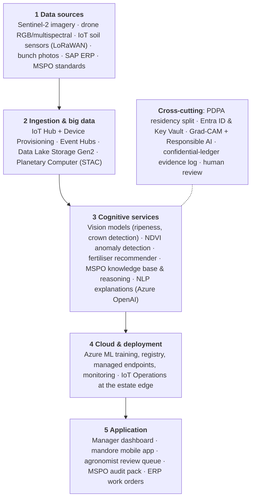

## Executive Summary

Malaysia's palm oil sector produced record output in 2025 (MPOB, 2026), yet those gains depend on scarce harvesters, healthy palm stands and certified practice. This report analyses the case of FELDA, SD Guthrie and IOI and ranks three problems: (P1) labour shortage and harvest losses; (P2) declining stand productivity, driven mainly by *Ganoderma* basal stem rot; and (P3) MSPO compliance and fertiliser efficiency. It proposes **SawitSense**, a cognitive decision-support application. SawitSense fuses satellite, drone and IoT soil-sensor data through computer vision, multisource anomaly detection and knowledge-based reasoning. It plans harvests, screens for disease and gives explained fertiliser advice. A capability-only evaluation of four enterprise platforms ranks Microsoft Azure first (88/100) for its Malaysian region, first-party IoT with an offline edge, and SAP integration. A three-phase roadmap runs from a one-estate pilot to group-wide use. The main novelty is an explain-to-audit evidence log that turns every decision into tamper-evident MSPO and EUDR evidence.

---

## 1 Introduction

In 2025 Malaysia's 5.70 million hectares of oil palm produced a ten-year high of 20.28 million tonnes of crude palm oil (CPO). Palm product exports earned RM112.4 billion (Malaysian Palm Oil Board (MPOB), 2026). The case concerns three producers that typify the sector: the FELDA settlement scheme, the multinational SD Guthrie and the digitising IOI Corporation. They share one difficulty. Key field decisions depend on human judgement over images, sensor readings and regulations: when to harvest, which palms are diseased, how much fertiliser to apply. The workforce that supplies that judgement is shrinking (The Edge Malaysia, 2026). Cognitive computing systems perceive patterns, reason over domain knowledge and explain their conclusions, which makes them suited to this task. Part 1 analyses the case and ranks the problems. Part 2 proposes SawitSense, evaluates platforms and plans integration. Part 3 explains its novelty and how it can be extended.

---

# Part 1 — Case Analysis & Problem Identification

## 1.1 The Case: Organisations, Stakeholders and Current Situation

**Organisations.** FELDA, the national land-settlement agency, controls about 870,000 ha. Around 490,000 ha are worked by settlers, and about 330,000 ha of commercial estates are run by FGV, which FELDA has taken private (The Edge Malaysia, n.d.). The scheme supports 112,635 settler families (New Straits Times, 2019). SD Guthrie (formerly Sime Darby Plantation) has raised its land-to-labour ratio from 10.7 to 13–13.5 ha per worker and is targeting 15 ha by 2028. It states that harvesting still has no mechanised solution (The Edge Malaysia, 2025). IOI has built more than 100 4G/LTE sites across more than 100 estates to support IoT and data-led management (IOI Corporation Berhad, 2026). These are three distinct operating models: a settler scheme, a multinational estate group and a digitising estate group. A useful solution must therefore serve smallholders as well as well-connected estates.

**Stakeholders.** The direct users are estate managers, harvest supervisors (*mandores*), agronomists, plant-health and MSPO officers, and mill graders. Affected parties include settlers and smallholders, the regulators MPOB and MSPO, and EU buyers subject to deforestation due diligence (MSPO and EFI, 2025; European Commission, 2026).

**Current situation.** MPOB attributes the 2025 gains to better labour supply and a higher share of ripe bunches reaching mills (MPOB, 2026). Field decisions remain manual, however:
- ripeness is judged by eye on fixed harvesting rounds (Ma, n.d.);
- *Ganoderma* is found by visual census (Khoo and Chong, 2023);
- fertiliser follows blanket schedules (Chong, 2026).

MSPO records are compiled as separate paperwork. MSPO data also lack the plot polygons and plot-level traceability that the EUDR requires (MSPO and EFI, 2025). The sector is therefore high-performing but fragile. Its gains rest on scarce labour and on decisions that are not recorded where they are made.

## 1.2 Key Problems, Evidence and Prioritisation

The problems in the case brief were tested against published evidence. Each was then ranked on four criteria:
- scale of loss;
- urgency;
- how far today's remedy depends on scarce labour;
- *cognitive addressability*, meaning whether the binding constraint is information and judgement (Table 1).

*Table 1: Problem prioritisation*

| Problem | Scale of loss | Urgency | Labour dependence of current remedy | Cognitive addressability | Rank |
|---|---|---|---|---|---|
| P1 Labour shortage & harvest losses | RM7.5–20 bn/yr (employer estimate); ≈RM2.2 bn per 0.5-pt OER | High: 30,000 workers short (2026) | Very high: grading by scarce harvesters | High | **1** |
| P2 *Ganoderma* BSR (+ ageing) | 43 % loss within 6 months; 860,610 ha at risk by 2040 | Medium–high: progressive, hidden | High: visual census | High for BSR; low for ageing | **2** |
| P3 MSPO compliance & fertiliser | Fertiliser ≈30 % of cost; market access | High: EUDR from Dec 2026 | Medium: clerical | High | **3** |

**P1 Labour shortage and harvest losses.**
- *Workforce.* About 80 % of plantation workers are foreign, and employers estimate the cost of shortages at RM7.5–20 billion a year (Ramendran, 2026).
- *The current shortfall.* In October 2026 the sector was 30,000 workers short, and replacing a worker takes about six months. Policy aims to cut foreign workers to 10 % of the workforce by 2030. In 2021 about RM1 billion of ripe fruit went unharvested (The Edge Malaysia, 2026).
- *Quality as well as volume.* Short of labour, estates cut more under-ripe bunches to avoid collecting loose fruit, which lowers the oil extraction rate (OER) (Ma, n.d.).
- *The cost of lost OER.* Mills processed about 103 Mt of fresh fruit bunches (FFB) in 2025 (20.28 Mt CPO ÷ 19.74 % OER). Each 0.5-point loss of OER is therefore about 0.51 Mt of CPO, or RM2.2 billion at the 2025 average price of RM4,292.50/t (authors' calculation from MPOB, 2026).

The shortage eased in 2024–25 and is now returning (The Edge Malaysia, 2026). The need is therefore structural resilience, not crisis response.

**P2 Declining stand productivity: *Ganoderma* (primary) and ageing.**
- *Scale.* Basal stem rot (BSR) can cut a plantation's economic return by 43 % within six months. Modelling suggests it could destroy 860,610 ha of Malaysian mature palms by 2040 (Khoo and Chong, 2023).
- *Detection.* Palms show no symptoms until infection is about 60–70 % advanced, and laboratory tests are too slow and costly to apply to every palm (Khoo and Chong, 2023).
- *Ageing.* Ageing stands also depress yield, but the constraint there is replanting capital. Blocks that miss the replanting window stay unsuited to mechanisation for decades (The Edge Malaysia, 2025).

BSR is therefore the cognitively addressable part of P2.

**P3 MSPO compliance and fertiliser efficiency.**
- *MSPO.* Certification is mandatory and covers 87 % of planted area. The MS 2530:2022 standard adds a deforestation cut-off of 31 December 2019 and tighter traceability (MSPO and EFI, 2025).
- *Records required.* The standard requires records for fertilising and soil fertility (criterion 4.1.3), FFB traceability (4.2.2), and GHG reporting that includes nitrous oxide from fertiliser (4.5.4) (MPOCC, 2023).
- *Fertiliser.* Fertiliser is about 30 % of production cost, and a 40 % cut can reduce yields by at least 20 % (Chong, 2026).
- *EUDR.* The EUDR applies to large operators from 30 December 2026 (European Commission, 2026). However, the EU takes only 6.8 % of Malaysian palm oil exports (MPOB, 2026), so MSPO is the driver that applies to every producer.

**Interaction.** *Ganoderma* census and compliance paperwork draw on the same scarce field and supervisory labour as harvesting (Khoo and Chong, 2023; The Edge Malaysia, 2026). P1 is therefore the root priority, and one integrated system is preferable to three separate tools.

## 1.3 Cognitive Computing Capabilities for Each Problem

Each problem is matched to the capability that removes its binding constraint (Table 2).

**P1: computer-vision pattern recognition with scheduling.**
- *Capability.* Deep-learning detectors classify bunch ripeness from drone and ground images. A YOLO11 model trained on 11,613 drone images reached 98.3 % mAP at about 7.7 ms per frame and logged results for each tree (Che Hassan et al., 2026).
- *From grades to a plan.* Counts of ripe bunches per block feed a harvest-window forecast and an optimiser that assigns the available crew.
- *Why conventional methods fall short.* Human grading cannot scale this way. It needs the workers who are missing, varies between graders (which feeds estate–mill disputes over oil content), and sees nothing between rounds (Ma, n.d.). An ERP or scheduling system cannot read images at all.
- *Explanation.* Each grade comes with a Grad-CAM heat-map and a confidence score.

**P2: multisource machine-learning anomaly detection with spatial reasoning.**
- *Capability.* A screening cascade fuses weak signals. Sentinel-2 NDVI time series flag blocks that are losing vigour. A drone-image detector flags suspect crowns. A rule then raises the risk of palms within the four-row root-contact zone (Khoo and Chong, 2023).
- *Why conventional methods fall short.* Visual census finds palms only once symptoms show. Learned spectral patterns can flag stress earlier, and satellite screening covers every palm.
- *Limits.* Published early-detection accuracy is only 64–84 % (Kwang et al., 2025), and spectral signals can confuse disease with nutrient deficiency (Khoo and Chong, 2023). SawitSense therefore ranks palms for laboratory confirmation; it does not diagnose them.

**P3: knowledge representation and reasoning with explainable machine learning.**
- *Capability.* A knowledge base encodes agronomic thresholds and the MS 2530:2022 criteria (MPOCC, 2023). A recommender reads soil-sensor data (moisture, pH, conductivity, temperature) and proposes fertilise, lime, irrigate or skip. The knowledge base constrains each proposal and explains it. Natural language processing (NLP) renders the explanations in Bahasa Malaysia and English.
- *Why conventional methods fall short.* A conventional dashboard can display a pH of 3.8. It cannot infer that the block needs lime before fertiliser, or record why.
- *Explanation.* Counterfactual explanations let agronomists challenge the model; for example, "had pH been 4.2 or higher, the advice would be to fertilise". The Azure Responsible AI dashboard provides these explanations for tabular models such as this one (Microsoft, 2025).
- *Audit evidence.* Each recommendation is stored with its data and the MSPO clause it supports, so compliance evidence becomes a by-product of normal work.

*Table 2: Conventional and cognitive approaches compared*

| Problem | Conventional method and its limit | Cognitive capability | Why it is better suited |
|---|---|---|---|
| P1 | Visual grading on fixed rounds: needs scarce harvesters, inconsistent, blind between rounds | Computer vision + harvest-window forecasting + crew optimisation | Grades every visible bunch consistently without extra labour and produces a harvest plan |
| P2 | Visual census + laboratory tests: finds BSR only at 60–70 % infection | Multisource anomaly detection + spatial reasoning | Screens all palms continuously and sends experts to the highest-risk palms first |
| P3 | Blanket schedules + paper records: blind between samples | Knowledge-based reasoning + explainable ML + NLP | Site-specific, explained advice; MSPO evidence produced automatically |

In all three problems the constraint is the same. Judgement over unstructured, fast-changing evidence must be applied at a scale the workforce cannot supply. Conventional systems store such data; cognitive systems perceive it, reason over it and explain their conclusions.

---

# Part 2 — Technology Evaluation & Solution Proposal

## 2.1 The Proposed Application: SawitSense

**SawitSense** joins *sawit*, Malay for oil palm, with *sense*, meaning both sensing and sense-making. It is a cognitive decision-support platform that turns satellite, drone, soil-sensor and bunch-image data into explained decisions. Its five core functions map onto the Part 1 problems and the case outcomes (O1–O4):

- **F1 Ripeness grading and harvest window** (P1, O1): grades bunches from images and forecasts when each block is ready.
- **F2 Harvester allocation** (P1, O4): assigns the available crews to the blocks with the most ripe bunches at risk.
- **F3 *Ganoderma* screening cascade** (P2, O2): moves from satellite to drone to ground and produces a ranked check-list of palms for confirmation.
- **F4 Explained fertiliser, lime and irrigation advice** (P3, O3): bases advice on soil sensors and the agronomic knowledge base.
- **F5 Explain-to-audit evidence log** (P3, O4): links each decision to an MSPO criterion and exports audit packs (MPOCC, 2023).

**Target users** are:
- estate managers, who get a dashboard of daily priorities and KPIs;
- harvest *mandores*, who get a mobile app with multilingual text for a largely foreign workforce (Ramendran, 2026);
- agronomists, who get a review queue to approve or override advice;
- plant-health officers, who get ranked palm check-lists;
- MSPO officers, who get audit packs;
- the IT team, who get the model registry and the ERP integration.

Smallholder co-operatives, including FELDA's 112,635 settler families (New Straits Times, 2019), are a later-phase user group.

## 2.2 Underlying Technologies and Layered Architecture

Figure 1 adapts the assignment's layered reference architecture to the plantation case. Each technology was chosen for a capability that a Part 1 problem requires.

*Figure 1: SawitSense layered architecture (adapted from the assignment's Figure 4)*

- **Data sources.** P2 needs multiscale evidence. Satellite imagery covers every block, drones resolve individual crowns, and soil sensors give P3 the continuous readings that periodic sampling lacks. LoRaWAN suits sensors spread across large estates, and IOI's estate-wide 4G shows that the backhaul exists on large estates (IOI Corporation Berhad, 2026).
- **Ingestion and big data.** IoT Hub handles device identity and two-way messaging, Event Hubs streams telemetry, and the data lake stores raw and curated imagery and readings. Azure IoT Operations feeds these services from the estate (Microsoft, 2026c).
- **Cognitive services.** Convolutional detectors suit ripeness grading (Che Hassan et al., 2026). Anomaly detection over NDVI time series suits a disease that is invisible early (Khoo and Chong, 2023). A rule-constrained recommender plus a knowledge base suits a regulated decision.
- **Cloud and deployment.** Azure Machine Learning provides managed training, versioned models and monitored endpoints. The Responsible AI dashboard provides interpretability and counterfactuals for the tabular fertiliser model only (Microsoft, 2025), so the image models use Grad-CAM heat-maps.
- **Edge.** IoT Operations keeps processing locally during outages and has been validated after up to 45 days offline (Microsoft, 2026c). This is essential for remote blocks.
- **NLP.** A language model rewrites the structured explanations into Bahasa Malaysia and English. It receives only non-personal text and never makes the decision (Microsoft, 2026a).

## 2.3 Evaluation of Enterprise Platforms and Recommendation

Four platforms were compared: Microsoft Azure, Amazon Web Services (AWS), Google Cloud's Gemini platform (formerly Vertex AI) and IBM watsonx. Seven criteria were derived from the Part 1 problems and weighted by importance. Each platform was scored from 1 to 5 against vendor documentation (Table 3). Price was deliberately excluded: at enterprise scale, cost is managed as a risk (Section 2.5), not used to choose.

*Table 3: Weighted capability matrix (scores 1–5; total = Σ score × weight ÷ 5)*

| Criterion (weight) | Linked problem | Azure | AWS | Google | IBM |
|---|---|---|---|---|---|
| C1 First-party IoT & device management (15) | P3 | 5 | 4 | 2 | 1 |
| C2 In-country region & residency (15) | P3 | 5 | 5 | 2 | 1 |
| C3 Vision model training (15) | P1, P2 | 4 | 4 | 5 | 3 |
| C4 Geospatial & satellite services (15) | P2, P3 | 3 | 3 | 5 | 2 |
| C5 Edge & offline operation (10) | P1–P3 | 5 | 5 | 2 | 2 |
| C6 MLOps, monitoring & explainability (15) | P3 | 4 | 4 | 4 | 5 |
| C7 Integration with estate IT (15) | P1, P3 | 5 | 3 | 3 | 3 |
| **Total /100** | | **88** | **79** | **67** | **49** |
| Equal weights / geospatial-heavy | | 89 / 82 | 80 / 76 | 66 / 75 | 49 / 50 |

**Evidence behind the scores.**
- *IoT (C1).* Google retired Cloud IoT Core in August 2023 (Google Cloud, n.d.), and IBM retired its Watson IoT Platform (Clark, 2022). Both would need third-party device management for the soil-sensor fleet that P3 depends on.
- *Residency (C2).* Azure operates Malaysia West with three availability zones (Microsoft, 2026b), and AWS launched a Malaysian region in 2024 (Amazon, 2024). Google's published region list has no Malaysian region (Google Cloud, 2026). In-country hosting matters because worker and smallholder data fall under the PDPA's cross-border rules (Mayer Brown, 2025).
- *Vision and geospatial (C3, C4).* Google leads here, through its AutoML vision and the Earth Engine catalogue, which includes Sentinel-2 (Google Earth Engine, n.d.).
- *Edge (C5).* Azure's edge runtime works offline (Microsoft, 2026c).
- *MLOps and explainability (C6).* Azure's explainability tooling is strong but limited to tabular models (Microsoft, 2025). IBM's governance tooling scores highest.
- *Estate integration (C7).* Azure's Logic Apps SAP connector supports IDoc, BAPI and RFC (Microsoft, n.d.).

**Critical assessment.** Azure stays first under equal and geospatial-heavy weightings, so the ranking does not depend on the chosen weights. AWS, however, is a credible runner-up nine points behind. Its gap rests mainly on C7, where AWS was researched in less depth. Azure's lead is therefore best stated as *best fit for estates already running SAP and Microsoft systems*, not as a large capability gap. Azure also has two limitations, both handled in the design:
- explainability tooling covers tabular models only, so the image models use Grad-CAM;
- Azure OpenAI is not offered in Malaysia West (Microsoft, 2026a), so it is hosted in Southeast Asia and receives non-personal data only (Section 2.4).

**Recommendation: Microsoft Azure.** Azure is the only platform of the four that combines an in-country Malaysian region, a first-party IoT platform with an offline edge, and native SAP integration. These capabilities map onto the problems as follows:
- *P1:* vision models are served at the edge, and harvest plans flow into ERP work orders.
- *P2:* the drone and satellite cascade runs on Azure ML. Azure's weakest criterion, geospatial, is offset by open Sentinel-2 data in a standard STAC catalogue.
- *P3:* residency controls, explainable recommendations and SAP integration together make the MSPO evidence trail possible.

## 2.4 Integration with Existing IT and Phased Implementation Plan

**Integration.** SawitSense connects to the systems estates already run:
- *SAP ERP.* The Logic Apps SAP connector links SawitSense to SAP (Microsoft, n.d.). The ERP block master seeds the MSPO block reference system, approved fertiliser and lime actions become SAP work orders, and harvest tickets close the yield loop.
- *Mill grading.* Mill grading records come back in as ripeness feedback and OER KPIs.
- *MSPO reporting.* Evidence packs and fertiliser nitrogen quantities go out to MSPO reporting, including the GHG criterion (MPOCC, 2023).
- *Field data.* Soil sensors reach IoT Hub through a LoRaWAN network server, with an edge cluster on the estate network and 4G where it is available (IOI Corporation Berhad, 2026; Microsoft, 2026c).

**PDPA constraint.** Personal data (worker and smallholder identities, and plot locations linked to individuals) stays in Malaysia West (Microsoft, 2026b). Azure OpenAI and the confidential ledger run in Southeast Asia and receive only non-personal text or hashes. Any transfer of personal data relies on the amended section 129 safeguards: a transfer impact assessment and a record of each transfer (Mayer Brown, 2025).

*Table 4: Phased implementation plan*

| Phase | Scope | Functions and models | Integration | Success measure |
|---|---|---|---|---|
| Short term (0–6 months): pilot | One estate, 2–3 blocks including one with BSR history | F1, F4, F5 on a rule-based baseline; F3 screening trial; human approval of every action | ERP read-only; manual audit export | Agronomist agreement ≥80 %; audit pack accepted by internal MSPO auditor |
| Medium term (6–18 months): scale and integrate | All estates in one region | Rule-based baseline replaced by estate-trained models; harvest window learned from logged grades; F2 live; drift monitoring | SAP work-order write-back; Power BI; ledger anchoring | Shorter harvesting rounds; fewer over-ripe bunches; fertiliser skipped where not needed |
| Long term (18–36 months): optimise and extend | Group-wide plus smallholder co-operatives | Yield forecasting; multispectral BSR detection; multilingual audit narrative | MSPO GHG export; EUDR geolocation package; co-operative APIs | Measurable OER gain; MSPO audits with zero record findings |

Each phase starts by measuring a baseline, such as round length, the under-ripe share at the mill and fertiliser kg/ha, so that gains are demonstrated rather than assumed.

## 2.5 Integration and Implementation Risks and Mitigation

Risks were scored on likelihood × impact (each 1–3). Table 5 lists them in priority order across the assignment's three categories.

*Table 5: Prioritised risk register*

| # | Category | Risk | L×I | Mitigation | Owner |
|---|---|---|---|---|---|
| 1 | Technical | Cold start: no labelled estate data at launch; early-BSR accuracy only 64–84 % in research (Kwang et al., 2025) | 3×3 | Launch on a rule-based agronomic baseline with human review; frame *Ganoderma* as screening with ground confirmation; validate across countries before go-live; retrain on pilot data when drift is detected | Data science lead |
| 2 | Operational | Low adoption and trust among a largely foreign, mixed-literacy workforce (Ramendran, 2026) | 3×2 | Multilingual counterfactual explanations; one-tap approve/override; *mandore* champions; paper fallback in pilot | Estate manager |
| 3 | Technical | Legacy SAP customisation and weak coverage on remote blocks | 2×3 | Read-only integration first, write-back in phase 2 (Microsoft, n.d.); block-master clean-up; edge buffering with local rules (Microsoft, 2026c) | IT lead |
| 4 | Vendor & cost | Platform lock-in | 2×2 | Open formats (ONNX, STAC, Kafka protocol, MLflow); containerised API; AWS documented as fallback with a Malaysian region (Amazon, 2024) | Architecture board |
| 5 | Vendor & cost | Enterprise spend growth from GPU training, always-on endpoints and message volume | 2×2 | Budgets and alerts; edge aggregation; scheduled autoscale; drift-triggered rather than calendar retraining; quarterly FinOps review | Finance and IT |
| 6 | Vendor & compliance | Services unavailable in Malaysia West; PDPA cross-border transfer | 2×2 | Residency split with non-personal data only offshore (Microsoft, 2026a); template text if the LLM is unavailable; DPO sign-off before phase 2 (Mayer Brown, 2025) | Data protection officer |

The two highest risks are about data and people, not technology. This is why the pilot keeps a human in every decision and treats the first six months as a data-collection phase.

---

# Part 3 — Creative Thinking & Innovation

*[In progress.]*

---

## Conclusion

*[In progress.]*

---

## References

Amazon (2024) *AWS launches infrastructure region in Malaysia* [Press release], 21 August. Available at: https://press.aboutamazon.com/2024/8/aws-launches-infrastructure-region-in-malaysia (Accessed: 23 November 2026).

Che Hassan, C.A.Z., Muhammad Razif, M.R., Mohd, M.N., Abd Halim, A., Mohd Mustapha, N.H. and Azman, M.N. (2026) 'Real-time oil palm fresh fruit bunch drone image classification using YOLO11 architecture', *Journal of Oil Palm Research* (article in press, published online 17 August). doi:10.21894/jopr.2026.0033 (Accessed: 23 November 2026).

Chong, R. (2026) 'Lower palm oil yields loom as Sabah growers cut fertiliser', *The Star*, 20 August. Available at: https://www.thestar.com.my/news/nation/2026/08/20/lower-palm-oil-yields-loom-as-sabah-growers-cut-fertiliser (Accessed: 23 November 2026).

Clark, L. (2022) 'IBM to fire Watson IoT Platform from its cloud', *The Register*, 15 November. Available at: https://www.theregister.com/2022/11/15/ibm_set_to_retire_watson/ (Accessed: 23 November 2026).

European Commission (2026) *Regulation on deforestation-free products* (Regulation (EU) 2023/1115). Available at: https://environment.ec.europa.eu/topics/forests/deforestation/regulation-deforestation-free-products_en (Accessed: 23 November 2026).

Google Cloud (2026) *Regions and zones* (Compute Engine documentation). Available at: https://docs.cloud.google.com/compute/docs/regions-zones (Accessed: 23 November 2026).

Google Cloud (n.d.) *Google.Cloud.Iot.V1 .NET client library reference* (deprecation notice). Available at: https://docs.cloud.google.com/dotnet/docs/reference/Google.Cloud.Iot.V1/latest (Accessed: 23 November 2026).

Google Earth Engine (n.d.) *Harmonized Sentinel-2 MSI: MultiSpectral Instrument, Level-2A (COPERNICUS/S2_SR_HARMONIZED)*. Available at: https://developers.google.com/earth-engine/datasets/catalog/COPERNICUS_S2_SR_HARMONIZED (Accessed: 23 November 2026).

IOI Corporation Berhad (2026) *IOI accelerates digital transformation across our plantations with estate-wide high-speed connectivity* [Media release], 15 January. Available at: https://www.ioigroup.com/media-releases/ioi-accelerates-digital-transformation-across-our-plantations-with-estate-wide-high-speed-connectivity (Accessed: 23 November 2026).

Khoo, Y.W. and Chong, K.P. (2023) '*Ganoderma boninense*: general characteristics of pathogenicity and methods of control', *Frontiers in Plant Science*, 14, 1156869. doi:10.3389/fpls.2023.1156869 (Accessed: 23 November 2026).

Kwang, C.S., Razak, S.F.A., Yogarayan, S., Bin Muhammad, A.M.M., Ling, C.A., Bakar, S.A. and Abidin, H. (2025) 'Ganoderma detection in oil palm plantations using UAV hyperspectral imaging and AI', *TENCON 2025 – IEEE Region 10 Conference*, Kota Kinabalu, 27–30 October. Available at: https://shdl.mmu.edu.my/15767/ (Accessed: 23 November 2026).

Ma, A.N. (n.d.) 'Challenges facing the palm oil industry', *Palm Oil Engineering Bulletin*, No. 94, pp. 19–22. Bangi: MPOB. Available at: https://palmoilis.mpob.gov.my/publications/POEB/poeb94-ma2.pdf (Accessed: 23 November 2026).

Malaysian Palm Oil Board (MPOB) (2026) *Overview of the Malaysian Oil Palm Industry in 2025*. Bangi: MPOB. Available at: https://bepi.mpob.gov.my/images/overview/Overview2025.pdf (Accessed: 23 November 2026).

Malaysian Palm Oil Certification Council (MPOCC) (2023) *Guidance document for MS2530-3-1:2022 General principles for oil palm plantations (40.46 hectares to 500 hectares)*, Version 1.0, May. Available at: https://mspo.org.my/wp-content/uploads/2025/08/Guidance-document-for-MSPO-Part-3-1.pdf (Accessed: 23 November 2026).

Malaysian Sustainable Palm Oil (MSPO) and European Forest Institute (EFI) (2025) *Joint gap assessment of the EUDR information needs and information availability from the Malaysian Sustainable Palm Oil (MSPO) certification*. Available at: https://www.forest-trends.org/wp-content/uploads/2022/01/2025-MSPO_EUDR-Joint_Gap_Assessment.pdf (Accessed: 23 November 2026).

Mayer Brown (2025) *From legislative reform to practical guidance: key amendments to Malaysia's PDPA and the launch of cross-border transfer guidelines*, 25 July. Available at: https://www.mayerbrown.com/en/insights/publications/2025/07/from-legislative-reform-to-practical-guidance-key-amendments-to-malaysias-pdpa-and-the-launch-of-cross-border-transfer-guidelines (Accessed: 23 November 2026).

Microsoft (2025) *Assess AI systems and make data-driven decisions with Azure Machine Learning Responsible AI dashboard*. Microsoft Learn. Available at: https://learn.microsoft.com/en-us/azure/machine-learning/concept-responsible-ai-dashboard (Accessed: 23 November 2026).

Microsoft (2026a) *Azure OpenAI models and region availability*. Microsoft Learn. Available at: https://learn.microsoft.com/en-us/azure/ai-foundry/openai/concepts/models (Accessed: 23 November 2026).

Microsoft (2026b) *List of Azure regions*. Microsoft Learn. Available at: https://learn.microsoft.com/en-us/azure/reliability/regions-list (Accessed: 23 November 2026).

Microsoft (2026c) *What is Azure IoT Operations?* Microsoft Learn. Available at: https://learn.microsoft.com/en-us/azure/iot-operations/overview-iot-operations (Accessed: 23 November 2026).

Microsoft (n.d.) *Access SAP from workflows* (Azure Logic Apps SAP connector). Microsoft Learn. Available at: https://learn.microsoft.com/en-us/azure/logic-apps/logic-apps-using-sap-connector (Accessed: 23 November 2026).

New Straits Times (2019) 'Felda seeking investors for hitech agriculture and cash cropping', 25 February; republished by MPOB Palm News. Available at: https://prestasisawit.mpob.gov.my/en/palmnews/news/27078 (Accessed: 23 November 2026).

Ramendran, C. (2026) 'Plantation sector hit hard by labour shortage', *The Star*, 1 March. Available at: https://www.thestar.com.my/news/nation/2026/03/01/plantation-sector-hit-hard-by-labour-shortage (Accessed: 23 November 2026).

The Edge Malaysia (2025) 'Cover Story: Positioning SD Guthrie for next stage of growth', *The Edge Malaysia Weekly*, 15–21 December. Available at: https://theedgemalaysia.com/node/786139 (Accessed: 23 November 2026).

The Edge Malaysia (2026) 'Cover Story 1: Can Malaysian planters avert another migrant worker crunch?', *The Edge Malaysia Weekly*, 9–15 November. Available at: https://theedgemalaysia.com/node/825330 (Accessed: 23 November 2026).

The Edge Malaysia (n.d.) 'Felda's road ahead in the spotlight', *The Edge Malaysia*, 6 October (year not stated in text; displayed 2026). Available at: https://theedgemalaysia.com/node/820636 (Accessed: 23 November 2026).

---

## Appendix A — Progress Report

Group: [GroupNo] · Lecturer: [Lecturer name]

*Table A1: Project timeline*

| Date (2026) | Milestone | Owner |
|---|---|---|
| 23 Nov | Case selected; problems validated with evidence; sources compiled | [Member 1 – Leader], [Member 2] |
| 23–26 Nov | Problem prioritisation and cognitive-capability analysis (Part 1) | [Member 2] |
| 26 Nov – 3 Dec | Solution design, architecture and AI models (Part 2.1–2.2) | [Member 3] |
| 3–6 Dec | Platform evaluation, integration plan and risks (Part 2.3–2.5) | [Member 4] |
| 6–10 Dec | Novelty and extension (Part 3); report drafting | [Member 5] |
| 10–12 Dec | Compliance review against rubric; revisions | [Member 1 – Leader] |
| 14 Dec | Final report submitted; presentation rehearsal | All |

*Table A2: Member contributions*

| Member | Student ID | Role | Main contribution |
|---|---|---|---|
| [Member 1 – Leader] | [ID] | Project lead | [Contribution] |
| [Member 2] | [ID] | [Role] | [Contribution] |
| [Member 3] | [ID] | [Role] | [Contribution] |
| [Member 4] | [ID] | [Role] | [Contribution] |
| [Member 5] | [ID] | [Role] | [Contribution] |
